```{=html}
<style>
/* =========================================================
   SHM 377 Lecture Styling
   ========================================================= */

body {
  color: #212529;
}

blockquote {
  color: #212529;
  font-size: inherit;
  font-style: normal;
  font-weight: normal;
}

blockquote strong {
  color: #212529;
}

.text-center {
  color: #212529;
}

/* =========================================================
   Lecture Cover
   ========================================================= */

.cover-image img {
  width: 100%;
  height: 300px;
  object-fit: cover;
  object-position: center;
}

.cover-image p {
  margin-bottom: 0;
}

/* =========================================================
   Scientific Evidence Callout
   Compact formatting
   ========================================================= */

.evidence-callout {
  background-color: #f2f3f5;
  border-left: 3px solid #737980;
  border-radius: 4px;
  padding: 0.55rem 0.75rem;
  margin: 0.5rem 0 0;
  color: #212529;
  font-size: 0.82rem;
  line-height: 1.35;
}

.evidence-callout h2 {
  font-size: 0.95rem;
  font-weight: 600;
  margin: 0 0 0.4rem;
  color: #343a40;
}

.evidence-callout p {
  margin: 0 0 0.45rem;
}

.evidence-callout p:last-child {
  margin-bottom: 0;
}

/* =========================================================
   Chemical and Nuclear Equations
   Responsive KaTeX display
   ========================================================= */

.katex-display {
  max-width: 100%;
  overflow-x: auto;
  overflow-y: hidden;
  padding: 0.5rem 0;
  margin: 1rem 0;
  -webkit-overflow-scrolling: touch;
}

.katex-display > .katex {
  white-space: nowrap;
}

/* =========================================================
   Mobile Responsiveness
   ========================================================= */

@media (max-width: 768px) {

  /* Stack lecture cover columns vertically */

  .columns {
    display: block !important;
  }

  .columns > .column {
    width: 100% !important;
    max-width: 100% !important;
    flex: 0 0 100% !important;
  }

  .columns > .column:empty {
    display: none !important;
  }

  /* Scale images to mobile screen width */

  img {
    max-width: 100%;
    height: auto;
  }

  .cover-image img {
    height: auto;
  }

  /* Prevent long text from overflowing */

  p, li, figcaption {
    overflow-wrap: anywhere;
  }

  /* Slightly reduce equation size on mobile */

  .katex-display > .katex {
    font-size: 0.9em;
  }
}

/* =========================================================
   Chemical vs. Nuclear Reactions Comparison Table
   ========================================================= */

table.reaction-comparison {
  width: 100%;
  table-layout: fixed;
  border-collapse: collapse;
}

table.reaction-comparison th,
table.reaction-comparison td {
  width: 50%;
  text-align: left;
  vertical-align: top;
  overflow-wrap: break-word;
  padding: 0.75rem;
}

/* Vertical divider between the two columns */

table.reaction-comparison th:first-child,
table.reaction-comparison td:first-child {
  border-right: 1px solid #adb5bd;
}

</style>
```

::::::: {.columns style="align-items: flex-start;"}
:::: {.column width="46%"}
::: cover-image
. Image credit: SDO/NASA.](sun-emits-solar-flare-12-19-2014.jpg){fig-alt="NASA Solar Dynamics Observatory image showing a significant solar flare erupting from the Sun on December 19, 2014"}
:::
::::

::: {.column width="4%"}
:::

::: {.column width="50%"}
## SHM 377: Hazardous Materials Management

### Chemistry of Hazardous Materials: Solids and Radiation

**Lecture 04 · Fall 2026**

Yoni Rodriguez\
Engineering Technologies, Safety, and Construction\
Central Washington University\
[Yoni.Rodriguez\@cwu.edu](mailto:Yoni.Rodriguez@cwu.edu)
:::
:::::::

------------------------------------------------------------------------

# Introduction: From Atomic Structure to Nuclear Chemistry and Radiation

In Lecture 02, *Chemistry of Hazardous Materials: Matter*, we introduced the fundamental principles of chemistry and explored how scientists use observations and experimental evidence to understand the composition and behavior of matter. We examined how John Dalton developed his atomic theory without being able to observe individual atoms directly, demonstrating how scientific reasoning allows us to explain and predict the behavior of materials.

In Lecture 03, *Chemistry of Hazardous Materials: Solids*, we applied these principles to understand how atomic arrangements, chemical bonding, and the physical and chemical properties of solids influence their behavior and associated hazards.

In this lecture, we will return to the atom and examine how scientists discovered the structure of atoms and their smaller subatomic particles. Through the experimental work of scientists such as J. J. Thomson, Henri Becquerel, Ernest Rutherford, and James Chadwick, we will explore how our understanding of atomic structure developed and how these discoveries contributed to the field of nuclear chemistry.

We will then examine the structure of the atomic nucleus, the differences between isotopes, and the forces that determine nuclear stability. These principles will help us understand why certain nuclei are unstable, how radioactive decay occurs, and why different forms of ionizing radiation are emitted.

Finally, we will apply these chemical principles to hazardous materials management by examining how ionizing radiation interacts with matter, how radiation exposure can affect human health, and how the principles of health physics guide radiation protection and emergency response.

As in our previous chemistry lectures, **our objective is not simply to memorize scientific terminology or equations, but to use scientific evidence to understand hazardous materials, predict their behavior, and make informed decisions that protect workers, the public, and the environment.**

## Learning Objectives

By the end of this lecture, students should be able to:

1.  **Explain the development of the atomic model** using experimental evidence from the discovery of subatomic particles, radioactivity, and the atomic nucleus.

2.  **Describe atomic and nuclear structure**, including the properties of protons, neutrons, and electrons, and distinguish between atomic number, mass number, and isotopes.

3.  **Explain nuclear stability** by examining the strong nuclear interaction, electrostatic repulsion, and the relationship between neutrons and protons.

4.  **Describe radioactive decay** and explain how unstable nuclei undergo nuclear transformations, producing daughter nuclei and releasing particles or energy.

5.  **Distinguish between the major types of ionizing radiation**, including alpha particles, beta particles, gamma rays, and neutron radiation, based on their origins, physical properties, and interactions with matter.

6.  **Interpret fundamental concepts of radioactivity**, including nuclear equations, radioactive decay series, half-life, and activity.

7.  **Explain the biological effects of ionizing radiation**, including how energy deposited in biological tissues can cause cellular damage and influence health outcomes.

8.  **Apply fundamental radiation protection principles**, including time, distance, shielding, and contamination control, to evaluate radiation hazards and identify appropriate protective measures during hazardous materials incidents.

# Part I. Atoms and the Periodic Table

*Primary source: Chemistry: Atoms First, 2nd ed., Chapter 2*

{#fig-periodic-table fig-alt="Periodic table showing the chemical elements organized by increasing atomic number, with elements arranged into periods and groups" width="100%"}

## 4.1 Atoms First

Let's review two fundamental concepts from our previous chemistry lectures:

- An **atom** is the smallest unit of an element that retains the chemical properties of that element.
- An **element** is a substance that cannot be broken down into two or more simpler substances by chemical means.

**Examples of elements:**

- **Potassium (K):** Metal
- **Oxygen (O):** Nonmetal
- **Silicon (Si):** Metalloid

### Understanding Atoms: An Analogy

A useful analogy can help us visualize why an atom represents the smallest unit of an element that retains its chemical identity.

Imagine you have a collection of CDs. You can separate the collection into smaller and smaller groups until you are left with a single CD.

You could break that CD into smaller pieces, but would those pieces still be a CD?

**No.** You would have pieces of a CD that no longer function as an individual CD.

Similarly, a collection of atoms can be separated into smaller groups until only one atom remains. Although an atom contains smaller particles, separating those particles would mean it no longer retains the identity of the original element.

{#fig-cd-atom-analogy fig-alt="Two parallel sequences showing four CDs reduced to two CDs and then one CD, and four atoms reduced to two atoms and then one atom" width="100%"}

Remember, John Dalton? Dalton said "that atoms, of which all matter consists, are tiny, indivisible particles." However, we know that atoms are divisible and made up of smaller subatomic particles.

## 4.2 Subatomic Particles and Atomic Structure

### Discovery of the Electron

In Lecture 02, we discussed how John Dalton proposed that atoms were tiny, indivisible particles. However, scientific discoveries in the late nineteenth century began to challenge this model.

In 1897, the British physicist **J. J. Thomson** investigated the behavior of cathode rays produced when a high voltage was applied between two electrodes inside a vacuum tube.

{#fig-jj-thomson fig-alt="J. J. Thomson and his experimental apparatus used to investigate cathode rays" width="45%"}

The rays traveled from the negatively charged electrode, known as the **cathode**, toward the opposite end of the tube, where they could produce a visible glow on a fluorescent screen.

Thomson observed that the rays could be deflected by an electric field. From these observations, he concluded that cathode rays consisted of streams of negatively charged particles, which we now call **electrons**.

Importantly, Thomson found that these particles behaved the same way regardless of the metal used to produce them. This observation led him to conclude that electrons are part of the makeup of all atoms.

{#fig-cathode-ray-tube fig-alt="Side-view schematic of an evacuated cathode-ray tube showing the cathode, anode, magnet, positively and negatively charged deflection plates, and electron beam bending toward the positive plate" width="45%"}

#### Determining the Electron's Charge and Mass

Thomson's discovery of the electron was not the result of a single observation. Instead, he conducted a series of experiments to investigate the physical properties of cathode rays.

By applying electric and magnetic fields, Thomson observed that cathode rays could be deflected from their original paths.

When an electric field was applied, the rays were attracted toward the positively charged plate and repelled by the negatively charged plate.

This provided experimental evidence that cathode rays consisted of negatively charged particles.

Thomson's experiments also demonstrated that these particles were much smaller than atoms, providing further evidence that atoms were not indivisible.

**Scientific significance:** Thomson's discovery challenged Dalton's original atomic model and established that atoms contain smaller, negatively charged particles called electrons.

### Millikan's Oil-Drop Experiment

Following Thomson's discovery of the electron, scientists understood that atoms contained negatively charged particles. However, they still did not know the magnitude of the electric charge carried by an individual electron.

In the early twentieth century, the American physicist **Robert Millikan**, working with his graduate student **Harvey Fletcher**, developed an ingenious experiment to investigate this question.

Their approach was to study the behavior of extremely small, electrically charged droplets of oil.

#### How the Experiment Worked

Millikan and Fletcher introduced tiny oil droplets into a chamber containing two electrically charged metal plates.

The droplets were affected by two opposing forces:

1.  **Gravity:** Pulled the oil droplets downward.
2.  **Electric force:** Could push the charged droplets upward or downward, depending on their electric charge and the direction of the electric field.

By adjusting the voltage between the plates, the researchers could change the electric force acting on a droplet.

For some droplets, they could adjust the electric field until the upward electric force balanced the downward pull of gravity.

When these forces were balanced, the droplet remained suspended rather than rising or falling.

{#fig-millikan-oil-drop fig-alt="Millikan oil-drop apparatus showing oil droplets released from a sprayer between two electrically charged plates, a microscope used to observe the droplets, and opposing upward electric and downward gravitational forces acting on a selected droplet" width="45%"}

#### What Did the Researchers Discover?

Millikan and Fletcher found that the charge on any particular drop was always a multiple of $-1.6022 \times 10^{-19}\ \mathrm{C}$, which they deduced was the charge on a single electron.

The notation $10^{-19}$ means **one ten-quintillionth**, or one divided by ten quintillion. The negative sign indicates the electron’s negative electrical charge; the negative exponent indicates how small that charge is. We will define the **coulomb (C)**, the SI unit of electrical charge, in Section 4.6A.

#### Why Was This Discovery Important?

Millikan and Fletcher's experiments combined with Thomson's allowed scientists to calculate the mass of an electron:

$$
m_e = \frac{\text{Charge}}{\text{Charge/Mass}} = \frac{-1.6022 \times 10^{-19}\ \cancel{\mathrm{C}}}{-1.76 \times 10^{8}\ \cancel{\mathrm{C}}/\mathrm{g}} = 9.10 \times 10^{-28}\ \mathrm{g}
$$

In this calculation, $10^{8}$ represents **one hundred million**, while $10^{-28}$ represents **one ten-octillionth**. The calculated electron mass, $9.10 \times 10^{-28}\ \mathrm{g}$, is approximately **9.10 ten-octillionths of a gram**. These extremely small quantities help explain why scientists use scientific notation when describing subatomic particles.

### Radioactivity

While scientists were investigating the electron, other experiments revealed that certain materials could spontaneously emit radiation.

In 1896, French physicist **Henri Becquerel** observed that uranium oxide left in a drawer with photographic plates darkened areas of the plates. From his observations, he realized that uranium must give off some kind of "radiation." This observation provided evidence that radiation could originate from within matter itself.

{#fig-uw-henri-becquerel fig-alt="Educational image illustrating Henri Becquerel and his contributions to the discovery of radioactivity" width="45%"}

{#fig-becquerel-photographic-plates fig-alt="Photographic plates showing darkened regions caused by radiation from uranium compounds during Becquerel's experiments" width="45%"}

**Marie Curie** demonstrated that the radiation emitted by uranium, which she called **radioactivity**, was independent of the chemical compound in which the uranium was found. She concluded that the source of this radiation must be the uranium atoms themselves.

{#fig-marie-curie fig-alt="Historical photograph of physicist and chemist Marie Curie" width="45%"}

Together with her husband, **Pierre Curie**, she received the Nobel Prize in Physics for their research on radiation phenomena. Their investigations also contributed to the discovery of the radioactive elements **polonium** and **radium**, while thorium was also identified as radioactive.

Marie Curie later received a second Nobel Prize, this time in Chemistry, for her discovery of radium and polonium and her research on radium.

**Key definitions:**

- **Radioactivity:** The spontaneous emission of radiation by atomic nuclei.
- **Radioactive:** Having the ability to emit ionizing radiation spontaneously.

{#fig-ernest-rutherford fig-alt="Historical photograph of physicist Ernest Rutherford" width="45%"}

*Photograph source: [Rincón Educativo](https://rinconeducativo.org/en/anniversaries/august-30-1871-birth-ernest-rutherford-nobel-prize-considered-one-of-the-fathers-atomic-physics/).*

Radioactivity was a mystery because the structure of the atomic nucleus was still unknown. **Ernest Rutherford** took the first steps in discovering its origin when he identified three different types of electric fields on radioactive emissions:

These emissions include:

- **Alpha particles (**$\alpha$): Positively charged particles.
- **Beta particles (**$\beta$): Charged particles, including electrons emitted from the nucleus during radioactive decay.
- **Gamma rays (**$\gamma$): High-energy electromagnetic radiation that carries no electric charge, emitted by the nuclei.

{#fig-radiation-emission-types fig-alt="Beta particles (red) deflect toward the positive plate, alpha particles (blue) deflect toward the negative plate, and gamma rays (green) continue straight without deflection." width="45%"}

Because alpha and beta particles carry electric charge, their paths can be deflected by electric or magnetic fields. Gamma rays do not undergo this type of deflection because they have no electric charge.

**What can we learn about an unknown form of radiation by observing how it responds to an electric field?**

These discoveries provided additional evidence that atoms were more complex than Dalton's original model suggested.

### The Proton and the Nuclear Model of the Atom

Although Thomson demonstrated that atoms contain negatively charged electrons, another question remained:

**If atoms contain negatively charged electrons, why are atoms electrically neutral?**

Scientists reasoned that atoms must also contain positive charge to balance the negative charge of their electrons.

Thomson proposed a plum-pudding model in which negatively charged electrons were embedded within a region of distributed positive charge.

{#fig-thomson-plum-pudding fig-alt="Schematic illustration of Thomson's plum-pudding atomic model, showing negatively charged electrons embedded in a uniformly distributed positive charge" width="45%"}

*Image source: [Khan Academy, Discovery of the Electron and Nucleus](https://www.khanacademy.org/science/cambridge-o-level-physics-cie/x0e04e0cb682fb793:nuclear-physics/x0e04e0cb682fb793:the-atom/a/discovery-of-the-electron-and-nucleus).*

However, subsequent experiments challenged this explanation.

#### Rutherford's Gold Foil Experiment

**Ernest Rutherford**, working with **Hans Geiger and Ernest Marsden**, investigated how positively charged alpha particles interacted with thin metal foil.

The researchers directed alpha particles toward the foil and observed their scattering using a fluorescent screen.

{#fig-gold-foil-experiment fig-alt="Diagram of Rutherford's gold foil experiment showing an alpha particle emitter, thin gold foil, zinc-sulfide detection screen, and alpha-particle trajectories. Most particles pass through with little or no deflection, some scatter at an angle, and a small number reverse direction toward the source." width="45%"}

They made three important observations:

1.  **Most alpha particles passed through the foil** with little or no change in direction.
2.  **Some alpha particles were deflected** from their original paths.
3.  **A very small number of alpha particles experienced a large repulsive force and therefore a large deflection**, making the alpha particle traveling directly toward the nucleus completely repelled and reverse in direction.

From these observations, Rutherford concluded that most of an atom consists of relatively empty space, while its positive charge and most of its mass are concentrated in a small, dense region called the **atomic nucleus**.

This became known as the **nuclear model of the atom**.

#### From the Nucleus to the Proton

The positive charge of the nucleus is associated with particles called **protons**.

A proton carries a positive electric charge equal in magnitude to the negative charge of an electron.

In an electrically neutral atom, the number of protons equals the number of electrons.

For example, an aluminum atom has an atomic number of 13. This means its nucleus contains 13 protons. A neutral aluminum atom also contains 13 electrons.

**Scientific significance:** Rutherford's scattering experiment demonstrated that an atom's positive charge is concentrated in a small nucleus rather than distributed uniformly throughout the atom.

### The Neutron

Although Rutherford's nuclear model explained the concentration of positive charge within the nucleus, protons and electrons alone could not account for the mass of many atoms.

- It was known that hydrogen, the simplest atom, contained only one proton.
- It was also known that the helium atom contained two protons.
- Therefore, the ratio of the mass of a helium atom to that of a hydrogen atom should be 2:1 (because electrons are much lighter than protons).
- In reality, the mass ratio was approximately 4:1.

This led Rutherford and others to think that there must be another type of subatomic particle in the atomic nucleus.

In 1932, British physicist **James Chadwick** bombarded a thin sheet of beryllium with alpha particles. A very high-energy radiation was emitted by the metal that was not deflected by either electric or magnetic fields, similar to gamma rays. Later experiments showed that the radiation consisted of a third type of subatomic particle, which Chadwick named **neutrons**.

{#fig-james-chadwick fig-alt="Historical portrait of British physicist James Chadwick, who discovered the neutron in 1932" width="45%"}

*Photograph source: [Wikipedia, James Chadwick](https://en.wikipedia.org/wiki/James_Chadwick).*

The discovery of the neutron helped explain the mass of atomic nuclei.

We now understand that atoms contain three fundamental subatomic particles:

- **Protons:** Positively charged particles that determine the identity of an element.
- **Neutrons:** Electrically neutral particles that contribute to nuclear mass and influence nuclear stability.
- **Electrons:** Negatively charged particles that occupy the region surrounding the nucleus.

The approximate scale of an atom is often expressed as $10^{-10}\ \mathrm{m}$, or **one ten-billionth of a meter**. A nuclear scale of $10^{-14}\ \mathrm{m}$ corresponds to **one hundred-trillionth of a meter**. These values illustrate why the nucleus occupies only a tiny fraction of the atom’s overall size.

{#fig-atom-nucleus-model fig-alt="Diagram comparing the approximate size of an atom, 10^-10 meters, with its nucleus, 10^-14 meters. The atom is represented by a large electron-containing region, while the enlarged nucleus shows positively charged protons and electrically neutral neutrons." width="100%"}

{#fig-dodger-stadium fig-alt="Photograph of Dodger Stadium illustrating the relative scale of an atomic nucleus and the much larger region occupied by electrons, using a fly at the center of the baseball field as an analogy." width="100%"}

*Photograph source: [Wikipedia, Dodger Stadium](https://en.wikipedia.org/wiki/Dodger_Stadium).*

**Table reference:** Chemistry: Atoms First, Table 2.1 (masses and electric charges of electrons, protons, and neutrons).

**Scientific significance:** Chadwick's discovery helped establish our modern understanding of the nucleus as a structure containing both protons and neutrons.

### Historical Development of Atomic Structure and Radioactivity

Our understanding of atomic structure developed through a series of scientific discoveries. Each discovery provided new experimental evidence that challenged earlier explanations of matter and helped scientists develop a more complete understanding of the atom.

1.  **John Dalton (Early 1800s): Atomic Theory**

    Dalton proposed that matter consists of tiny, indivisible particles called atoms. His atomic theory provided a foundation for explaining the composition and behavior of matter.

2.  **Henri Becquerel (1896): Discovery of Radioactivity**

    Becquerel observed that uranium-containing materials could darken photographic plates without exposure to light. His observations provided evidence that radiation could originate from within matter itself.

3.  **J. J. Thomson (1897): Discovery of the Electron**

    Thomson investigated cathode rays and demonstrated that they consisted of negatively charged particles called electrons. His experiments provided evidence that atoms contain smaller subatomic particles and are not indivisible.

4.  **Marie and Pierre Curie (1898 onward): Investigations of Radioactivity**

    Marie Curie demonstrated that radioactivity was associated with atoms rather than their chemical compounds. Together, Marie and Pierre Curie investigated radioactive materials and contributed to the discovery of polonium and radium.

5.  **Robert Millikan and Harvey Fletcher (Early 1900s): Measurement of the Electron's Charge**

    Through their oil-drop experiments, Millikan and Fletcher determined the magnitude of the elementary electric charge. Combined with Thomson's measurements, their findings allowed scientists to calculate the mass of an electron.

6.  **Ernest Rutherford (1911): Discovery of the Atomic Nucleus**

    Rutherford, working with Hans Geiger and Ernest Marsden, investigated the scattering of alpha particles through thin metal foil. Their observations provided evidence that most of an atom consists of relatively empty space, with its positive charge and most of its mass concentrated in a small, dense nucleus.

7.  **James Chadwick (1932): Discovery of the Neutron**

    Chadwick investigated radiation produced when beryllium was bombarded with alpha particles. His experiments provided evidence for the existence of electrically neutral particles called neutrons, helping explain the mass and composition of atomic nuclei.

**Scientific significance:** These discoveries demonstrate how scientific understanding develops through observations, experimentation, and the evaluation of evidence. Scientists were able to investigate the structure of atoms and identify subatomic particles even though they could not directly observe individual atoms.

Together, these discoveries established the foundation for our modern understanding of atomic structure, radioactivity, and nuclear chemistry.

## 4.3 Atomic Number, Mass Number, and Isotopes

All elements on the periodic table can be identified by the following:

- The **atomic number (**$Z$): the number of protons in the nucleus of each atom of an element.
- The **mass number (**$A$): the total number of neutrons *AND* protons. Often referred to *jointly* as **nucleons**.

Therefore:

$$
\text{Mass number } (A) = \text{Number of protons } (Z) + \text{Number of neutrons}
$$

or

$$
\text{Number of neutrons} = \text{Mass number } (A) - \text{Number of protons } (Z)
$$

or

$$
\text{Number of protons (Z)} = \text{Mass number } (A) - \text{Number of neutrons}
$$

{#fig-atomic-number-mass-number fig-alt="Diagram showing the element symbol X with mass number A in the upper left and atomic number Z in the lower left. The mass number represents the total number of protons and neutrons, while the atomic number represents the number of protons." width="100%"}

What do we call an atom that has the same atomic number (Z) but different mass numbers (A)?

### Isotopes

Most elements have two or more isotopes, atoms that have the same atomic number (same number of protons *and* electrons) but different number of neutrons.

How do we identify an isotope from an element?

- We write the mass number after the name of the element. Take Uranium for example:

{#fig-uranium-isotopes fig-alt="Side-by-side comparison of uranium-238 and uranium-235 showing the same atomic number of 92 and different mass numbers of 238 and 235." width="100%"}

The isotope Uranium-235 (U-235) has 143 neutrons in its nucleus (235-92 = 143) and is used in nuclear reactors and atomic bombs, whereas U-238 does not behave the same way in these applications.

NOTE: the chemical properties of an element are determined primarily by the number of protons and electrons in its atoms; not by the number of neutrons. Therefore, isotopes of the same element usually, not always, exhibit very similar chemical properties.

## 4.4 Nuclear Stability

{fig-alt="Periodic table showing the chemical elements organized by increasing atomic number, with elements arranged into periods and groups" width="100%"}

The nuclei of some elements are stable, but others decay seconds after they are formed. Therefore, patterns of stability and instability of nuclei are useful to make predictions regarding nuclear decay.

The principal factor that determines whether a nucleus is stable is the *neutron-to-proton ratio (n/p)*. For atoms of elements having low atomic numbers (less than or equal to 20; calcium), the *n/p* value is close to 1. The increase in the ratio of neutrons-to-protons with increasing atomic number can be explained by considering the role of the neutrons in helping to overcome the electrical repulsion between protons. The strong force that holds protons and neutrons together in a nucleus is powerful enough to overcome the electrostatic repulsion between the protons, but it can act over only a very short distance, about the diameter of a nucleus.

Given that neutrons are uncharged, they can contribute to the strong force without adding to the electrostatic repulsion. Therefore, a lot of neutrons are needed to overcome the mutal repulsion of the protons in a nucleus of high atomic number, which explains why the band of stability curves upward.

{#fig-neutron-proton-stability fig-alt="Graph showing the number of protons on the horizontal axis and the number of neutrons on the vertical axis. A straight red diagonal line represents a 1:1 neutron-to-proton ratio. An orange belt of stability curves upward above the red line as atomic number increases, indicating that heavier stable nuclei require more neutrons than protons." width="100%"}

*Figure adapted from Figure 2.9, "Plot of Neutrons Versus Protons," Chapter 2: Atoms and the Periodic Table, in Chemistry: Atoms First by Julia Burdge and Jason Overby.*

General patterns:

- **magic numbers** there are more stable nuclei containing *2, 8, 20, 50, 82, and 126* protons or neutrons than there are containing other numbers of protons or neutrons.

  - Example: tin (Sn) vs. antimony (Sb):

  | Element       | atomic number | stable isotopes |
  |:--------------|--------------:|----------------:|
  | Tin (Sn)      |            50 |              10 |
  | Antimony (Sb) |            51 |               2 |

- There are more stable nuclei with even numbers of both protons and neutrons than with odd numbers of these particles.

- All isotopes of the elements with atomic numbers higher than 82 are radioactive.

  - NOTE: Bismuth Z = 83 was long thought to have a stable isotope but it was found to decay very slowly.

- All isotopes of technetium (Tc, Z = 43) and promethium (Pm, Z = 61) are radioactive.

# Part II. Nuclear Chemistry

*Primary source: Chemistry: Atoms First, 2nd ed., Chemical Principles Focus 9: Nuclear Chemistry.*

## 4.4 Nuclei and Nuclear Reactions


### Nuclei

Rutherford showed that each type of radiation is produced by **nuclear decay**. A change in the composition of a nucleus is called a **nuclear reaction**.

A specific atom with a given atomic number (Z) and mass number (A) is called a **nuclide**. For example, ${}^{1}_{1}\mathrm{H}$, ${}^{2}_{1}\mathrm{H}$, and ${}^{16}_{8}\mathrm{O}$ are three different nuclides, with the first two being isotopes of the same element.

Nuclei that change their *structure spontaneously* and *emit radiation* are described as **radioactive**. Often, the result is a nucleus of a different element.


### Understanding the Nuclear Notation

Nuclear notation identifies an element and its atomic number and mass number.

$$
{}^{A}_{Z}\mathrm{X}
$$

- **A (upper left):** Mass number, the total number of protons and neutrons.
- **Z (lower left):** Atomic number, the number of protons.
- **X (right):** Chemical symbol of the element.

**For hydrogen-1:**

$$
{}^{1}_{1}\mathrm{H}
$$

- Mass number = 1
- Atomic number = 1
- Number of protons = 1
- Number of neutrons = 1 − 1 = 0

### Understanding Nuclear Reactions

Nuclear reactions differ in some important ways from chemical reactions.

1.  Different isotopes of the same element undergo essentially the same chemical reactions but undergo very different nuclear reactions.

2.  Some nuclear reactions, such as those in which $\alpha$ or $\beta$ particles are emitted from the nucleus, leave behind a nucleus with a different number of protons and which is therefore the nucleus of an atom of a different element. The product nucleus is called a **daughter nucleus.**


For example, when atmospheric ${}^{14}_{7}\mathrm{N}$ is converted to ${}^{14}_{6}\mathrm{C}$ and ${}^{1}_{1}\mathrm{H}$, **nuclear transmutation** has taken place. This transformation occurs when nitrogen-14 is bombarded by neutrons produced through cosmic-ray interactions in the atmosphere.

$$
{}^{14}_{7}\mathrm{N}
+
{}^{1}_{0}\mathrm{n}
\;\longrightarrow\;
{}^{14}_{6}\mathrm{C}
+
{}^{1}_{1}\mathrm{H}
$$

This type of transmutation occurs naturally, but nuclear transmutation can also be achieved artificially.


3.  Another important difference between nuclear and chemical reactions is that energy changes are very much greater for nuclear reactions than for chemical reactions.

    For example, the combustion of $1.0\ \mathrm{g}$ of methane produces about $52\ \mathrm{kJ}$ of energy as heat. In contrast, a nuclear reaction of $1.0\ \mathrm{g}$ of uranium-235 produces about $8.2 \times 10^{7}\ \mathrm{kJ}$ of energy, more than a million times as much.

    The notation $10^{7}$ represents **ten million**. Therefore, $8.2 \times 10^{7}\ \mathrm{kJ}$ is equivalent to approximately **82 million kilojoules**. A kilojoule (kJ) is one thousand joules (J), a unit of energy.

    To put that energy into perspective:

    - **A moving baseball:** A 250-gram baseball thrown or hit at roughly 20 meters per second (45 mph) carries about 50 joules of kinetic energy.
    - **Walking/Climbing:** Walking up a flight of stairs (roughly 10 to 12 steps) uses around 2 to 4 kilojoules depending on your body weight.

| Chemical Reactions | Nuclear Reactions |
|:-----------------------------------|:-----------------------------------|
| 1\. Atoms are rearranged by the breaking and forming of chemical bonds. | 1\. Elements are converted to other elements (or isotopes). |
| 2\. Only electrons in atomic or molecular orbitals are involved in the reaction. | 2\. Protons, neutrons, electrons, and other subatomic particles such as $\alpha$ particles may be involved. |
| 3\. Reactions are accompanied by the absorption or release of relatively small amounts of energy. | 3\. Reactions are accompanied by the absorption or release of tremendous amounts of energy. |
| 4\. Rates of reaction are influenced by temperature, pressure, concentration, and catalysts. | 4\. Rates of reaction normally are not affected by temperature, pressure, or catalysts. |

: Comparison of Chemical Reactions and Nuclear Reactions

*Source: Burdge, J., & Overby, J. (2018). Chemistry: Atoms First (2nd ed.), Chapter 20, Table 20.1, "Comparison of Chemical Reactions and Nuclear Reactions."*

### Key Definitions

- **nuclear decay:** the partial breakup of a nucleus
- **nuclear reaction:** a change that a nucleus undergoes
- **nuclide:** An atom of specified atomic number and mass number. *Examples* ${}^{1}_{1}\mathrm{H}$, ${}^{16}_{8}\mathrm{O}$
- **radioactive:** A nucleus is radioactive if it can change its structure spontaneously and emit radiation.
- **daughter nucleus:** a nucleus that is the produce of a nuclear decay.
- **nuclear transmutation:** The conversion of one element into another.

------------------------------------------------------------------------

# Types of Nuclear Radiation

Rutherford identified three common types of nuclear radiation: alpha ($\alpha$) particles, beta ($\beta$) particles, and gamma ($\gamma$) rays. Each differs in its physical characteristics, electric charge, and degree of penetration.

#### Alpha Particles ($\alpha$)

**Alpha-particle radiation:** ${}^{4}_{2}\alpha$ is positively charged and can be thought of as a tightly bound cluster of two protons and two neutrons. An alpha particle is also often referred to as a helium nucleus: ${}^{4}_{2}\mathrm{He}$.

When a nucleus emits an alpha particle, its **atomic number decreases by two** and its **mass number decreases by four.**

We can represent this transformation using a **nuclear equation**, which shows how an unstable nucleus changes into a different nucleus while emitting radiation.

For example, when polonium-212 undergoes alpha decay:

$$
{}^{212}_{84}\mathrm{Po}
\;\longrightarrow\;
{}^{4}_{2}\alpha
\;+\;
{}^{208}_{82}\mathrm{Pb}
$$

In this nuclear equation:

- **Parent nucleus:** Polonium-212 (${}^{212}_{84}\mathrm{Po}$)
- **Emitted particle:** Alpha particle (${}^{4}_{2}\alpha$)
- **Daughter nucleus:** Lead-208 (${}^{208}_{82}\mathrm{Pb}$)

The atomic number decreases from 84 to 82, while the mass number decreases from 212 to 208.

**Degree of penetration:** Alpha particles have very limited penetration. They can travel only a short distance through air (*\~4 inches from their source*) and can be stopped by a sheet of paper or the outer layer of skin.

Although alpha particles generally present a limited external radiation hazard, radioactive material that emits alpha particles can be particularly damaging if it enters the body through inhalation, ingestion, or wounds.

*Source: Bevelacqua, A. S., & Norman, L. A. Hazardous Materials Chemistry (3rd ed.). Jones & Bartlett Learning, Chapter 3, "Alpha Particles."*

#### Beta Particles ($\beta$)

**Beta-particle radiation:** ${}^{0}_{-1}\beta$ is negatively charged, and by measuring the charge and mass of these particles, Rutherford showed that they are electrons. Given that a beta particle has no protons or neutrons, its mass number is 0 and can be written as ${}^{0}_{-1}\mathrm{e}$.

Beta particles are high-speed electrons emitted during nuclear transformations.

During negative beta decay ($\beta^{-}$), **a neutron** in the nucleus is **converted into a proton**, and an **electron is emitted**. **The atomic number increases by one**, while **the mass number remains unchanged**.

We can represent this transformation using the following nuclear equation:

$$
{}^{1}_{0}\mathrm{n}
\;\longrightarrow\;
{}^{1}_{1}\mathrm{p}
\;+\;
{}^{0}_{-1}\mathrm{e}
$$

We can represent this transformation using a **nuclear equation**, which shows how an unstable nucleus changes into a different nucleus while emitting radiation.

For example, when strontium-90 undergoes beta-minus decay:

$$
{}^{90}_{38}\mathrm{Sr}
\;\longrightarrow\;
{}^{0}_{-1}\beta
\;+\;
{}^{90}_{39}\mathrm{Y}
$$

In this nuclear equation:

- **Parent nucleus:** Strontium-90 (${}^{90}_{38}\mathrm{Sr}$)
- **Emitted particle:** Beta particle (${}^{0}_{-1}\beta$)
- **Daughter nucleus:** Yttrium-90 (${}^{90}_{39}\mathrm{Y}$)

The atomic number increases from 38 to 39, while the mass number remains 90.

**Degree of penetration:** Beta particles are moderately penetrating. They generally travel farther through air than alpha particles (*\~1 to 20 feet from their source*) and can penetrate the outer layers of skin.

Beta radiation can be shielded using suitable materials, including plastic or thin sheets of metal. The choice of shielding material depends on the energy of the beta particles.

*Source: Bevelacqua, A. S., & Norman, L. A. Hazardous Materials Chemistry (3rd ed.). Jones & Bartlett Learning, Chapter 3, "Beta Particles."*

#### Gamma Radiation ($\gamma$)

**Gamma radiation:** The third common type of nuclear radiation is gamma radiation, represented by the Greek letter $\gamma$. Gamma rays were first identified by Paul Villard in 1900 and were subsequently studied and named by Ernest Rutherford.

Like visible light, gamma radiation is a form of electromagnetic radiation, but gamma rays emitted during nuclear transitions generally have much higher frequencies and photon energies.

Gamma rays can be emitted when an excited nucleus moves from a higher-energy state to a lower-energy state. Unlike alpha or beta decay, **gamma emission by itself does not change the atomic number or mass number of the nucleus.**

We can represent this transformation using a **nuclear equation**, which shows how an excited nucleus releases energy in the form of a gamma-ray photon.

##### Example: Technetium-99m in Nuclear Medicine

Technetium-99m is a radioactive nuclear isomer of technetium-99 commonly used in nuclear medicine for diagnostic imaging.

The superscript **m** in technetium-99m (${}^{99m}_{43}\mathrm{Tc}$) stands for **metastable**, indicating that the nucleus is in an **excited nuclear state**. This means that the nucleus contains more energy than the same nucleus in its **ground state**, or lowest-energy state.

In this example:

- **Technetium (Tc):** The chemical element.
- **Atomic number (43):** The nucleus contains 43 protons.
- **Mass number (99):** The nucleus contains 99 protons and neutrons combined.
- **Metastable (m):** The nucleus is in an excited nuclear state.

The gamma emission from technetium-99m can be represented by the following simplified nuclear equation:

$$
{}^{99m}_{43}\mathrm{Tc}
\;\longrightarrow\;
{}^{99}_{43}\mathrm{Tc}
\;+\;
{}^{0}_{0}\gamma
$$

In this nuclear equation:

- **Parent nucleus:** Technetium-99m (${}^{99m}_{43}\mathrm{Tc}$), in an excited nuclear state.
- **Emitted radiation:** Gamma-ray photon (${}^{0}_{0}\gamma$), which carries away energy.
- **Resulting nucleus:** Technetium-99 (${}^{99}_{43}\mathrm{Tc}$), in its nuclear ground state.

Notice that the **atomic number remains 43** and the **mass number remains 99**. Only the energy state of the nucleus changes.

This process is called an **isomeric transition** because the nucleus releases energy without changing its number of protons or neutrons.

Although technetium-99 is in its nuclear ground state, it is still radioactive and undergoes further radioactive decay over a much longer period.

**Application in nuclear medicine:** Technetium-99m is a valuable diagnostic tool because gamma radiation emitted from radioactive material inside the body can be detected using specialized imaging equipment.

Patients may receive a radiopharmaceutical containing technetium-99m by injection or, for certain examinations, by ingestion. By detecting the emitted gamma radiation, medical professionals can obtain diagnostic images that help evaluate organs such as the **heart, liver, and lungs**.

*Source: Burdge, J., & Overby, J. Chemistry: Atoms First (2nd ed.), Chapter 20, Nuclear Chemistry.*


### Additional Nuclear Transformations and Radiation Types

#### Electron Capture: Iodine-125

In **electron capture**, an electron from an atomic orbital is captured by the nucleus, and a proton is converted into a neutron. The **atomic number decreases by one**, while the **mass number remains unchanged**.

$$
{}^{1}_{1}\mathrm{p}+{}^{0}_{-1}\mathrm{e}\longrightarrow{}^{1}_{0}\mathrm{n}+\nu_e
$$

For example, iodine-125 undergoes electron capture to produce tellurium-125:

$$
{}^{125}_{53}\mathrm{I}+{}^{0}_{-1}\mathrm{e}\longrightarrow{}^{125}_{52}\mathrm{Te}^{*}+\nu_e
$$

The daughter atom can subsequently release energy as it relaxes, including characteristic X-rays and Auger electrons; nuclear gamma emission can also occur from an excited nuclear state. The asterisk indicates an excited state, and $\nu_e$ denotes an electron neutrino. The **change from atomic number 53 to 52 is caused by electron capture**, not by subsequent photon emission.

*Source: Bevelacqua, A. S., & Norman, L. A. Hazardous Materials Chemistry (3rd ed.), Chapter 3, "Gamma Radiation."*

#### Other Nuclear Particles and Processes

Nuclear processes may also involve protons, neutrons, and **positrons**. A proton is a hydrogen-1 nucleus (${}^{1}_{1}\mathrm{p}$); a neutron is represented by ${}^{1}_{0}\mathrm{n}$.

A **positron** ($\beta^{+}$ or ${}^{0}_{+1}\mathrm{e}$) is the electron's antiparticle: it has the same mass as an electron but a positive electric charge. When a positron encounters an electron, they can annihilate and produce photons. Positron emission, like electron capture, converts a proton into a neutron in the nucleus.

#### Comparison of Nuclear Radiation

| Radiation or particle | Representation | Charge | General penetration behavior |
|:-----------------|:----------------:|:----------------:|:-----------------|
| Alpha particle | ${}^{4}_{2}\alpha$ | +2 | Low; stopped by paper or outer skin |
| Beta particle | ${}^{0}_{-1}\mathrm{e}$ | −1 | Moderate; can affect skin |
| Gamma photon | $\gamma$ | 0 | Highly penetrating; attenuated by dense shielding |
| Positron | ${}^{0}_{+1}\mathrm{e}$ | +1 | Charged-particle range depends on energy; annihilation photons can penetrate |
| Proton | ${}^{1}_{1}\mathrm{p}$ | +1 | Strongly dependent on energy |
| Neutron | ${}^{1}_{0}\mathrm{n}$ | 0 | Can be highly penetrating; depends on energy and material |

: Comparison of Common Types of Nuclear Radiation

*Source: Adapted from Atkins, Jones, Laverman, Patterson, and Young, Chemical Principles (8th ed.), Focus 9: Nuclear Chemistry, Table 9A.1.*

{#fig-radiation-penetration fig-alt="Illustration comparing penetration of different types of radiation through shielding materials" width="100%"}

The table describes general tendencies, not universal stopping distances. Radiation energy and shielding thickness matter. Gamma radiation often accompanies other nuclear transformations and can penetrate deeply into matter; lead or sufficiently thick concrete can reduce its intensity.


### Returning to Nuclear Stability

Earlier, we introduced the **neutron-to-proton ratio** and the **belt of nuclear stability**. We can now ask: **Why do different unstable nuclei emit different types of radiation?**

{#fig-nuclear-stability fig-alt="Graph illustrating the band of nuclear stability and regions of nuclear instability" width="100%"}

#### Predicting Common Nuclear Transformations

**Note:** These are **general patterns**, not rules that uniquely predict the decay of every isotope. Nuclear energy levels and other factors determine which transformations are possible.

- Nuclides along the narrow black band (the band of stability) are generally stable.
- Nuclides in the blue region (to the left) are likely to emit a ${}^{0}_{-1}\beta$ particle.
- Nuclides in the red region (to the right) are likely to emit positrons or undergo electron capture.
- The straight diagonal line indicates the position that nuclides would have if the numbers of neutrons and protons were equal.
- Nuclei that do not lie within the belt of stability, as well as nuclei with more than 82 protons, tend to be unstable.

The spontaneous emission of particles or electromagnetic radiation by unstable nuclei is known as **radioactivity**.


The main nuclear transformations we have examined include the emission of alpha ($\alpha$) particles, beta ($\beta$) particles, and gamma ($\gamma$) rays, as well as positron ($\beta^{+}$) emission and electron capture.


The disintegration of a radioactive nucleus is often the beginning of a **radioactive decay series**.

#### Natural Radioactivity: The Uranium-238 Decay Series

Some radioactive nuclei undergo a series of nuclear transformations before reaching a stable state.

The uranium-238 decay series illustrates how a radioactive parent nucleus can produce several radioactive daughter nuclei through successive emissions of alpha ($\alpha$) and beta ($\beta$) radiation.

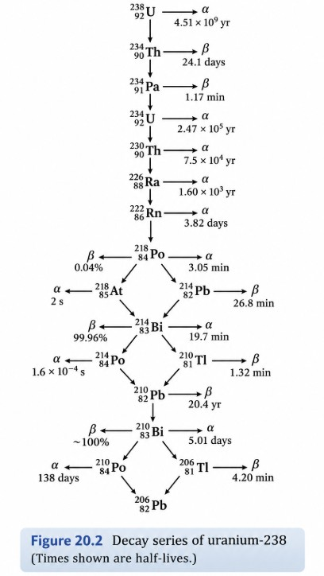{#fig-uranium-238-decay-series fig-alt="Decay series beginning with uranium-238 and ending with stable lead-206, showing alpha and beta emissions, daughter nuclides, branching pathways, and their physical half-lives" width="85%" fig-align="center"}

Notice that the decay series includes **polonium-210 (${}^{210}_{84}\mathrm{Po}$)**, the isotope we used in our earlier half-life calculations.

*Source: Burdge, J., & Overby, J. Chemistry: Atoms First (2nd ed.), Chapter 20, Section 20.3, "Natural Radioactivity," Figure 20.2, p. 881.*


# The Mathematics of Radioactive Decay

#### Applying Exponential and Logarithmic Functions to Radioactive Decay

Before calculating how the amount of radioactive material changes with time, we will review three related mathematical ideas: **linear functions**, **exponential functions**, and **logarithmic functions**. These are different mathematical relationships, and recognizing their differences will help us select an appropriate model for radioactive decay.

Our mathematical review follows the progression in Stewart, Redlin, and Watson, *Precalculus: Mathematics for Calculus*, 6th ed., Chapter 4. We will begin with familiar graphs and equations before applying the mathematics to radioactive material.

##### Reviewing Linear Functions

A **function** describes a relationship between an input and an output. In a graph, we typically place the input, $x$, on the horizontal axis and the output, $y$, on the vertical axis.

A linear function has the form:

$$
f(x)=mx+b
$$

where:

- $f(x)$ is the output for a given input $x$.
- $x$ is the input variable.
- $m$ is the **slope**, which tells us how much the output changes for each one-unit increase in $x$.
- $b$ is the **vertical intercept**, the value of the function when $x=0$.

A linear function produces a straight line. When $m=0$, the line is horizontal; when $m$ is positive, the line rises; and when $m$ is negative, the line falls as $x$ increases.

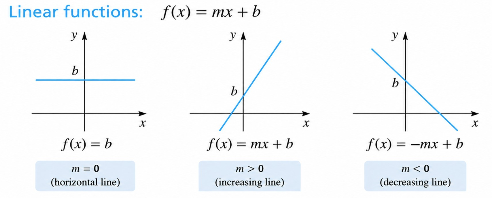{#fig-linear-functions width="80%" fig-align="center"}

**How do we calculate the slope of a line?** If we know two points, $P_1(x_1,y_1)$ and $P_2(x_2,y_2)$, then:

$$
m=\frac{y_2-y_1}{x_2-x_1}
$$

The numerator is the change in the output; the denominator is the change in the input. The point-slope and slope-intercept equations provide two ways to describe the same straight-line relationship.

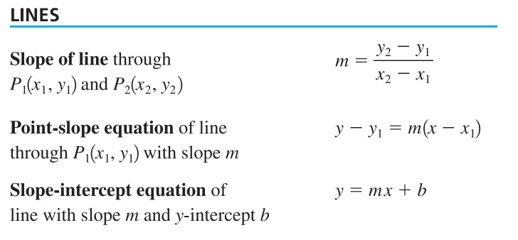{#fig-line-function-formulas width="80%" fig-align="center"}

For example, consider:

$$
f(x)=300-10x
$$

Here, the initial output is 300 and the slope is $-10$. Each time $x$ increases by 1, the output decreases by **10 units**. This is a constant *amount* of decrease, not a constant fraction.

##### Comparing Linear, Exponential, and Logarithmic Graphs

The next figure compares exponential and logarithmic functions. For now, focus on the **top two graphs**: exponential growth curves upward when the base is greater than 1, while exponential decay curves downward when the base lies between 0 and 1. We will return to the bottom two logarithmic graphs after defining logarithms.

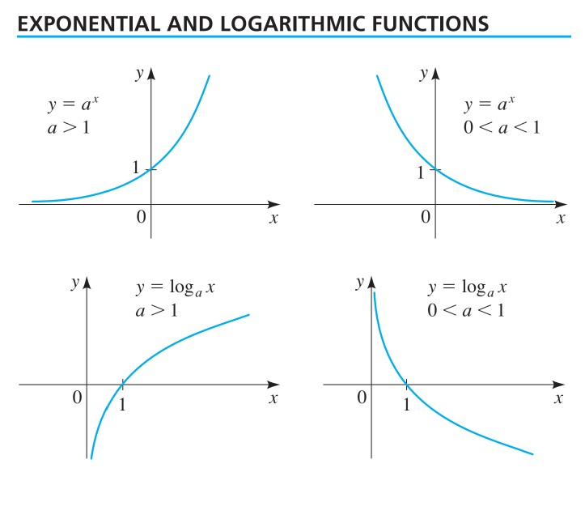{#fig-exponential-and-logarithmic-functions width="85%" fig-align="center"}

A straight line changes by the same **amount** over equal input intervals. An exponential function changes by the same **multiplicative factor** over equal input intervals. Radioactive decay follows the second pattern: the fraction remaining after each half-life is constant, even though the amount that decays becomes smaller.

##### Defining Exponential Functions

Stewart defines an exponential function as:

$$
\boxed{f(x)=a^x}
$$

where:

- $f(x)$ is the output.
- $a$ is the **base**, a fixed positive number other than 1.
- $x$ is the **exponent**, the input variable.

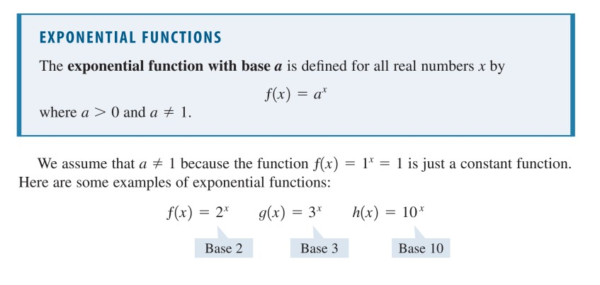{#fig-exponential-functions width="85%" fig-align="center"}

For example, $f(x)=2^x$. If $x=3$, then:

$$
f(3)=2^3=2\times2\times2=8
$$

When the exponent is a positive whole number, it tells us how many times the base is multiplied by itself. Exponents can also be zero, negative, or fractional:

$$
2^0=1,\qquad 2^{-1}=\frac12,\qquad 2^{-2}=\frac14
$$

A **negative exponent** means taking a reciprocal: $2^{-2}=1/2^2=1/4$. This is not the same as placing a negative sign in front of the entire function.

##### Graphing Exponential Functions

Consider the two functions shown in Stewart's worked graphing example:

$$
f(x)=3^x
$$

$$
g(x)=\left(\frac13\right)^x
$$

The first function has a base greater than 1 and increases as $x$ increases. The second has a base between 0 and 1 and decreases as $x$ increases.

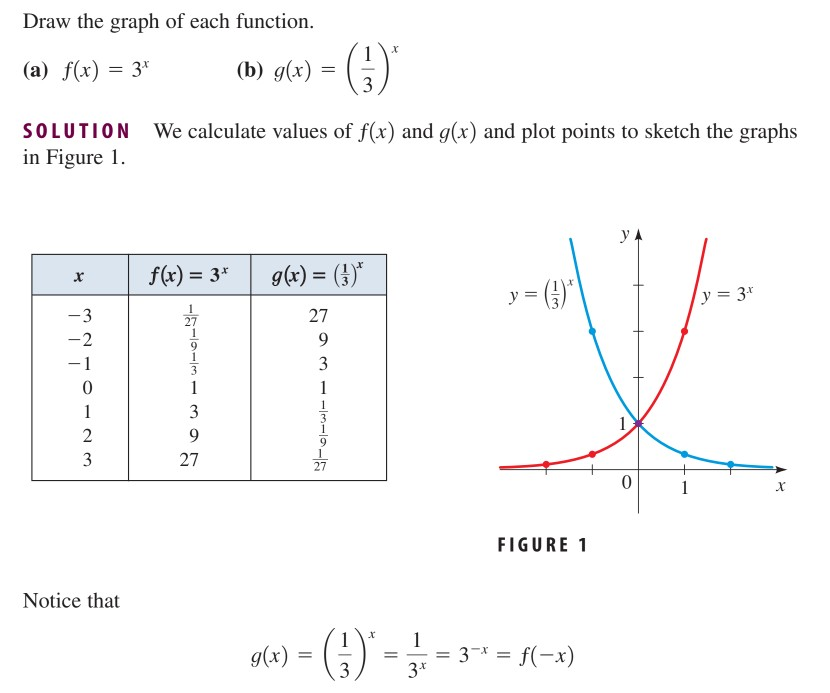{#fig-graphing-exponential-functions width="90%" fig-align="center"}

Notice that both functions equal 1 when $x=0$. However, when $x=1$, the first function equals 3 and the second equals $1/3$. **A base between 0 and 1 produces exponential decay.**

##### Comparing a Family of Exponential Functions

The next figure shows several exponential functions together. Every curve passes through $(0,1)$ because $a^0=1$ for any allowed base $a$.

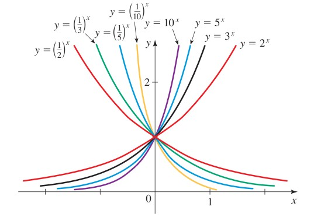{#fig-family-of-exponential-functions width="85%" fig-align="center"}

The curve $y=(1/2)^x$ is particularly relevant to our later discussion of radioactive half-life. For each increase of 1 in $x$, the output is multiplied by $1/2$:

$$
\begin{aligned}
x=0 &: \quad (1/2)^0=1\\
x=1 &: \quad (1/2)^1=1/2\\
x=2 &: \quad (1/2)^2=1/4\\
x=3 &: \quad (1/2)^3=1/8
\end{aligned}
$$

We have not yet defined the time variable for radioactive decay. At this stage, $x$ is simply the input. Later, we will show how an exponent can represent the **number of elapsed half-lives**.

##### Distinguishing a Negative Sign from a Negative Exponent

Stewart also illustrates what happens when a negative sign is placed **outside** an exponential expression.

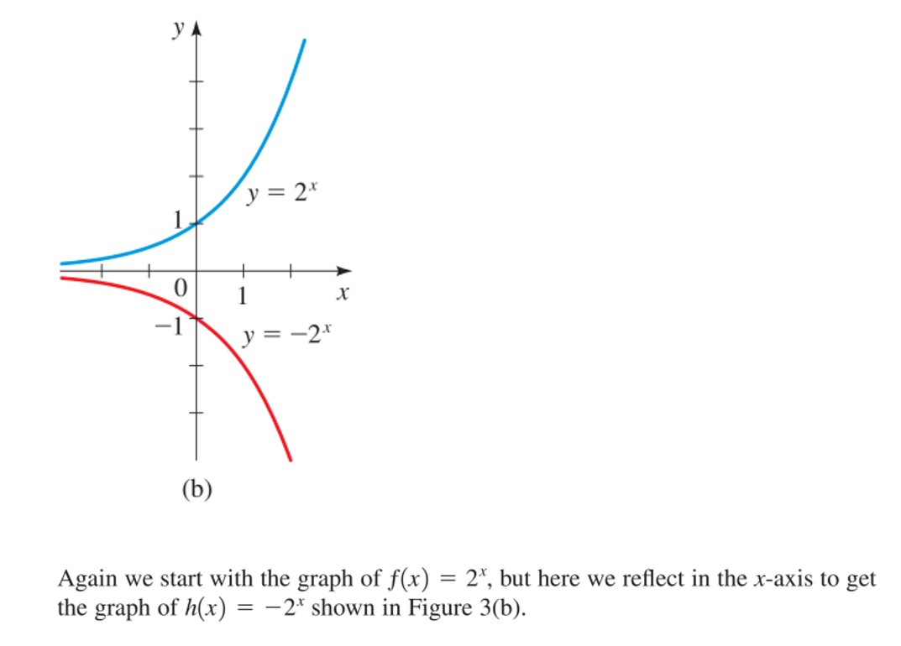{#fig-reflecting-on-x-axis width="70%" fig-align="center"}

Compare:

$$
2^{-x}=\frac{1}{2^x}
$$

with:

$$
-2^x=-(2^x)
$$

The first expression is **positive** and decreases toward zero as $x$ increases. The second is **negative** and reflects the graph of $2^x$ across the horizontal axis. These are not the same function. The graph $y=-2^x$ is **not** an appropriate model for the mass of radioactive material remaining because it produces negative outputs.

##### Why Are Inverse Functions Important?

So far, we have examined how mathematical functions describe relationships between inputs and outputs.

A function takes an input, performs a mathematical operation, and produces an output:

$$
\boxed{\text{Input}\longrightarrow\text{Function}\longrightarrow\text{Output}}
$$

But what if we already know the output and want to determine the original input?

This is where **inverse functions** become useful. An inverse function reverses the relationship described by the original function, allowing us to work backward from an output to its corresponding input:

$$
\boxed{\text{Output}\longrightarrow\text{Inverse Function}\longrightarrow\text{Input}}
$$

For example, consider the exponential function:

$$
f(x)=2^x
$$

If the input is $x=3$, we calculate:

$$
f(3)=2^3=8
$$

Now suppose the output is 8, but the input is unknown:

$$
2^x=8
$$

We want to know: **What exponent produces an output of 8 when the base is 2?**

The inverse of an exponential function is a logarithmic function. We can write:

$$
\log_2(8)=x
$$

Therefore:

$$
\boxed{x=3}
$$

The exponential function calculates an **output from a known input**. Its logarithmic inverse determines the **input from a known output**.

::: callout-note
## Why Is This Useful?

In hazardous materials chemistry, we may know the result of a physical process but need to determine what happened before that result was observed.

Consider radioactive decay:

- If we know the initial mass of a radioactive isotope, its half-life, and the elapsed time, an exponential model allows us to calculate the **remaining mass**.
- If we know the initial mass, its half-life, and the remaining mass, logarithms allow us to determine **how much time has elapsed**.

The difference is **which quantity is unknown**. When elapsed time appears in an exponent, a logarithm allows us to reverse the exponential relationship and solve for time.

**This is why we study inverse functions:** they allow us to work backward from a known result to the input that produced it.
:::

##### Defining Logarithmic Functions: The Inverse of Exponentiation

We now return to the logarithmic graphs in Figure @fig-exponential-and-logarithmic-functions.

An **exponential function** tells us the result when we know the base and exponent. A **logarithmic function** allows us to determine the exponent when we know the base and the result.

For example:

$$
2^3=8
$$

In this expression:

- $2$ is the **base**.
- $3$ is the **exponent**.
- $8$ is the **result**.

But what if we know the base is 2 and the result is 8, and we want to determine the exponent?

We can rewrite the expression using a logarithm:

$$
\log_2(8)=3
$$

This asks: **To what power must we raise 2 to obtain 8?**

The answer is 3.

Both expressions describe the same mathematical relationship.

###### Figure 1: Definition of the Logarithmic Function

The first illustration introduces the formal definition of a logarithmic function.

$$
\boxed{\log_a(x)=y\quad\Longleftrightarrow\quad a^y=x}
$$

where:

- $a$ is the **base**, with $a>0$ and $a\ne1$.
- $x$ is the **positive number** whose logarithm we want to determine.
- $y$ is the **exponent** that produces $x$ when the base $a$ is raised to that power.

The symbol $\Longleftrightarrow$ means that the expressions on either side are equivalent statements.

Notice that the base $a$ does not change. We are simply expressing the same relationship in two different mathematical forms.

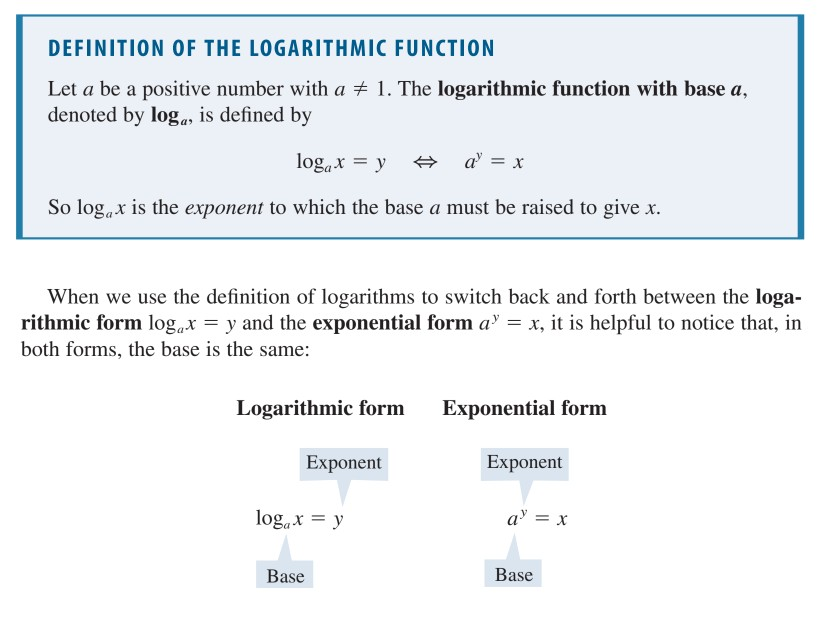{#fig-logarithmic-definition width="85%" fig-align="center"}

###### Figure 2: Identifying the Base and Exponent

The second illustration shows how to identify the **base** and **exponent** when converting between logarithmic and exponential notation.

Consider:

$$
\log_2(8)=3
$$

The logarithmic expression tells us that the base is 2 and the exponent is 3.

We can rewrite the same relationship in exponential form:

$$
2^3=8
$$

Notice what happens:

- The **base remains 2** in both expressions.
- The logarithm's **result, 3**, becomes the exponent in exponential form.
- The number **8** is the value produced by raising 2 to the third power.

This relationship is useful because we can move between logarithmic and exponential forms depending on which quantity we need to determine.

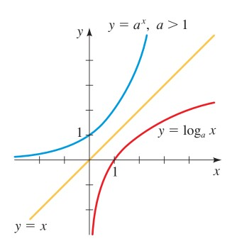{#fig-logarithmic-exponential-notation width="85%" fig-align="center"}

###### Figure 3: Graphing Exponential and Logarithmic Inverse Functions

The third illustration shows how exponential and logarithmic functions are related graphically.

Consider the exponential function:

$$
y=2^x
$$

When $x=3$:

$$
y=2^3=8
$$

Therefore, the point $(3,8)$ lies on the exponential graph.

Now consider its logarithmic inverse:

$$
y=\log_2(x)
$$

When $x=8$:

$$
y=\log_2(8)=3
$$

Therefore, the point $(8,3)$ lies on the logarithmic graph.

Notice that the coordinates have exchanged positions:

$$
(3,8)\longleftrightarrow(8,3)
$$

This occurs because exponential and logarithmic functions are **inverse functions**.

In the illustration, the two graphs are reflections of each other across the diagonal line:

$$
y=x
$$

This line represents all points where the horizontal and vertical coordinates are equal.

The reflection illustrates that the input of one function becomes the output of its inverse.

{#fig-logarithmic-inverse-graphs width="85%" fig-align="center"}

::: callout-note
## Why Is This Useful?

An exponential function allows us to calculate a result when the exponent is known.

A logarithmic function allows us to determine the exponent when the result is known.

This distinction becomes important when studying radioactive decay.

For example, if we know the initial mass of a radioactive isotope, its half-life, and the elapsed time, we can calculate how much material remains using an exponential function.

But what if we know the initial mass and the remaining mass, and want to determine **how much time has elapsed**?

Because time appears in the exponent of the radioactive decay equation, logarithms allow us to isolate and calculate that unknown time.
:::

##### Euler's Number and the Natural Exponential Function

So far, we have examined exponential functions with bases such as 2, 3, and $1/2$. Another important base is **Euler's number**, represented by the letter $e$:

$$
e\approx2.71828
$$

Euler's number is a mathematical constant, just like $\pi$. Its value does not change.

But why is this particular number useful?

Euler's number appears naturally in mathematics used to describe **continuous growth and decay**. Examples include population growth, continuously compounded interest, heat transfer, and radioactive decay.

Although we can describe exponential changes using many different bases, using $e$ makes the mathematics of continuous rates of change particularly convenient.

The **natural exponential function** is defined by:

$$
\boxed{f(x)=e^x}
$$

where:

- $e$ is Euler's number, approximately 2.71828.
- $x$ is the exponent, or independent variable.
- $f(x)$ is the output of the function.

###### Figure 1: Comparing Exponential Functions

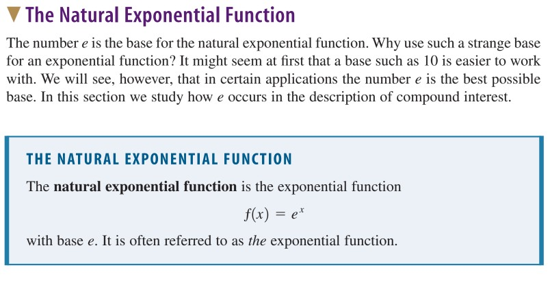{#fig-natural-exponential-comparison width="85%" fig-align="center"}

The natural exponential function belongs to the same family of exponential functions we examined earlier:

$$
f(x)=a^x
$$

The difference is that its base is $e$, rather than 2, 3, or another positive number.

For example:

$$
e^0=1
$$

$$
e^1\approx2.71828
$$

$$
e^2\approx7.38906
$$

Like other exponential functions with a base greater than 1, $e^x$ increases as $x$ increases.

<p style="color: red; font-weight: bold;">

The important distinction is not that (e\^x) grows while other exponential functions do not. It is that the base (e) is especially useful when modeling continuous changes.

</p>

###### Figure 2: Why Euler's Number Is Useful

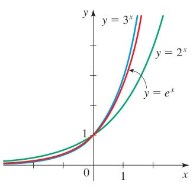{#fig-natural-exponential-growth width="85%" fig-align="center"}

Consider a process in which the rate of change depends on how much of a quantity is currently present.

For example:

- A growing population may increase faster when more individuals are present.
- A radioactive sample with more unstable nuclei will generally experience more radioactive decays per unit time than a smaller sample of the same isotope.
- A warmer object may cool faster when the temperature difference between the object and its surroundings is larger.

These processes can be described using exponential models.

Euler's number is particularly useful because the function $e^x$ has a special mathematical property: **its instantaneous rate of change is equal to its current value**.

In calculus, this means that the derivative of $e^x$ is also $e^x$.

We do not need to calculate derivatives in this course. What matters is recognizing why scientists frequently use Euler's number when describing quantities that change continuously.

###### Figure 3: Exponential Growth Versus Exponential Decay

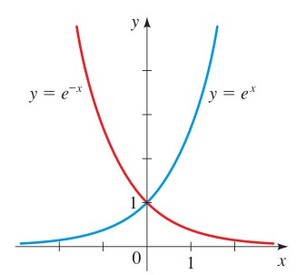{#fig-natural-exponential-decay width="85%" fig-align="center"}

The third illustration compares two functions:

$$
f(x)=e^x
$$

and

$$
f(x)=e^{-x}
$$

Although both functions use Euler's number as their base, their behavior differs.

- $e^x$ represents exponential growth: the output increases as $x$ increases.
- $e^{-x}$ represents exponential decay: the output decreases as $x$ increases.

Recall that a negative exponent represents a reciprocal:

$$
e^{-x}=\frac{1}{e^x}
$$

For example, when $x=1$:

$$
e^{-1}=\frac{1}{e}\approx0.36788
$$

When $x=2$:

$$
e^{-2}=\frac{1}{e^2}\approx0.13534
$$

The output becomes progressively smaller as $x$ increases.

Notice that the decreasing function remains positive and approaches zero without reaching it.

This is the mathematical behavior we will use to describe radioactive decay.

::: callout-note
## Why Is This Useful?

Radioactive decay is a continuous process in which unstable atomic nuclei undergo nuclear transformations.

For a sufficiently large sample of a single radioactive isotope, the expected rate of decay is proportional to the number of radioactive nuclei remaining.

As the number of radioactive nuclei decreases, the expected number of decays per unit time also decreases.

Following Stewart, Redlin, and Watson, we can describe the remaining mass of a radioactive substance using the **radioactive decay model**:

$$
\boxed{m(t)=m_0e^{-rt}}
$$

where:

- $m(t)$ is the mass of the radioactive substance remaining after elapsed time $t$.
- $m_0$ is the initial mass of the radioactive substance.
- $e$ is Euler's number, approximately 2.71828.
- $r$ is the **positive radioactive decay constant**.
- $t$ is the elapsed time.

The decay constant is related to the radioactive substance's half-life by:

$$
\boxed{r=\frac{\ln 2}{h}}
$$

where:

- $r$ is the positive radioactive decay constant.
- $\ln 2$ is the natural logarithm of 2, approximately 0.69315.
- $h$ is the half-life of the radioactive substance, expressed in the same time units used for $t$.

Because $r$ is positive, the exponent $-rt$ becomes more negative as time increases, causing the remaining mass to decrease.

**The practical advantage:** Once we know the initial mass and half-life of a radioactive substance, we can calculate its decay constant and estimate how much material remains after a specified period.

Later, we will use this relationship to solve radioactive decay problems involving half-life, remaining mass, and elapsed time.
:::

##### Natural Logarithms: The Inverse of the Natural Exponential Function

So far, we have learned that logarithmic functions allow us to reverse exponential relationships and determine an unknown exponent.

When the base of an exponential function is Euler's number, $e$, its inverse is called the **natural logarithm**.

The natural logarithm is written $\ln$:

$$
\boxed{\ln(x)=\log_e(x)}
$$

where:

- $\ln(x)$ is the natural logarithm of $x$.
- $e$ is Euler's number, approximately 2.71828.
- $x$ is a positive number, with $x>0$.

Unlike logarithms with bases such as 2 or 10, natural logarithms specifically use Euler's number as their base.

###### Figure 1: Defining the Natural Logarithm

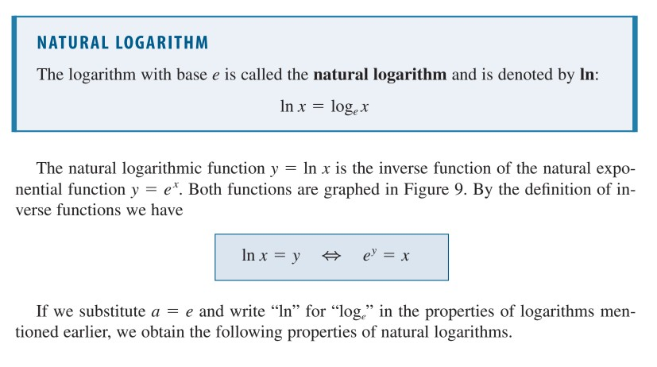{#fig-natural-logarithms-definition width="85%" fig-align="center"}

The natural logarithm and natural exponential function are **inverse functions**.

In Stewart's notation:

$$
\boxed{\ln(x)=y\quad\Longleftrightarrow\quad e^y=x}
$$

where:

- $x$ is the positive number whose natural logarithm we want to determine.
- $y$ is the exponent.
- $e$ is the base of the exponential function.

This means that $\ln(x)$ asks:

**To what power must we raise** $e$ to obtain $x$?

For example:

$$
e^2\approx7.38906
$$

Therefore:

$$
\boxed{\ln(e^2)=2}
$$

We recover the exponent 2 because the natural logarithm reverses exponentiation with base $e$.

###### Figure 2: Properties of Natural Logarithms

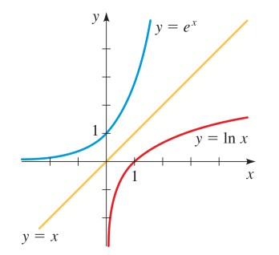{#fig-natural-logarithms-properties width="85%" fig-align="center"}

Because the natural logarithm and natural exponential function are inverses, they can reverse one another's operations.

Two important relationships are:

$$
\boxed{\ln(e^x)=x}
$$

and, for $x>0$:

$$
\boxed{e^{\ln(x)}=x}
$$

The first relationship tells us that taking the natural logarithm of an exponential expression with base $e$ returns the original exponent.

The second relationship tells us that raising $e$ to the natural logarithm of a positive number returns the original number.

For example:

$$
\ln(1)=0
$$

**Why does the natural logarithm equal zero?**

Because raising Euler's number to the zeroth power produces 1:

$$
e^0=1
$$

Similarly:

$$
\ln(e)=1
$$

**Why does the natural logarithm equal one?**

Because raising Euler's number to the first power produces $e$:

$$
e^1=e
$$

In both examples, the natural logarithm tells us the exponent needed to produce the number inside the parentheses.

###### Figure 3: Graphing Natural Logarithms and Their Inverses

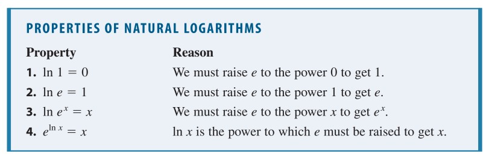{#fig-natural-logarithms-inverse-graphs width="85%" fig-align="center"}

The natural exponential function is:

$$
y=e^x
$$

Its inverse is:

$$
y=\ln(x)
$$

Just as we observed with other exponential and logarithmic functions, these graphs are reflections of one another across the diagonal line:

$$
y=x
$$

Consider the exponential function:

$$
e^0=1
$$

This tells us that the point $(0,1)$ lies on the graph of $y=e^x$.

For the inverse function:

$$
\ln(1)=0
$$

The corresponding point is $(1,0)$ on the graph of $y=\ln(x)$.

Notice how the coordinates exchange positions:

$$
(0,1)\longleftrightarrow(1,0)
$$

This illustrates how an inverse function reverses the roles of the input and output.

::: callout-note
## Why Is This Useful?

Recall Stewart's radioactive decay model:

$$
\boxed{m(t)=m_0e^{-rt}}
$$

where:

- $m(t)$ is the mass of the radioactive parent isotope remaining after elapsed time $t$.
- $m_0$ is the initial mass of the radioactive parent isotope.
- $e$ is Euler's number.
- $r$ is the positive radioactive decay constant.
- $t$ is elapsed time.

If we know the initial mass, decay constant, and elapsed time, we can calculate the remaining mass.

But what if we know the initial mass and remaining mass and want to determine **how much time has passed**?

Because time appears in the exponent, we can use the natural logarithm to reverse the exponential relationship.

This is why natural logarithms are particularly useful in radioactive decay calculations.

Later, we will apply this inverse relationship to solve for elapsed time using Stewart's radioactive decay model.
:::

##### Understanding the Laws of Logarithms

Logarithms follow rules that allow us to simplify expressions and solve equations. For positive numbers $a$ and $b$, and any real exponent $x$:

**Product law**

$$
\ln(ab)=\ln(a)+\ln(b)
$$

**Quotient law**

$$
\ln\left(\frac ab\right)=\ln(a)-\ln(b)
$$

**Power law**

$$
\ln(a^x)=x\ln(a)
$$

The power law is especially important because it allows an exponent to be written as a multiplier. For example:

$$
\ln(2^3)=3\ln(2)=\ln(8)\approx2.07944
$$

When the base is $e$, the expression simplifies further:

$$
\ln(e^3)=3\ln(e)=3(1)=3
$$

This is why the natural logarithm is useful for solving an equation with an unknown exponent. We will use the same operation later to determine elapsed time from the amount of radioactive material remaining.

::: callout-note
## Why Is This Useful?

A linear equation can often be solved using addition, subtraction, multiplication, and division. An exponential equation is different because the unknown may appear **in the exponent**.

Logarithms allow us to reverse exponentiation and isolate that unknown. For radioactive decay, this means we can use measurements of the amount remaining to determine **how much time has elapsed**, provided the decay model and its parameters are known.
:::

------------------------------------------------------------------------

#### Understanding Radioactive Half-Life

**Physical half-life:** The time required for half of a large population of radioactive parent nuclei to undergo radioactive decay.

For example, suppose a radioactive sample initially contains 300 mg of a particular radioactive isotope.

If its half-life is 140 days, then approximately half of the original isotope remains after 140 days.

$$
300\ \mathrm{mg}\times\frac12=150\ \mathrm{mg}
$$

After another 140 days, half of the remaining 150 mg will have decayed.

$$
150\ \mathrm{mg}\times\frac12=75\ \mathrm{mg}
$$

After a third half-life:

$$
75\ \mathrm{mg}\times\frac12=37.5\ \mathrm{mg}
$$

Notice that we multiply by $\frac12$ each time.

**Why do we use** $\frac12$?

Because half-life means that half of the radioactive parent material remains after each half-life.

We can represent repeated multiplication using exponents.

After one half-life:

$$
300\left(\frac12\right)^1=150
$$

After two half-lives:

$$
300\left(\frac12\right)^2=75
$$

After three half-lives:

$$
300\left(\frac12\right)^3=37.5
$$

The exponent tells us how many half-lives have elapsed.

##### Developing the Half-Life Equation

We can now describe this pattern mathematically:

$$
m(t)=m_0\left(\frac12\right)^{t/h}
$$

where:

- $m(t)$ is the mass of the radioactive parent isotope remaining after time $t$.
- $m_0$ is the initial mass of the radioactive parent isotope.
- $\frac12$ is the fraction remaining after one half-life.
- $t$ is elapsed time.
- $h$ is the physical half-life.
- $t/h$ is the number of elapsed half-lives.

The time variables $t$ and $h$ must use the same units.

For example, if 280 days have elapsed and the half-life is 140 days:

$$
\frac{t}{h}
=
\frac{280\ \mathrm{days}}{140\ \mathrm{days}}
=2
$$

Two half-lives have elapsed.

Therefore:

$$
m(280)=300\left(\frac12\right)^2
$$

$$
m(280)=300\left(\frac14\right)
$$

$$
\boxed{m(280)=75\ \mathrm{mg}}
$$

We have calculated the remaining mass using the physical meaning of half-life.

------------------------------------------------------------------------

#### Why Radioactive Decay Is Exponential

Radioactive decay is not a linear process.

The amount of radioactive parent material decreases by the same fraction over each half-life, rather than by the same mass.

The half-life equation is one way to describe this process.

Another way uses the natural exponential function:

$$
\boxed{m(t)=m_0e^{-rt}}
$$

where:

- $m(t)$ is the mass of the radioactive parent isotope remaining after time $t$.
- $m_0$ is the initial mass of the radioactive parent isotope.
- $e$ is Euler's number.
- $r$ is the positive radioactive decay constant, expressed in inverse time units.
- $t$ is elapsed time.

**Why is there a negative sign in the exponent?**

Consider the exponential part of the equation:

$$
e^{-rt}
$$

Because $r>0$, the exponent becomes more negative as time increases.

For example, consider the values of the natural exponential function:

$$
e^0=1
$$

$$
e^{-1}\approx0.368
$$

$$
e^{-2}\approx0.135
$$

As the exponent becomes more negative, the exponential factor decreases.

{width="85%" fig-align="center"}

This represents the decreasing mass of radioactive parent material.

##### Connecting the Decay Constant to Half-Life

We have introduced two mathematical equations that describe the exponential decay of radioactive parent material:

**1. Half-life equation**

$$
m(t)=m_0\left(\frac{1}{2}\right)^{t/h}
$$

**2. Natural exponential decay equation**

$$
m(t)=m_0e^{-rt}
$$

Both equations describe the mass of radioactive parent material remaining after an elapsed time $t$. However, they express the rate of decay differently.

The first equation uses the **physical half-life (**$h$), while the second uses the **radioactive decay constant (**$r$).

Our objective is to determine how these two quantities are mathematically related.

For this derivation:

- $m(t)$ is the mass of radioactive parent material remaining at elapsed time $t$.
- $m_0$ is the initial mass of radioactive parent material.
- $t$ is elapsed time.
- $h$ is the physical half-life of the radioactive isotope.
- $r$ is the radioactive decay constant, expressed in inverse units of time.
- $e$ is Euler's number, approximately $2.71828$.

**Step 1: Establish the condition of one half-life.**

The physical half-life is the time required for half of the radioactive parent nuclei in a large sample to undergo radioactive decay.

If the elapsed time is equal to one physical half-life, then:

$$
t=h
$$

For example, suppose a radioactive isotope has a physical half-life of 140 days.

After one half-life has elapsed:

$$
t=h=140\ \mathrm{days}
$$

We can now use this condition to evaluate both exponential decay equations at the same point in time.

**Step 2: Substitute the half-life into the half-life equation.**

Begin with the half-life equation:

$$
m(t)=m_0\left(\frac{1}{2}\right)^{t/h}
$$

Since we are evaluating the remaining mass after one half-life, substitute $t=h$:

$$
m(h)=m_0\left(\frac{1}{2}\right)^{h/h}
$$

Notice that the function notation changes from $m(t)$ to $m(h)$ because we are calculating the remaining mass when the elapsed time equals one half-life.

The exponent is:

$$
\frac{h}{h}=1
$$

For our example:

$$
\frac{140\ \mathrm{days}}{140\ \mathrm{days}}=1
$$

Therefore:

$$
m(h)=m_0\left(\frac{1}{2}\right)^1
$$

Any number raised to the first power equals itself:

$$
\left(\frac{1}{2}\right)^1=\frac{1}{2}
$$

Thus:

$$
m(h)=m_0\left(\frac{1}{2}\right)
$$

Multiplying by one-half is equivalent to dividing by two:

$$
\begin{aligned}
m(h)
&=m_0\left(\frac{1}{2}\right)\\[6pt]
&=\frac{m_0\times1}{2}\\[6pt]
&=\frac{m_0}{2}
\end{aligned}
$$

We have demonstrated mathematically that:

$$
\boxed{m(h)=\frac{m_0}{2}}
$$

This confirms the definition of half-life: after one physical half-life, half of the original radioactive parent material remains.

For example, if the initial mass were 300 mg:

$$
m(h)=\frac{300\ \mathrm{mg}}{2}=150\ \mathrm{mg}
$$

**Step 3: Apply the same condition to the natural exponential decay equation.**

We will now use the second equation to describe the same radioactive material at the same elapsed time.

Begin with:

$$
m(t)=m_0e^{-rt}
$$

Recall that one half-life has elapsed when:

$$
t=h
$$

Substitute $h$ for $t$:

$$
m(h)=m_0e^{-rh}
$$

This equation describes the remaining mass after one half-life using the radioactive decay constant $r$.

From Step 2, we already established that:

$$
m(h)=\frac{m_0}{2}
$$

Both expressions represent the mass remaining after the same elapsed time.

Therefore, we can set them equal:

$$
\boxed{\frac{m_0}{2}=m_0e^{-rh}}
$$

We now have an equation containing both the physical half-life $h$ and the radioactive decay constant $r$.

Our next objective is to isolate $r$.

**Step 4: Divide both sides by the initial mass.**

Begin with:

$$
\frac{m_0}{2}=m_0e^{-rh}
$$

To isolate the exponential expression, divide both sides by $m_0$:

$$
\frac{\frac{m_0}{2}}{m_0}
=
\frac{m_0e^{-rh}}{m_0}
$$

Because the initial mass $m_0$ is the same nonzero quantity on both sides, it cancels:

$$
\frac{\frac{\cancel{m_0}}{2}}{\cancel{m_0}}
=
\frac{\cancel{m_0}e^{-rh}}{\cancel{m_0}}
$$

We obtain:

$$
\boxed{\frac{1}{2}=e^{-rh}}
$$

This equation tells us that after one half-life, the natural exponential factor must equal one-half.

**Step 5: Apply the natural logarithm to both sides.**

We need to solve for $r$, but it is currently located in the exponent:

$$
\frac{1}{2}=e^{-rh}
$$

Recall that the natural logarithm is the inverse function of the natural exponential function.

We can use this inverse relationship to remove the exponential function and isolate the exponent.

Take the natural logarithm of both sides:

$$
\ln\left(\frac{1}{2}\right)=\ln\left(e^{-rh}\right)
$$

Recall the inverse relationship:

$$
\ln(e^x)=x
$$

In our equation, the exponent $x$ is equal to $-rh$.

Therefore:

$$
\ln\left(e^{-rh}\right)=-rh
$$

Substituting this result gives:

$$
\boxed{\ln\left(\frac{1}{2}\right)=-rh}
$$

We have removed the exponential function and obtained an equation that we can solve algebraically for $r$.

**Step 6: Isolate the radioactive decay constant.**

Begin with:

$$
\ln\left(\frac{1}{2}\right)=-rh
$$

Because $r$ is multiplied by $-h$, divide both sides by $-h$:

$$
\frac{\ln(1/2)}{-h}
=
\frac{-rh}{-h}
$$

The factor $-h$ cancels on the right-hand side:

$$
\frac{\ln(1/2)}{-h}
=
\frac{r\cancel{(-h)}}{\cancel{(-h)}}
$$

Therefore:

$$
r=\frac{\ln(1/2)}{-h}
$$

We can also express this as:

$$
\boxed{r=-\frac{\ln(1/2)}{h}}
$$

However, we can simplify the logarithmic expression further.

**Step 7: Simplify the logarithm using logarithmic identities.**

Recall the quotient rule for logarithms:

$$
\ln\left(\frac{a}{b}\right)=\ln(a)-\ln(b)
$$

Apply this rule to the fraction $\frac{1}{2}$:

$$
\ln\left(\frac{1}{2}\right)=\ln(1)-\ln(2)
$$

Recall that:

$$
e^0=1
$$

Therefore:

$$
\ln(1)=0
$$

Substitute this value:

$$
\begin{aligned}
\ln\left(\frac{1}{2}\right)
&=\ln(1)-\ln(2)\\[6pt]
&=0-\ln(2)\\[6pt]
&=-\ln(2)
\end{aligned}
$$

Return to our expression for the decay constant:

$$
r=-\frac{\ln(1/2)}{h}
$$

Substitute $\ln(1/2)=-\ln(2)$:

$$
r=-\frac{-\ln(2)}{h}
$$

The two negative signs produce a positive result:

$$
\boxed{r=\frac{\ln(2)}{h}}
$$

We have now derived the mathematical relationship between the radioactive decay constant and the physical half-life.

This equation is called the **half-life–decay constant relationship**.

It allows us to calculate the radioactive decay constant ($r$) when we know the physical half-life ($h$).

Because:

$$
\ln(2)\approx0.693147
$$

We can also write:

$$
\boxed{r\approx\frac{0.693147}{h}}
$$

The units of $r$ are the inverse of the time units used for $h$.

For example, if $h$ is measured in days, then $r$ is expressed in $\mathrm{days}^{-1}$.

**Step 8: Interpret the positive decay constant and negative exponent.**

Our derivation gives:

$$
r=\frac{\ln(2)}{h}
$$

Since $\ln(2)>0$ and the physical half-life $h>0$, the radioactive decay constant is positive:

$$
r>0
$$

However, recall that the natural exponential decay equation contains a negative sign:

$$
m(t)=m_0e^{-rt}
$$

**Why does the equation use a negative sign if the decay constant is positive?**

The negative sign in the exponent indicates that the amount of radioactive parent material decreases over time.

As elapsed time ($t$) increases, the exponent $-rt$ becomes increasingly negative.

For example:

$$
e^0=1
$$

$$
e^{-1}\approx0.368
$$

$$
e^{-2}\approx0.135
$$

As the exponent becomes more negative, the exponential factor decreases toward zero.

{width="85%" fig-align="center"}

The graph illustrates that:

- $r>0$: The radioactive decay constant is positive.
- $-rt$: The negative sign gives the exponential function its decreasing direction.
- $e^{-rt}$: The fraction of radioactive parent material remaining decreases as time increases.

The negative sign does not mean that the decay constant or remaining mass is negative. It describes the direction of the exponential change.

#### First-Order Radioactive Decay

Radioactive decay follows a **first-order process**, meaning that the rate of decay is directly proportional to the number of radioactive parent nuclei remaining.

In simpler terms, the more radioactive parent nuclei present, the more nuclear transformations we expect to occur per unit time. As the number of parent nuclei decreases, the activity of the parent isotope also decreases.

An important characteristic of first-order radioactive decay is that **the physical half-life depends on the radioactive decay constant, not on the initial amount of radioactive material**.

Recall the half-life–decay constant relationship:

$$
r=\frac{\ln(2)}{h}
$$

Therefore:

- **A larger decay constant (**$r$) corresponds to a shorter physical half-life and more rapid radioactive decay.
- **A smaller decay constant (**$r$) corresponds to a longer physical half-life and slower radioactive decay.

The physical half-life of a particular radioactive isotope remains the same regardless of the initial mass of the sample.

##### How Is Radioactive Decay Different From Ordinary Chemical Reactions?

The rates of many ordinary chemical reactions can change with environmental conditions, including temperature, pressure, and reactant concentrations.

Radioactive decay is different because it involves transformations of unstable atomic nuclei rather than the rearrangement of chemical bonds.

For a particular radioactive isotope, the decay constant and physical half-life are generally unaffected by ordinary changes in temperature and pressure.

This means that changing the storage conditions of radioactive material will not ordinarily accelerate its nuclear decay.

::: callout-note
### Application to Hazardous Materials Management

Understanding radioactive decay is important when planning the storage, handling, and long-term management of radioactive materials.

The **physical half-life** helps us estimate how much radioactive parent material remains after a specified period.

The **radioactive decay constant** characterizes how rapidly radioactive nuclei undergo decay and helps us understand how the activity of a radioactive source changes over time.

These properties are particularly important when considering radioactive waste storage and decay-in-storage practices.

However, **radioactive decay alone does not determine whether a material is safe to handle or dispose of**. Radiation type, energy, activity, radioactive daughter products, exposure pathways, shielding, and applicable regulatory requirements must also be considered.
:::

#### Why Do We Need Two Radioactive Decay Equations?

We have learned two equations that describe the same radioactive decay process:

**Half-life equation**

$$
m(t)=m_0\left(\frac{1}{2}\right)^{t/h}
$$

**Natural exponential decay equation**

$$
m(t)=m_0e^{-rt}
$$

If both equations calculate the same remaining mass, why do we need to learn both?

The **half-life equation** is useful when we know the physical half-life of a radioactive isotope and want to calculate how much radioactive parent material remains after a given period.

The **natural exponential decay equation** describes the same process using the radioactive decay constant ($r$), which characterizes how rapidly radioactive nuclei undergo decay.

The decay constant also connects the number of radioactive parent nuclei remaining to the radioactive activity of a sample:

$$
A=rN
$$

where:

- $A$ is radioactive activity, or the number of nuclear transformations occurring per unit time.
- $r$ is the radioactive decay constant.
- $N$ is the number of radioactive parent nuclei remaining.

The two equations are mathematically equivalent, and the relationship:

$$
\boxed{r=\frac{\ln(2)}{h}}
$$

allows us to convert between physical half-life and the radioactive decay constant.

**For hazardous materials management, half-life helps us understand how long radioactive parent material persists, while the decay constant characterizes how rapidly its nuclei undergo decay.**

Neither quantity alone establishes the radiation dose or health risk associated with a radioactive material.

------------------------------------------------------------------------

#### Worked Example: Radioactive Decay of Polonium-210

*Mathematical approach based on Stewart, Redlin, and Watson, Precalculus: Mathematics for Calculus, 6th ed., Section 4.6, Example 6.*

Suppose a sample initially contains 300 mg of polonium-210.

For this example, we will use a half-life of 140 days. This is a rounded instructional value; the measured physical half-life of polonium-210 is approximately 138.4 days.

We want to answer three questions:

1.  How much polonium-210 remains after 365 days?
2.  What is the radioactive decay constant?
3.  How much time must pass before only 200 mg remain?

##### Part I: How Much Radioactive Material Remains?

**Step 1: Identify the known information, unknown variable, and relevant equations.**

Before beginning a calculation, we need to identify the information provided in the problem and determine what we are trying to calculate.

**Known information:**

Initial mass of the radioactive parent isotope:

$$
m_0=300\ \mathrm{mg}
$$

Physical half-life:

$$
h=140\ \mathrm{days}
$$

Elapsed time:

$$
t=365\ \mathrm{days}
$$

**Unknown variable:**

We want to calculate the mass of radioactive parent material remaining after 365 days:

$$
m(t)=?
$$

**Relevant equations:**

We have learned two equations that describe the remaining mass of radioactive parent material and a third equation that relates the physical half-life to the radioactive decay constant.

**1. Half-life equation**

$$
m(t)=m_0\left(\frac{1}{2}\right)^{t/h}
$$

**2. Natural exponential decay equation**

$$
m(t)=m_0e^{-rt}
$$

**3. Half-life–decay constant relationship**

$$
r=\frac{\ln(2)}{h}
$$

where:

- $m(t)$ is the mass of radioactive parent material remaining after elapsed time $t$.
- $m_0$ is the initial mass of radioactive parent material.
- $t$ is elapsed time.
- $h$ is the physical half-life of the radioactive isotope.
- $r$ is the radioactive decay constant, expressed in inverse units of time.
- $e$ is Euler's number, approximately $2.71828$.
- $\ln$ represents the natural logarithm.

The **half-life equation** and **natural exponential decay equation** can both be used to calculate the remaining mass of radioactive parent material.

The **half-life–decay constant relationship** allows us to calculate the radioactive decay constant ($r$) from the known physical half-life ($h$).

The information provided in a problem helps us determine which equation, or combination of equations, to use.

**Step 2: Select the appropriate equation.**

We know the initial mass ($m_0$), physical half-life ($h$), and elapsed time ($t$).

Our unknown is the remaining mass, $m(t)$.

Consider the three equations identified in Step 1.

| Equation | Mathematical Expression | Required Information | Application to Our Problem |
|:-----------------|:----------------:|:-----------------|:-----------------|
| **1. Half-life equation** | $m(t)=m_0\left(\frac{1}{2}\right)^{t/h}$ | Initial mass ($m_0$), elapsed time ($t$), and physical half-life ($h$) | **All three values are known.** We can calculate the remaining mass directly. |
| **2. Natural exponential decay equation** | $m(t)=m_0e^{-rt}$ | Initial mass ($m_0$), elapsed time ($t$), and radioactive decay constant ($r$) | We know $m_0$ and $t$, but must first calculate $r$. |
| **3. Half-life–decay constant relationship** | $r=\frac{\ln(2)}{h}$ | Physical half-life ($h$) | We can calculate $r$ and then use Equation 2 to determine the remaining mass. |

**Which equation should we select?**

Because the physical half-life is already provided, the most direct approach is to use the **half-life equation**:

$$
\boxed{m(t)=m_0\left(\frac{1}{2}\right)^{t/h}}
$$

This equation allows us to calculate the remaining mass directly without first calculating the radioactive decay constant.

In Part II, we will use the half-life–decay constant relationship and the natural exponential decay equation to solve the same problem using a different approach.

**Which equation should we select?**

Because the physical half-life is already provided, the most direct approach is to use the **half-life equation**:

$$
\boxed{m(t)=m_0\left(\frac{1}{2}\right)^{t/h}}
$$

This equation allows us to calculate the remaining mass directly without first calculating the radioactive decay constant.

In Part II, we will use the half-life–decay constant relationship and the natural exponential decay equation to solve the same problem using a different approach.

**Step 3: Substitute the known values.**

Begin with:

$$
m(t)=m_0\left(\frac{1}{2}\right)^{t/h}
$$

Substitute the initial mass, elapsed time, and physical half-life:

$$
m(365)=(300\ \mathrm{mg})
\left(\frac{1}{2}\right)^{365/140}
$$

**Step 4: Calculate the exponent.**

$$
\frac{365}{140}\approx2.60714
$$

This means approximately 2.61 half-lives have elapsed.

**Step 5: Evaluate the exponential expression.**

$$
\left(\frac{1}{2}\right)^{365/140}\approx0.164124
$$

This means approximately 16.41% of the original polonium-210 remains.

**Step 6: Calculate the remaining mass.**

$$
m(365)\approx(300\ \mathrm{mg})(0.164124)
$$

Therefore:

$$
\boxed{m(365)\approx49.24\ \mathrm{mg}}
$$

Approximately 49.24 mg of polonium-210 remains after 365 days using the assumed physical half-life of 140 days.

##### Part II: Calculate the Radioactive Decay Constant and Apply the Natural Exponential Decay Equation

In Part I, we used the half-life equation to calculate how much radioactive parent material remains after 365 days.

We will now solve the same problem using the **half-life–decay constant relationship** and the **natural exponential decay equation**.

Our known information is:

- Initial mass: $m_0=300\ \mathrm{mg}$
- Physical half-life: $h=140\ \mathrm{days}$
- Elapsed time: $t=365\ \mathrm{days}$

Our objective is to calculate the radioactive decay constant ($r$) and use it to determine the remaining mass, $m(365)$.

**Step 1: Calculate the radioactive decay constant (**$r$).

Recall the half-life–decay constant relationship:

$$
r=\frac{\ln(2)}{h}
$$

Substitute the physical half-life:

$$
r=\frac{\ln(2)}{140\ \mathrm{days}}
$$

Recall that:

$$
\ln(2)\approx0.693147
$$

Therefore:

$$
r\approx\frac{0.693147}{140\ \mathrm{days}}
$$

Divide:

$$
\boxed{r\approx0.00495105\ \mathrm{days}^{-1}}
$$

Because the half-life is expressed in days, the radioactive decay constant is expressed in inverse days ($\mathrm{days}^{-1}$).

**Step 2: Identify the natural exponential decay equation.**

Recall:

$$
\boxed{m(t)=m_0e^{-rt}}
$$

where:

- $m(t)$ is the remaining mass of radioactive parent material.
- $m_0$ is the initial mass of radioactive parent material.
- $r$ is the radioactive decay constant.
- $t$ is the elapsed time.
- $e$ is Euler's number, approximately $2.71828$.

We now have all the information needed to calculate the remaining mass.

**Step 3: Substitute the known values and solve.**

Substitute:

$$
m(365)=(300\ \mathrm{mg})
e^{-(0.00495105\ \mathrm{days}^{-1})(365\ \mathrm{days})}
$$

Notice that the time units cancel:

$$
\mathrm{days}^{-1}\times\mathrm{days}=1
$$

The exponent is dimensionless, meaning it has no units.

Calculate the exponent:

$$
-(0.00495105)(365)\approx-1.80713
$$

Therefore:

$$
m(365)\approx(300\ \mathrm{mg})e^{-1.80713}
$$

Evaluate the exponential factor:

$$
e^{-1.80713}\approx0.1641
$$

Multiply by the initial mass:

$$
m(365)\approx(300\ \mathrm{mg})(0.1641)
$$

Using the unrounded values in the calculation:

$$
\boxed{m(365)\approx49.23\ \mathrm{mg}}
$$

After 365 days, approximately **49.23 mg of the original 300 mg of polonium-210 remains**.

**Compare the results from Parts I and II.**

In Part I, we used the half-life equation:

$$
m(t)=m_0\left(\frac{1}{2}\right)^{t/h}
$$

In Part II, we used the natural exponential decay equation:

$$
m(t)=m_0e^{-rt}
$$

Both approaches give approximately:

$$
\boxed{m(365)\approx49.23\ \mathrm{mg}}
$$

The two equations are mathematically equivalent and describe the same radioactive decay process.

::: callout-note
### Application to Hazardous Materials Management

The physical half-life helps us estimate how much radioactive parent material remains after a specified period.

The radioactive decay constant characterizes how rapidly radioactive parent nuclei undergo decay and helps us understand how the activity of a radioactive source changes over time.

These relationships are useful when planning radioactive material storage and management.

However, **radioactive activity is not the same as radiation dose or health risk**. A radiation hazard assessment must also consider radiation type, energy, exposure pathways, shielding, and other relevant factors.

We will discuss radioactive activity and radiation measurement later in this lecture.
:::

##### Part III: How Much Time Must Pass Until 200 mg Remain?

In Parts I and II, we calculated how much polonium-210 remains after 365 days.

Now, we will reverse the problem.

**How much time must pass for an initial 300 mg sample of polonium-210 to decrease to 200 mg?**

**Known information:**

- Initial mass ($m_0$): $300\ \mathrm{mg}$
- Remaining mass ($m(t)$): $200\ \mathrm{mg}$
- Radioactive decay constant ($r$): $0.00495\ \mathrm{days}^{-1}$
- Elapsed time ($t$): Unknown

**Step 1: Select the appropriate equation.**

We will use the **natural exponential decay equation**:

$$
m(t)=m_0e^{-rt}
$$

We know the initial mass, remaining mass, and radioactive decay constant. Our objective is to solve for elapsed time ($t$).

**Step 2: Substitute the known values.**

Substitute the known quantities into the equation:

$$
200\ \mathrm{mg}
=
(300\ \mathrm{mg})e^{-(0.00495\ \mathrm{days}^{-1})t}
$$

Notice that the unknown time ($t$) appears in the exponent.

To isolate $t$, we must first isolate the exponential expression.

Divide both sides by the initial mass ($300\ \mathrm{mg}$):

$$
\frac{200\ \mathrm{mg}}{300\ \mathrm{mg}}
=
\frac{(300\ \mathrm{mg})e^{-(0.00495\ \mathrm{days}^{-1})t}}{300\ \mathrm{mg}}
$$

The mass units cancel, and the initial mass cancels on the right-hand side:

$$
\frac{2}{3}
=
e^{-(0.00495\ \mathrm{days}^{-1})t}
$$

**Step 3: Apply the natural logarithm to both sides.**

Because the unknown time is in an exponent with base $e$, we can use the natural logarithm to isolate the exponent.

Take the natural logarithm of both sides:

$$
\ln\left(\frac{2}{3}\right)
=
\ln\left(e^{-(0.00495\ \mathrm{days}^{-1})t}\right)
$$

Recall the inverse relationship:

$$
\ln(e^x)=x
$$

The natural logarithm and natural exponential function cancel, leaving the exponent:

$$
\ln\left(\frac{2}{3}\right)
=
-(0.00495\ \mathrm{days}^{-1})t
$$

The unknown time ($t$) is no longer inside an exponent.

**Step 4: Isolate elapsed time.**

To solve for $t$, divide both sides by the negative decay constant:

$$
\frac{\ln(2/3)}{-0.00495\ \mathrm{days}^{-1}}
=
\frac{-(0.00495\ \mathrm{days}^{-1})t}{-0.00495\ \mathrm{days}^{-1}}
$$

The negative decay constant cancels on the right-hand side:

$$
\boxed{
t=\frac{\ln(2/3)}{-0.00495\ \mathrm{days}^{-1}}
}
$$

**Step 5: Calculate elapsed time.**

First, evaluate the natural logarithm:

$$
\ln\left(\frac{2}{3}\right)\approx-0.405465
$$

Substitute:

$$
t\approx
\frac{-0.405465}{-0.00495\ \mathrm{days}^{-1}}
$$

Divide:

$$
t\approx81.91\ \mathrm{days}
$$

Therefore:

$$
\boxed{t\approx82\ \mathrm{days}}
$$

Approximately **82 days** must pass for the original 300 mg sample of polonium-210 to decrease to 200 mg.

**Step 6: Verify the answer.**

We can check our result by substituting the calculated time into the original natural exponential decay equation:

$$
m(t)=m_0e^{-rt}
$$

Using the rounded elapsed time:

$$
m(82\ \mathrm{days})
=
(300\ \mathrm{mg})
e^{-(0.00495\ \mathrm{days}^{-1})(82\ \mathrm{days})}
$$

Calculate:

$$
m(82\ \mathrm{days})\approx199.9\ \mathrm{mg}
$$

This is approximately 200 mg, confirming that our calculated elapsed time is reasonable.

Small differences arise because we rounded the radioactive decay constant and elapsed time during the calculation.

*Mathematical reference: Stewart, J., Redlin, L., & Watson, S. Precalculus: Mathematics for Calculus, 6th ed., Chapter 4, especially Section 4.6, Example 6. Mathematical explanations developed for SHM 377.*

###### Hazardous Materials Application

Understanding radioactive half-life helps hazardous materials professionals estimate how radioactive activity changes over time.

For example:

- **Short physical half-life:** Radioactive activity decreases relatively quickly, although the initial activity and dose rate may still present significant hazards.
- **Long physical half-life:** Radioactive material may remain active for extended periods, requiring appropriate storage, containment, monitoring, or disposal procedures.
- **Decay constant:** Provides a mathematical relationship for estimating how rapidly the number of radioactive nuclei and their activity decrease over time.

However, **physical half-life alone does not determine the radiation hazard**.

Radiation type, activity, exposure pathways, distance, shielding, and whether radioactive material enters the body must also be considered.

*Sources: Atkins, P., Jones, L., & Laverman, L., Chemical Principles: The Quest for Insight, Section 7B.2, "Half-Lives for First-Order Reactions"; Cember, H., & Johnson, T. E., Introduction to Health Physics (4th ed.), radioactive decay and physical half-life.*


# Part III. Biological Effects of Ionizing Radiation

## Ionization and Biological Effects of Radiation

### Ionization and Ionizing Radiation

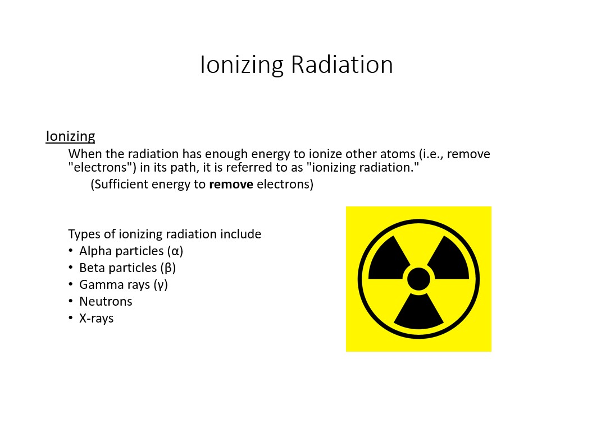{#fig-nasa-afrc-ionizing-radiation fig-alt="NASA radiation safety diagram comparing five nuclear transformations" width="100%"}

We have examined how different types of radiation are produced during nuclear transformations. Now, we will examine what happens when that radiation interacts with matter.

Charged particles, such as alpha and beta particles, can ionize atoms directly. Gamma photons can transfer energy to electrons and thereby produce ionization. Neutrons generally cause ionization **indirectly**, through energetic charged particles and secondary radiation produced during nuclear interactions.

When radiation interacts with matter, it can transfer energy to electrons in atoms or molecules. If enough energy is transferred, an electron can be removed. This process is called **ionization**. The atom or molecule that loses an electron becomes a positively charged **ion**; the removed electron carries a negative charge.

Radiation capable of removing electrons from atoms or molecules is called **ionizing radiation**.

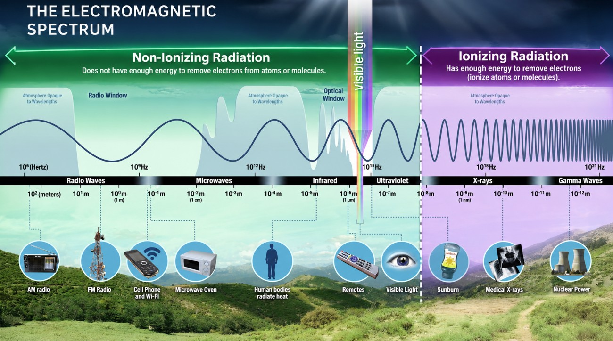{#fig-electromagnetic-spectrum fig-alt="Diagram of the electromagnetic spectrum showing radio waves, microwaves, infrared, visible light, ultraviolet radiation, X-rays, and gamma rays" width="100%"}

*Source: NASA, [Introduction to the Electromagnetic Spectrum](https://science.nasa.gov/ems/01_intro/).*

**Note:** The boundary between ionizing and non-ionizing radiation is not absolute. Although ultraviolet (UV) radiation is commonly classified as non-ionizing, sufficiently high-energy UV photons can cause ionization. Furthermore, non-ionizing UV radiation can damage DNA through photochemical reactions without directly ionizing atoms or molecules.

#### X-Ray Radiation and X-Ray Tubes

**X-ray radiation** is a form of electromagnetic radiation with sufficient photon energy to ionize atoms and molecules.

Like gamma ($\gamma$) rays, X-rays have no electric charge or rest mass and can penetrate matter. However, **X-rays and gamma rays are commonly distinguished by how they are produced**.

Gamma rays are generally emitted during nuclear transitions, whereas X-rays can be produced when high-speed electrons interact with matter or when electrons transition between atomic energy levels.

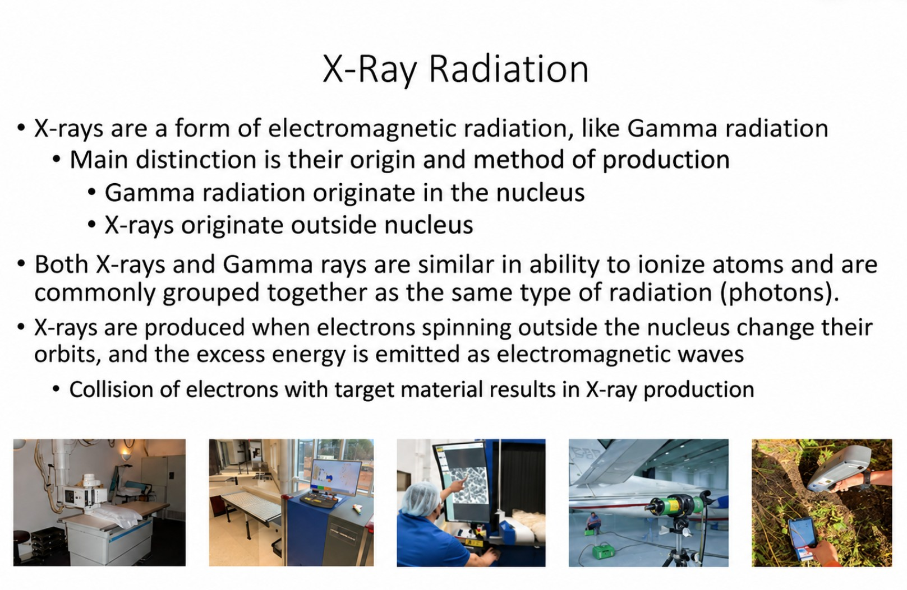{#fig-x-ray-radiation fig-alt="NASA Armstrong Flight Research Center training illustration introducing X-ray radiation" width="100%"}

*Source: NASA Armstrong Flight Research Center (AFRC), Radiation Safety Training.*

##### The Discovery of X-Rays

On November 8, 1895, **Wilhelm Conrad Röntgen**, a German physicist, discovered X-rays while experimenting with electrical discharge tubes. He observed that invisible radiation could penetrate certain materials and produce images on photographic plates.

The development of controllable X-ray sources helped establish the field of **radiography**, which uses penetrating radiation to produce images of objects and internal structures.

::: {layout-ncol="2"}

.](wilhelm-conrad-rontgen.jpg){#fig-wilhelm-conrad-rontgen fig-alt="Historical portrait of Wilhelm Conrad Röntgen alongside an early radiograph of Anna Bertha Ludwig's hand, showing the bones of her fingers and her wedding ring" height="300px"}

.](electrical-discharge-tube.jpg){#fig-electrical-discharge-tube fig-alt="Historical illustration depicting Wilhelm Conrad Röntgen and electrical discharge tube apparatus used during early X-ray experiments" height="300px"}

:::

##### How Are X-Rays Produced?

An **X-ray tube** is a vacuum tube that converts electrical energy into X-ray radiation.

An X-ray tube contains two principal electrodes:

- **Cathode (negative electrode):** Contains a heated filament that releases electrons through a process called thermionic emission.
- **Anode (positive electrode):** Contains a metal target, commonly tungsten, toward which electrons are accelerated by a high voltage.

When the electrons strike the anode target, they rapidly lose energy. A portion of this energy is emitted as **X-ray photons**, while most is converted into heat.

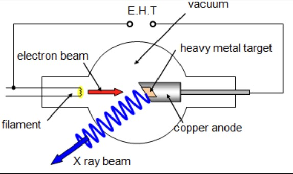{#fig-x-ray-diagram fig-alt="Schematic of an X-ray tube showing the cathode, electron acceleration toward the anode, and production of X-ray radiation" width="100%"}

{#fig-x-ray-tube fig-alt="Illustration or photograph of an X-ray tube showing its principal components" width="85%" fig-align="center"}

*Source: [PhysicsOpenLab, X-Ray Tube Diagram](https://physicsopenlab.org/wp-content/uploads/2017/10/xraytube_scheme.png).*

##### Applications and Radiation Safety

X-ray tubes are used in medical radiography, computed tomography (CT), airport luggage scanners, X-ray crystallography, material analysis, and industrial inspection.

An important distinction between an electrically powered X-ray tube and a radioactive source is that **an X-ray tube produces X-rays only while it is energized and operating**.

When electrical power is removed, X-ray production stops. This does not mean that the equipment is free of other hazards, such as stored electrical energy.

In hazardous materials management, understanding how radiation is produced helps us distinguish between **radiation-generating equipment** and **radioactive materials**.


### Ionizing Radiation Exposure Sources

We have examined how ionizing radiation is produced and how it interacts with matter. But where does our exposure to ionizing radiation come from?

Humans are continuously exposed to ionizing radiation from both **natural background sources** and **human-made sources**.

#### Annual Radiation Exposure

Natural background radiation comes from several sources, including:

- **Radon and thoron:** Radioactive gases and their decay products found in the environment.
- **Cosmic radiation:** Radiation originating from space that reaches Earth's atmosphere and surface.
- **Terrestrial radiation:** Radiation emitted by naturally occurring radioactive materials in soil, rocks, and other materials.
- **Internal radiation:** Radiation from naturally occurring radionuclides already present in the body.

Human-made sources include medical imaging, nuclear medicine, occupational activities, industrial applications, and consumer products.

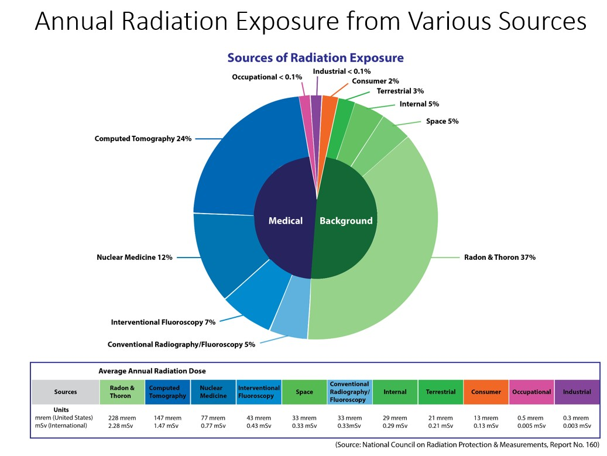{#fig-annual-radiation-exposure fig-alt="Chart showing the estimated distribution of annual radiation exposure from radon and thoron, cosmic radiation, terrestrial radiation, internal radionuclides, medical imaging, and other sources" width="100%"}

*Source: NASA Armstrong Flight Research Center (AFRC), Radiation Safety Training. Data attributed to the National Council on Radiation Protection and Measurements (NCRP), Report No. 160.*

Notice that **radon and thoron** represent a substantial contribution to natural background radiation exposure.

Medical procedures, particularly computed tomography (CT) and nuclear medicine, also contribute to population radiation exposure.

**Note:** The percentages shown represent historical estimates of average radiation exposure in the United States, based primarily on data from 2006. They do not describe the exposure received by every individual. Actual exposure depends on location, medical procedures, occupation, and other factors.

##### Natural Background Sources of Ionizing Radiation in the United States

The primary natural background source of ionizing radiation in the United States is **radon**, a naturally occurring radioactive gas that can accumulate inside homes and other buildings.

According to the historical estimates presented in NCRP Report No. 160, natural background radiation exposure in the United States comes from several sources:

- **Radon and thoron (approximately 68%):** Naturally occurring radioactive gases and their decay products that can accumulate indoors and contribute to radiation exposure through inhalation.
- **Internal radionuclides (approximately 14%):** Naturally occurring radioactive isotopes, including potassium-40 (${}^{40}_{19}\mathrm{K}$) and polonium-210 (${}^{210}_{84}\mathrm{Po}$), that may be present in the body. Radioactive isotopes in the environment can enter the food chain and eventually the human body.
- **Cosmic radiation (approximately 11%):** Radiation originating from space, including particles associated with solar activity and other cosmic sources. Exposure varies with altitude and geographic location.
- **Terrestrial radiation (approximately 7%):** Radiation emitted by naturally occurring radioactive materials in soil, rocks, and building materials, including granite, marble, and brick.

**Note:** These percentages describe the estimated distribution of natural background radiation exposure, not total exposure from all sources. They are based on historical U.S. population estimates and may not represent current exposure patterns or individual circumstances.

#### Average Background Radiation and Common Exposure Sources

Not everyone receives the same amount of radiation exposure.

Background radiation can vary with **altitude, latitude, geology, and the presence of naturally occurring radioactive materials**.

For example, people living at higher elevations may receive greater exposure to cosmic radiation because there is less atmosphere above them to attenuate incoming radiation.

Similarly, exposure to radon can vary considerably depending on local geology and building conditions.

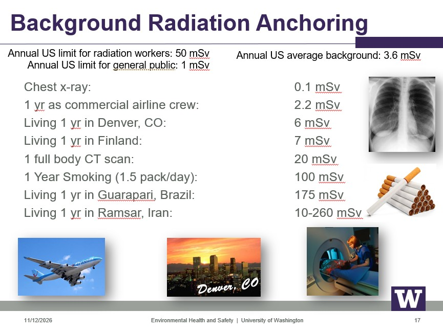{#fig-uw-background-radiation fig-alt="University of Washington training slide presenting radiation dose comparisons involving medical imaging, airline crews, geographic locations, and occupational exposure limits" width="100%"}

*Source: University of Washington, Environmental Health & Safety, Background Radiation Anchoring, November 12, 2026.*

The figure provides examples to help us put radiation exposure into perspective. However, it is important to distinguish between **annual exposure**, **dose from a single procedure**, and **regulatory dose limits**.

These values describe different circumstances and should not be interpreted as equivalent exposure scenarios.

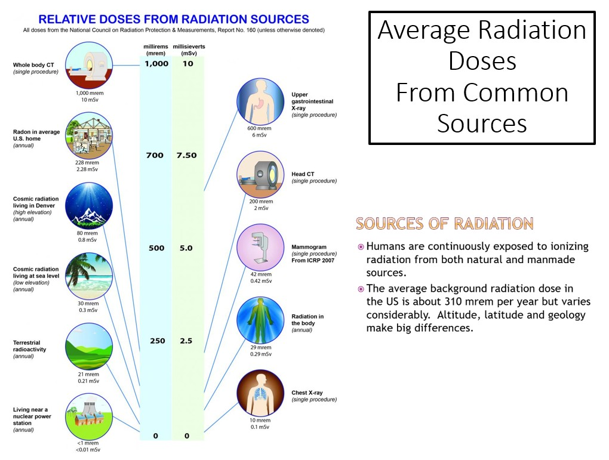{#fig-average-radiation-doses fig-alt="Radiation dose comparison chart showing millirem and millisievert values for CT scans, medical X-rays, radon, cosmic radiation, and terrestrial radiation" width="100%"}

*Source: National Council on Radiation Protection and Measurements (NCRP), Report No. 160, as attributed in the figure.*

The figures use two units commonly encountered in radiation protection:

- **Millirem (mrem):** One-thousandth of a rem, a traditional unit used for radiation protection dose quantities.
- **Millisievert (mSv):** One-thousandth of a sievert, the corresponding SI unit for equivalent or effective dose.

For these radiation protection dose quantities:

$$
1\ \mathrm{mSv}=100\ \mathrm{mrem}
$$

We will examine radiation dose quantities and their interpretation in greater detail in Part IV.

##### Radon Exposure and Indoor Air Quality

Radon is a major contributor to natural background ionizing radiation exposure, although the amount of exposure varies considerably with local geology, soil conditions, and building characteristics.

The U.S. Environmental Protection Agency (EPA) identifies radon as the **second leading cause of lung cancer in the United States after cigarette smoking**, with an estimated 21,000 radon-related lung cancer deaths annually.

Radon can enter homes and other buildings through cracks and openings in foundations, floors, and walls. Once inside, it may accumulate, particularly in areas with limited ventilation.

{#fig-ncrp-radon-home fig-alt="Illustration showing pathways through which radon can enter a home from the surrounding soil" width="100%"}

The EPA recommends taking action to reduce indoor radon concentrations when testing identifies levels at or above:

$$
4.0\ \mathrm{pCi/L}=0.148\ \mathrm{Bq/L}
$$

Where:

- **pCi/L:** Picocuries per liter, a unit of radioactive activity concentration.
- **Bq/L:** Becquerels per liter, the SI unit of radioactive activity concentration.

This is an **action level**, not a boundary between safe and unsafe exposure. Radon exposure can still present a risk below this concentration.


-----> YOU ARE HERE <----------------

maybe we incorporate the map of groundwater, maybe not. we are stopping here today at 8:02 pm. 


Radon may also be present in groundwater. When water containing dissolved radon is used for showering, bathing, or other household activities, radon can be released into indoor air and subsequently inhaled.

{#fig-ncrp-radon-epa fig-alt="Radon information reproduced from the NCRP Report No. 160 review article" width="100%"}

{#fig-ncrp-radon-testing fig-alt="Radon exposure and testing information reproduced from the NCRP Report No. 160 review article" width="100%"}

Because indoor radon concentrations vary between buildings, **testing is necessary to determine the radon concentration in a particular home or workplace**.

This is particularly relevant to hazardous materials management because radon illustrates how a naturally occurring radioactive substance can become an **indoor environmental exposure hazard**.

It also introduces an important distinction: radiation exposure can occur not only from sources outside the body but also when radioactive material enters the body through inhalation or ingestion.

*Sources: Bolus, N. E. (2013). Basic Review of Radiation Biology and Terminology. Journal of Nuclear Medicine Technology, 41(4), 255–260; NCRP Report No. 160 (2009); U.S. Environmental Protection Agency, Radon.*