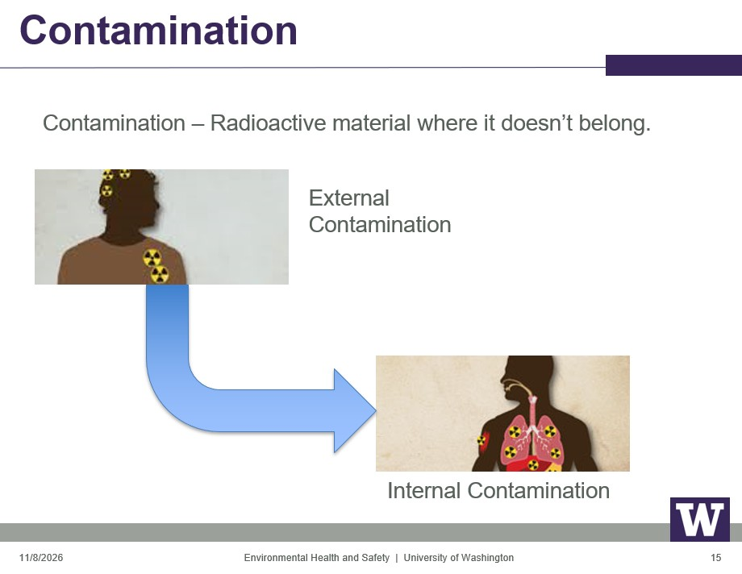
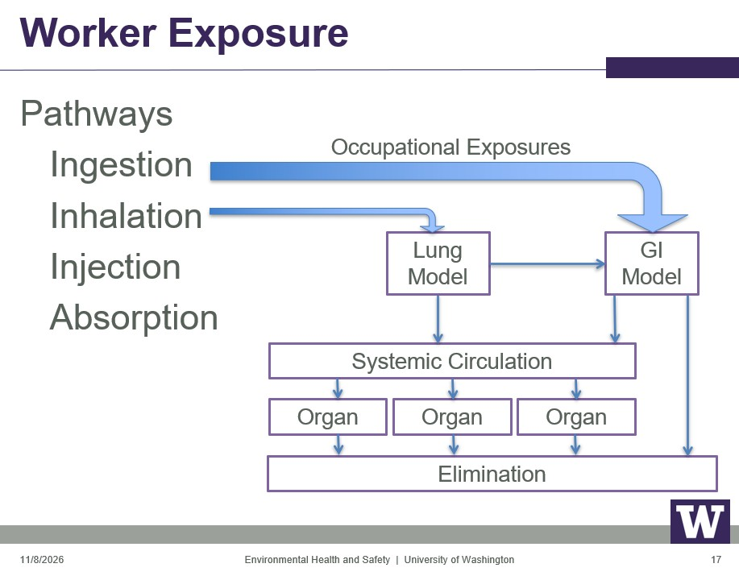

```{=html}
<style>
/* =========================================================
   SHM 377 Lecture Styling
   ========================================================= */

body {
  color: #212529;
}

blockquote {
  color: #212529;
  font-size: inherit;
  font-style: normal;
  font-weight: normal;
}

blockquote strong {
  color: #212529;
}

.text-center {
  color: #212529;
}

/* =========================================================
   Lecture Cover
   ========================================================= */

.cover-image img {
  width: 100%;
  height: 300px;
  object-fit: cover;
  object-position: center;
}

.cover-image p {
  margin-bottom: 0;
}

/* =========================================================
   Scientific Evidence Callout
   Compact formatting
   ========================================================= */

.evidence-callout {
  background-color: #f2f3f5;
  border-left: 3px solid #737980;
  border-radius: 4px;
  padding: 0.55rem 0.75rem;
  margin: 0.5rem 0 0;
  color: #212529;
  font-size: 0.82rem;
  line-height: 1.35;
}

.evidence-callout h2 {
  font-size: 0.95rem;
  font-weight: 600;
  margin: 0 0 0.4rem;
  color: #343a40;
}

.evidence-callout p {
  margin: 0 0 0.45rem;
}

.evidence-callout p:last-child {
  margin-bottom: 0;
}

/* =========================================================
   Chemical and Nuclear Equations
   Responsive KaTeX display
   ========================================================= */

.katex-display {
  max-width: 100%;
  overflow-x: auto;
  overflow-y: hidden;
  padding: 0.5rem 0;
  margin: 1rem 0;
  -webkit-overflow-scrolling: touch;
}

.katex-display > .katex {
  white-space: nowrap;
}

/* =========================================================
   Mobile Responsiveness
   ========================================================= */

@media (max-width: 768px) {

  /* Stack lecture cover columns vertically */

  .columns {
    display: block !important;
  }

  .columns > .column {
    width: 100% !important;
    max-width: 100% !important;
    flex: 0 0 100% !important;
  }

  .columns > .column:empty {
    display: none !important;
  }

  /* Scale images to mobile screen width */

  img {
    max-width: 100%;
    height: auto;
  }

  .cover-image img {
    height: auto;
  }

  /* Prevent long text from overflowing */

  p, li, figcaption {
    overflow-wrap: anywhere;
  }

  /* Slightly reduce equation size on mobile */

  .katex-display > .katex {
    font-size: 0.9em;
  }
}

/* =========================================================
   Chemical vs. Nuclear Reactions Comparison Table
   ========================================================= */

table.reaction-comparison {
  width: 100%;
  table-layout: fixed;
  border-collapse: collapse;
}

table.reaction-comparison th,
table.reaction-comparison td {
  width: 50%;
  text-align: left;
  vertical-align: top;
  overflow-wrap: break-word;
  padding: 0.75rem;
}

/* Vertical divider between the two columns */

table.reaction-comparison th:first-child,
table.reaction-comparison td:first-child {
  border-right: 1px solid #adb5bd;
}

</style>
```

::::::: {.columns style="align-items: flex-start;"}
:::: {.column width="46%"}
::: cover-image
. Image credit: SDO/NASA.](sun-emits-solar-flare-12-19-2014.jpg){fig-alt="NASA Solar Dynamics Observatory image showing a significant solar flare erupting from the Sun on December 19, 2014"}
:::
::::

::: {.column width="4%"}
:::

::: {.column width="50%"}
## SHM 377: Hazardous Materials Management

### Chemistry of Hazardous Materials: Solids and Radiation

**Lecture 04 · Fall 2026**

Yoni Rodriguez\
Engineering Technologies, Safety, and Construction\
Central Washington University\
[Yoni.Rodriguez\@cwu.edu](mailto:Yoni.Rodriguez@cwu.edu)
:::
:::::::

------------------------------------------------------------------------

# Introduction: From Atomic Structure to Nuclear Chemistry and Radiation

In Lecture 02, *Chemistry of Hazardous Materials: Matter*, we introduced the fundamental principles of chemistry and explored how scientists use observations and experimental evidence to understand the composition and behavior of matter. We examined how John Dalton developed his atomic theory without being able to observe individual atoms directly, demonstrating how scientific reasoning allows us to explain and predict the behavior of materials.

In Lecture 03, *Chemistry of Hazardous Materials: Solids*, we applied these principles to understand how atomic arrangements, chemical bonding, and the physical and chemical properties of solids influence their behavior and associated hazards.

In this lecture, we will return to the atom and examine how scientists discovered the structure of atoms and their smaller subatomic particles. Through the experimental work of scientists such as J. J. Thomson, Henri Becquerel, Ernest Rutherford, and James Chadwick, we will explore how our understanding of atomic structure developed and how these discoveries contributed to the field of nuclear chemistry.

We will then examine the structure of the atomic nucleus, the differences between isotopes, and the forces that determine nuclear stability. These principles will help us understand why certain nuclei are unstable, how radioactive decay occurs, and why different forms of ionizing radiation are emitted.

Finally, we will apply these chemical principles to hazardous materials management by examining how ionizing radiation interacts with matter, how radiation exposure can affect human health, and how the principles of health physics guide radiation protection and emergency response.

As in our previous chemistry lectures, **our objective is not simply to memorize scientific terminology or equations, but to use scientific evidence to understand hazardous materials, predict their behavior, and make informed decisions that protect workers, the public, and the environment.**

## Learning Objectives

By the end of this lecture, students should be able to:

1.  **Explain the development of the atomic model** using experimental evidence from the discovery of subatomic particles, radioactivity, and the atomic nucleus.

2.  **Describe atomic and nuclear structure**, including the properties of protons, neutrons, and electrons, and distinguish between atomic number, mass number, and isotopes.

3.  **Explain nuclear stability** by examining the strong nuclear interaction, electrostatic repulsion, and the relationship between neutrons and protons.

4.  **Describe radioactive decay** and explain how unstable nuclei undergo nuclear transformations, producing daughter nuclei and releasing particles or energy.

5.  **Distinguish between the major types of ionizing radiation**, including alpha particles, beta particles, gamma rays, and neutron radiation, based on their origins, physical properties, and interactions with matter.

6.  **Interpret fundamental concepts of radioactivity**, including nuclear equations, radioactive decay series, half-life, and activity.

7.  **Explain the biological effects of ionizing radiation**, including how energy deposited in biological tissues can cause cellular damage and influence health outcomes.

8.  **Apply fundamental radiation protection principles**, including time, distance, shielding, and contamination control, to evaluate radiation hazards and identify appropriate protective measures during hazardous materials incidents.

# Part I. Atoms and the Periodic Table

*Primary source: Chemistry: Atoms First, 2nd ed., Chapter 2*

{#fig-periodic-table fig-alt="Periodic table showing the chemical elements organized by increasing atomic number, with elements arranged into periods and groups" width="100%"}

## 4.1 Atoms First

Let's review two fundamental concepts from our previous chemistry lectures:

- An **atom** is the smallest unit of an element that retains the chemical properties of that element.
- An **element** is a substance that cannot be broken down into two or more simpler substances by chemical means.

**Examples of elements:**

- **Potassium (K):** Metal
- **Oxygen (O):** Nonmetal
- **Silicon (Si):** Metalloid

### Understanding Atoms: An Analogy

A useful analogy can help us visualize why an atom represents the smallest unit of an element that retains its chemical identity.

Imagine you have a collection of CDs. You can separate the collection into smaller and smaller groups until you are left with a single CD.

You could break that CD into smaller pieces, but would those pieces still be a CD?

**No.** You would have pieces of a CD that no longer function as an individual CD.

Similarly, a collection of atoms can be separated into smaller groups until only one atom remains. Although an atom contains smaller particles, separating those particles would mean it no longer retains the identity of the original element.

{#fig-cd-atom-analogy fig-alt="Two parallel sequences showing four CDs reduced to two CDs and then one CD, and four atoms reduced to two atoms and then one atom" width="100%"}

Remember, John Dalton? Dalton said "that atoms, of which all matter consists, are tiny, indivisible particles." However, we know that atoms are divisible and made up of smaller subatomic particles.

## 4.2 Subatomic Particles and Atomic Structure

### Discovery of the Electron

In Lecture 02, we discussed how John Dalton proposed that atoms were tiny, indivisible particles. However, scientific discoveries in the late nineteenth century began to challenge this model.

In 1897, the British physicist **J. J. Thomson** investigated the behavior of cathode rays produced when a high voltage was applied between two electrodes inside a vacuum tube.

{#fig-jj-thomson fig-alt="J. J. Thomson and his experimental apparatus used to investigate cathode rays" width="45%"}

The rays traveled from the negatively charged electrode, known as the **cathode**, toward the opposite end of the tube, where they could produce a visible glow on a fluorescent screen.

Thomson observed that the rays could be deflected by an electric field. From these observations, he concluded that cathode rays consisted of streams of negatively charged particles, which we now call **electrons**.

Importantly, Thomson found that these particles behaved the same way regardless of the metal used to produce them. This observation led him to conclude that electrons are part of the makeup of all atoms.

{#fig-cathode-ray-tube fig-alt="Side-view schematic of an evacuated cathode-ray tube showing the cathode, anode, magnet, positively and negatively charged deflection plates, and electron beam bending toward the positive plate" width="45%"}

#### Determining the Electron's Charge and Mass

Thomson's discovery of the electron was not the result of a single observation. Instead, he conducted a series of experiments to investigate the physical properties of cathode rays.

By applying electric and magnetic fields, Thomson observed that cathode rays could be deflected from their original paths.

When an electric field was applied, the rays were attracted toward the positively charged plate and repelled by the negatively charged plate.

This provided experimental evidence that cathode rays consisted of negatively charged particles.

Thomson's experiments also demonstrated that these particles were much smaller than atoms, providing further evidence that atoms were not indivisible.

**Scientific significance:** Thomson's discovery challenged Dalton's original atomic model and established that atoms contain smaller, negatively charged particles called electrons.

### Millikan's Oil-Drop Experiment

Following Thomson's discovery of the electron, scientists understood that atoms contained negatively charged particles. However, they still did not know the magnitude of the electric charge carried by an individual electron.

In the early twentieth century, the American physicist **Robert Millikan**, working with his graduate student **Harvey Fletcher**, developed an ingenious experiment to investigate this question.

Their approach was to study the behavior of extremely small, electrically charged droplets of oil.

#### How the Experiment Worked

Millikan and Fletcher introduced tiny oil droplets into a chamber containing two electrically charged metal plates.

The droplets were affected by two opposing forces:

1.  **Gravity:** Pulled the oil droplets downward.
2.  **Electric force:** Could push the charged droplets upward or downward, depending on their electric charge and the direction of the electric field.

By adjusting the voltage between the plates, the researchers could change the electric force acting on a droplet.

For some droplets, they could adjust the electric field until the upward electric force balanced the downward pull of gravity.

When these forces were balanced, the droplet remained suspended rather than rising or falling.

{#fig-millikan-oil-drop fig-alt="Millikan oil-drop apparatus showing oil droplets released from a sprayer between two electrically charged plates, a microscope used to observe the droplets, and opposing upward electric and downward gravitational forces acting on a selected droplet" width="45%"}

#### What Did the Researchers Discover?

Millikan and Fletcher found that the charge on any particular drop was always a multiple of $-1.6022 \times 10^{-19}\ \mathrm{C}$, which they deduced was the charge on a single electron.

The notation $10^{-19}$ means **one ten-quintillionth**, or one divided by ten quintillion. The negative sign indicates the electron’s negative electrical charge; the negative exponent indicates how small that charge is. We will define the **coulomb (C)**, the SI unit of electrical charge, in Section 4.6A.

#### Why Was This Discovery Important?

Millikan and Fletcher's experiments combined with Thomson's allowed scientists to calculate the mass of an electron:

$$
m_e = \frac{\text{Charge}}{\text{Charge/Mass}} = \frac{-1.6022 \times 10^{-19}\ \cancel{\mathrm{C}}}{-1.76 \times 10^{8}\ \cancel{\mathrm{C}}/\mathrm{g}} = 9.10 \times 10^{-28}\ \mathrm{g}
$$

In this calculation, $10^{8}$ represents **one hundred million**, while $10^{-28}$ represents **one ten-octillionth**. The calculated electron mass, $9.10 \times 10^{-28}\ \mathrm{g}$, is approximately **9.10 ten-octillionths of a gram**. These extremely small quantities help explain why scientists use scientific notation when describing subatomic particles.

### Radioactivity

While scientists were investigating the electron, other experiments revealed that certain materials could spontaneously emit radiation.

In 1896, French physicist **Henri Becquerel** observed that uranium oxide left in a drawer with photographic plates darkened areas of the plates. From his observations, he realized that uranium must give off some kind of "radiation." This observation provided evidence that radiation could originate from within matter itself.

{#fig-uw-henri-becquerel fig-alt="Educational image illustrating Henri Becquerel and his contributions to the discovery of radioactivity" width="45%"}

{#fig-becquerel-photographic-plates fig-alt="Photographic plates showing darkened regions caused by radiation from uranium compounds during Becquerel's experiments" width="45%"}

**Marie Curie** demonstrated that the radiation emitted by uranium, which she called **radioactivity**, was independent of the chemical compound in which the uranium was found. She concluded that the source of this radiation must be the uranium atoms themselves.

{#fig-marie-curie fig-alt="Historical photograph of physicist and chemist Marie Curie" width="45%"}

Together with her husband, **Pierre Curie**, she received the Nobel Prize in Physics for their research on radiation phenomena. Their investigations also contributed to the discovery of the radioactive elements **polonium** and **radium**, while thorium was also identified as radioactive.

Marie Curie later received a second Nobel Prize, this time in Chemistry, for her discovery of radium and polonium and her research on radium.

**Key definitions:**

- **Radioactivity:** The spontaneous emission of radiation by atomic nuclei.
- **Radioactive:** Having the ability to emit ionizing radiation spontaneously.

{#fig-ernest-rutherford fig-alt="Historical photograph of physicist Ernest Rutherford" width="45%"}

*Photograph source: [Rincón Educativo](https://rinconeducativo.org/en/anniversaries/august-30-1871-birth-ernest-rutherford-nobel-prize-considered-one-of-the-fathers-atomic-physics/).*

Radioactivity was a mystery because the structure of the atomic nucleus was still unknown. **Ernest Rutherford** took the first steps in discovering its origin when he identified three different types of electric fields on radioactive emissions:

These emissions include:

- **Alpha particles (**$\alpha$): Positively charged particles.
- **Beta particles (**$\beta$): Charged particles, including electrons emitted from the nucleus during radioactive decay.
- **Gamma rays (**$\gamma$): High-energy electromagnetic radiation that carries no electric charge, emitted by the nuclei.

{#fig-radiation-emission-types fig-alt="Beta particles (red) deflect toward the positive plate, alpha particles (blue) deflect toward the negative plate, and gamma rays (green) continue straight without deflection." width="45%"}

Because alpha and beta particles carry electric charge, their paths can be deflected by electric or magnetic fields. Gamma rays do not undergo this type of deflection because they have no electric charge.

**What can we learn about an unknown form of radiation by observing how it responds to an electric field?**

These discoveries provided additional evidence that atoms were more complex than Dalton's original model suggested.

### The Proton and the Nuclear Model of the Atom

Although Thomson demonstrated that atoms contain negatively charged electrons, another question remained:

**If atoms contain negatively charged electrons, why are atoms electrically neutral?**

Scientists reasoned that atoms must also contain positive charge to balance the negative charge of their electrons.

Thomson proposed a plum-pudding model in which negatively charged electrons were embedded within a region of distributed positive charge.

{#fig-thomson-plum-pudding fig-alt="Schematic illustration of Thomson's plum-pudding atomic model, showing negatively charged electrons embedded in a uniformly distributed positive charge" width="45%"}

*Image source: [Khan Academy, Discovery of the Electron and Nucleus](https://www.khanacademy.org/science/cambridge-o-level-physics-cie/x0e04e0cb682fb793:nuclear-physics/x0e04e0cb682fb793:the-atom/a/discovery-of-the-electron-and-nucleus).*

However, subsequent experiments challenged this explanation.

#### Rutherford's Gold Foil Experiment

**Ernest Rutherford**, working with **Hans Geiger and Ernest Marsden**, investigated how positively charged alpha particles interacted with thin metal foil.

The researchers directed alpha particles toward the foil and observed their scattering using a fluorescent screen.

{#fig-gold-foil-experiment fig-alt="Diagram of Rutherford's gold foil experiment showing an alpha particle emitter, thin gold foil, zinc-sulfide detection screen, and alpha-particle trajectories. Most particles pass through with little or no deflection, some scatter at an angle, and a small number reverse direction toward the source." width="45%"}

They made three important observations:

1.  **Most alpha particles passed through the foil** with little or no change in direction.
2.  **Some alpha particles were deflected** from their original paths.
3.  **A very small number of alpha particles experienced a large repulsive force and therefore a large deflection**, making the alpha particle traveling directly toward the nucleus completely repelled and reverse in direction.

From these observations, Rutherford concluded that most of an atom consists of relatively empty space, while its positive charge and most of its mass are concentrated in a small, dense region called the **atomic nucleus**.

This became known as the **nuclear model of the atom**.

#### From the Nucleus to the Proton

The positive charge of the nucleus is associated with particles called **protons**.

A proton carries a positive electric charge equal in magnitude to the negative charge of an electron.

In an electrically neutral atom, the number of protons equals the number of electrons.

For example, an aluminum atom has an atomic number of 13. This means its nucleus contains 13 protons. A neutral aluminum atom also contains 13 electrons.

**Scientific significance:** Rutherford's scattering experiment demonstrated that an atom's positive charge is concentrated in a small nucleus rather than distributed uniformly throughout the atom.

### The Neutron

Although Rutherford's nuclear model explained the concentration of positive charge within the nucleus, protons and electrons alone could not account for the mass of many atoms.

- It was known that hydrogen, the simplest atom, contained only one proton.
- It was also known that the helium atom contained two protons.
- Therefore, the ratio of the mass of a helium atom to that of a hydrogen atom should be 2:1 (because electrons are much lighter than protons).
- In reality, the mass ratio was approximately 4:1.

This led Rutherford and others to think that there must be another type of subatomic particle in the atomic nucleus.

In 1932, British physicist **James Chadwick** bombarded a thin sheet of beryllium with alpha particles. A very high-energy radiation was emitted by the metal that was not deflected by either electric or magnetic fields, similar to gamma rays. Later experiments showed that the radiation consisted of a third type of subatomic particle, which Chadwick named **neutrons**.

{#fig-james-chadwick fig-alt="Historical portrait of British physicist James Chadwick, who discovered the neutron in 1932" width="45%"}

*Photograph source: [Wikipedia, James Chadwick](https://en.wikipedia.org/wiki/James_Chadwick).*

The discovery of the neutron helped explain the mass of atomic nuclei.

We now understand that atoms contain three fundamental subatomic particles:

- **Protons:** Positively charged particles that determine the identity of an element.
- **Neutrons:** Electrically neutral particles that contribute to nuclear mass and influence nuclear stability.
- **Electrons:** Negatively charged particles that occupy the region surrounding the nucleus.

The approximate scale of an atom is often expressed as $10^{-10}\ \mathrm{m}$, or **one ten-billionth of a meter**. A nuclear scale of $10^{-14}\ \mathrm{m}$ corresponds to **one hundred-trillionth of a meter**. These values illustrate why the nucleus occupies only a tiny fraction of the atom’s overall size.

{#fig-atom-nucleus-model fig-alt="Diagram comparing the approximate size of an atom, 10^-10 meters, with its nucleus, 10^-14 meters. The atom is represented by a large electron-containing region, while the enlarged nucleus shows positively charged protons and electrically neutral neutrons." width="100%"}

{#fig-dodger-stadium fig-alt="Photograph of Dodger Stadium illustrating the relative scale of an atomic nucleus and the much larger region occupied by electrons, using a fly at the center of the baseball field as an analogy." width="100%"}

*Photograph source: [Wikipedia, Dodger Stadium](https://en.wikipedia.org/wiki/Dodger_Stadium).*

**Table reference:** Chemistry: Atoms First, Table 2.1 (masses and electric charges of electrons, protons, and neutrons).

**Scientific significance:** Chadwick's discovery helped establish our modern understanding of the nucleus as a structure containing both protons and neutrons.

### Historical Development of Atomic Structure and Radioactivity

Our understanding of atomic structure developed through a series of scientific discoveries. Each discovery provided new experimental evidence that challenged earlier explanations of matter and helped scientists develop a more complete understanding of the atom.

1.  **John Dalton (Early 1800s): Atomic Theory**

    Dalton proposed that matter consists of tiny, indivisible particles called atoms. His atomic theory provided a foundation for explaining the composition and behavior of matter.

2.  **Henri Becquerel (1896): Discovery of Radioactivity**

    Becquerel observed that uranium-containing materials could darken photographic plates without exposure to light. His observations provided evidence that radiation could originate from within matter itself.

3.  **J. J. Thomson (1897): Discovery of the Electron**

    Thomson investigated cathode rays and demonstrated that they consisted of negatively charged particles called electrons. His experiments provided evidence that atoms contain smaller subatomic particles and are not indivisible.

4.  **Marie and Pierre Curie (1898 onward): Investigations of Radioactivity**

    Marie Curie demonstrated that radioactivity was associated with atoms rather than their chemical compounds. Together, Marie and Pierre Curie investigated radioactive materials and contributed to the discovery of polonium and radium.

5.  **Robert Millikan and Harvey Fletcher (Early 1900s): Measurement of the Electron's Charge**

    Through their oil-drop experiments, Millikan and Fletcher determined the magnitude of the elementary electric charge. Combined with Thomson's measurements, their findings allowed scientists to calculate the mass of an electron.

6.  **Ernest Rutherford (1911): Discovery of the Atomic Nucleus**

    Rutherford, working with Hans Geiger and Ernest Marsden, investigated the scattering of alpha particles through thin metal foil. Their observations provided evidence that most of an atom consists of relatively empty space, with its positive charge and most of its mass concentrated in a small, dense nucleus.

7.  **James Chadwick (1932): Discovery of the Neutron**

    Chadwick investigated radiation produced when beryllium was bombarded with alpha particles. His experiments provided evidence for the existence of electrically neutral particles called neutrons, helping explain the mass and composition of atomic nuclei.

**Scientific significance:** These discoveries demonstrate how scientific understanding develops through observations, experimentation, and the evaluation of evidence. Scientists were able to investigate the structure of atoms and identify subatomic particles even though they could not directly observe individual atoms.

Together, these discoveries established the foundation for our modern understanding of atomic structure, radioactivity, and nuclear chemistry.

## 4.3 Atomic Number, Mass Number, and Isotopes

All elements on the periodic table can be identified by the following:

- The **atomic number (**$Z$): the number of protons in the nucleus of each atom of an element.
- The **mass number (**$A$): the total number of neutrons *AND* protons. Often referred to *jointly* as **nucleons**.

Therefore:

$$
\text{Mass number } (A) = \text{Number of protons } (Z) + \text{Number of neutrons}
$$

or

$$
\text{Number of neutrons} = \text{Mass number } (A) - \text{Number of protons } (Z)
$$

or

$$
\text{Number of protons (Z)} = \text{Mass number } (A) - \text{Number of neutrons}
$$

{#fig-atomic-number-mass-number fig-alt="Diagram showing the element symbol X with mass number A in the upper left and atomic number Z in the lower left. The mass number represents the total number of protons and neutrons, while the atomic number represents the number of protons." width="100%"}

What do we call an atom that has the same atomic number (Z) but different mass numbers (A)?

### Isotopes

Most elements have two or more isotopes, atoms that have the same atomic number (same number of protons *and* electrons) but different number of neutrons.

How do we identify an isotope from an element?

- We write the mass number after the name of the element. Take Uranium for example:

{#fig-uranium-isotopes fig-alt="Side-by-side comparison of uranium-238 and uranium-235 showing the same atomic number of 92 and different mass numbers of 238 and 235." width="100%"}

The isotope Uranium-235 (U-235) has 143 neutrons in its nucleus (235-92 = 143) and is used in nuclear reactors and atomic bombs, whereas U-238 does not behave the same way in these applications.

NOTE: the chemical properties of an element are determined primarily by the number of protons and electrons in its atoms; not by the number of neutrons. Therefore, isotopes of the same element usually, not always, exhibit very similar chemical properties.

## 4.4 Nuclear Stability

{fig-alt="Periodic table showing the chemical elements organized by increasing atomic number, with elements arranged into periods and groups" width="100%"}

The nuclei of some elements are stable, but others decay seconds after they are formed. Therefore, patterns of stability and instability of nuclei are useful to make predictions regarding nuclear decay.

The principal factor that determines whether a nucleus is stable is the *neutron-to-proton ratio (n/p)*. For atoms of elements having low atomic numbers (less than or equal to 20; calcium), the *n/p* value is close to 1. The increase in the ratio of neutrons-to-protons with increasing atomic number can be explained by considering the role of the neutrons in helping to overcome the electrical repulsion between protons. The strong force that holds protons and neutrons together in a nucleus is powerful enough to overcome the electrostatic repulsion between the protons, but it can act over only a very short distance, about the diameter of a nucleus.

Given that neutrons are uncharged, they can contribute to the strong force without adding to the electrostatic repulsion. Therefore, a lot of neutrons are needed to overcome the mutal repulsion of the protons in a nucleus of high atomic number, which explains why the band of stability curves upward.

{#fig-neutron-proton-stability fig-alt="Graph showing the number of protons on the horizontal axis and the number of neutrons on the vertical axis. A straight red diagonal line represents a 1:1 neutron-to-proton ratio. An orange belt of stability curves upward above the red line as atomic number increases, indicating that heavier stable nuclei require more neutrons than protons." width="100%"}

*Figure adapted from Figure 2.9, "Plot of Neutrons Versus Protons," Chapter 2: Atoms and the Periodic Table, in Chemistry: Atoms First by Julia Burdge and Jason Overby.*

General patterns:

- **magic numbers** there are more stable nuclei containing *2, 8, 20, 50, 82, and 126* protons or neutrons than there are containing other numbers of protons or neutrons.

  - Example: tin (Sn) vs. antimony (Sb):

  | Element       | atomic number | stable isotopes |
  |:--------------|--------------:|----------------:|
  | Tin (Sn)      |            50 |              10 |
  | Antimony (Sb) |            51 |               2 |

- There are more stable nuclei with even numbers of both protons and neutrons than with odd numbers of these particles.

- All isotopes of the elements with atomic numbers higher than 82 are radioactive.

  - NOTE: Bismuth Z = 83 was long thought to have a stable isotope but it was found to decay very slowly.

- All isotopes of technetium (Tc, Z = 43) and promethium (Pm, Z = 61) are radioactive.

# Part II. Nuclear Chemistry

*Primary source: Chemistry: Atoms First, 2nd ed., Chemical Principles Focus 9: Nuclear Chemistry.*

## 4.4 Nuclei and Nuclear Reactions

### Nuclei

Rutherford showed that each type of radiation is produced by **nuclear decay.** A change in the composition of a nucleus is called a **nuclear reaction.** Understand, that a specific atom with a given atomic number (Z) and mass number (A) is called a **nuclide.** For example, ${}^{1}_{1}\mathrm{H}$, ${}^{2}_{1}\mathrm{H}$, ${}^{16}_{8}\mathrm{O}$ are three different nucldies, the first two being isotopes of the same element. Nuclei that change their *structure spontaneously* and *emit radiation* are described as **radioactive.** Often the results is a nucleus of a different element.

### Understanding the Nuclear Notation

Nuclear notation identifies an element and its atomic number and mass number.

$$
{}^{A}_{Z}\mathrm{X}
$$

- **A (upper left):** Mass number, the total number of protons and neutrons.
- **Z (lower left):** Atomic number, the number of protons.
- **X (right):** Chemical symbol of the element.

**For hydrogen-1:**

$$
{}^{1}_{1}\mathrm{H}
$$

- Mass number = 1
- Atomic number = 1
- Number of protons = 1
- Number of neutrons = 1 − 1 = 0

### Understanding Nuclear Reactions

Nuclear reactions differ in some important ways from chemical reactions.

1.  Different isotopes of the same element undergo essentially the same chemical reactions but undergo very different nuclear reactions.

2.  Some nuclear reactions, such as those in which $\alpha$ or $\beta$ particles are emitted from the nucleus, leave behind a nucleus with a different number of protons and which is therefore the nucleus of an atom of a different element. The product nucleus is called a **daughter nucleus.**

    For example, when atmospheric ${}^{14}_{7}\mathrm{N}$, is convereted to ${}^{14}_{6}\mathrm{C}$ and ${}^{1}_{1}\mathrm{H}$, which results when the nitrogen isotpoe is bombarded by neutrons (from the sun), **nuclear transmuation** has taken place. This type of transmuation occurs naturally in outer space, but it can also be achieved artificially.

3.  Another important difference between nuclear and chemical reactions is that energy changes are very much greater for nuclear reactions than for chemical reactions.

    For example, the combustion of $1.0\ \mathrm{g}$ of methane produces about $52\ \mathrm{kJ}$ of energy as heat. In contrast, a nuclear reaction of $1.0\ \mathrm{g}$ of uranium-235 produces about $8.2 \times 10^{7}\ \mathrm{kJ}$ of energy, more than a million times as much.

    The notation $10^{7}$ represents **ten million**. Therefore, $8.2 \times 10^{7}\ \mathrm{kJ}$ is equivalent to approximately **82 million kilojoules**. A kilojoule (kJ) is one thousand joules (J), a unit of energy.

    To put that energy into perspective:

    - **A moving baseball:** A 250-gram baseball thrown or hit at roughly 20 meters per second (45 mph) carries about 50 joules of kinetic energy.
    - **Walking/Climbing:** Walking up a flight of stairs (roughly 10 to 12 steps) uses around 2 to 4 kilojoules depending on your body weight.

| Chemical Reactions | Nuclear Reactions |
|:------------------------------------|:----------------------------------|
| 1\. Atoms are rearranged by the breaking and forming of chemical bonds. | 1\. Elements are converted to other elements (or isotopes). |
| 2\. Only electrons in atomic or molecular orbitals are involved in the reaction. | 2\. Protons, neutrons, electrons, and other subatomic particles such as $\alpha$ particles may be involved. |
| 3\. Reactions are accompanied by the absorption or release of relatively small amounts of energy. | 3\. Reactions are accompanied by the absorption or release of tremendous amounts of energy. |
| 4\. Rates of reaction are influenced by temperature, pressure, concentration, and catalysts. | 4\. Rates of reaction normally are not affected by temperature, pressure, or catalysts. |

: Comparison of Chemical Reactions and Nuclear Reactions

*Source: Burdge, J., & Overby, J. (2018). Chemistry: Atoms First (2nd ed.), Chapter 20, Table 20.1, "Comparison of Chemical Reactions and Nuclear Reactions."*

### Key Definitions

- **nuclear decay:** the partial breakup of a nucleus
- **nuclear reaction:** a change that a nucleus undergoes
- **nuclide:** An atom of specified atomic number and mass number. *Examples* ${}^{1}_{1}\mathrm{H}$, ${}^{16}_{8}\mathrm{O}$
- **radioactive:** A nucleus is radioactive if it can change its structure spontaneously and emit radiation.
- **daughter nucleus:** a nucleus that is the produce of a nuclear decay.
- **nuclear transmutation:** The conversion of one element into another.

------------------------------------------------------------------------

### Types of Nuclear Radiation

Rutherford identified three common types of nuclear radiation: alpha ($\alpha$) particles, beta ($\beta$) particles, and gamma ($\gamma$) rays. Each differs in its physical characteristics, electric charge, and degree of penetration.

#### Alpha Particles ($\alpha$)

**Alpha-particle radiation:** ${}^{4}_{2}\alpha$ is positively charged and can be thought of as a tightly bound cluster of two protons and two neutrons. An alpha particle is also often referred to as a helium nucleus: ${}^{4}_{2}\mathrm{He}$.

When a nucleus emits an alpha particle, its **atomic number decreases by two** and its **mass number decreases by four.**

We can represent this transformation using a **nuclear equation**, which shows how an unstable nucleus changes into a different nucleus while emitting radiation.

For example, when polonium-212 undergoes alpha decay:

$$
{}^{212}_{84}\mathrm{Po}
\;\longrightarrow\;
{}^{4}_{2}\alpha
\;+\;
{}^{208}_{82}\mathrm{Pb}
$$

In this nuclear equation:

- **Parent nucleus:** Polonium-212 (${}^{212}_{84}\mathrm{Po}$)
- **Emitted particle:** Alpha particle (${}^{4}_{2}\alpha$)
- **Daughter nucleus:** Lead-208 (${}^{208}_{82}\mathrm{Pb}$)

The atomic number decreases from 84 to 82, while the mass number decreases from 212 to 208.

**Degree of penetration:** Alpha particles have very limited penetration. They can travel only a short distance through air (*\~4 inches from their source*) and can be stopped by a sheet of paper or the outer layer of skin.

Although alpha particles generally present a limited external radiation hazard, radioactive material that emits alpha particles can be particularly damaging if it enters the body through inhalation, ingestion, or wounds.

*Source: Bevelacqua, A. S., & Norman, L. A. Hazardous Materials Chemistry (3rd ed.). Jones & Bartlett Learning, Chapter 3, "Alpha Particles."*

#### Beta Particles ($\beta$)

**Beta-particle radiation:** ${}^{0}_{-1}\beta$ is negatively charged, and by measuring the charge and mass of these particles, Rutherford showed that they are electrons. Given that a beta particle has no protons or neutrons, its mass number is 0 and can be written as ${}^{0}_{-1}\mathrm{e}$.

Beta particles are high-speed electrons emitted during nuclear transformations.

During negative beta decay ($\beta^{-}$), **a neutron** in the nucleus is **converted into a proton**, and an **electron is emitted**. **The atomic number increases by one**, while **the mass number remains unchanged**.

We can represent this transformation using the following nuclear equation:

$$
{}^{1}_{0}\mathrm{n}
\;\longrightarrow\;
{}^{1}_{1}\mathrm{p}
\;+\;
{}^{0}_{-1}\mathrm{e}
$$

We can represent this transformation using a **nuclear equation**, which shows how an unstable nucleus changes into a different nucleus while emitting radiation.

For example, when strontium-90 undergoes beta-minus decay:

$$
{}^{90}_{38}\mathrm{Sr}
\;\longrightarrow\;
{}^{0}_{-1}\beta
\;+\;
{}^{90}_{39}\mathrm{Y}
$$

In this nuclear equation:

- **Parent nucleus:** Strontium-90 (${}^{90}_{38}\mathrm{Sr}$)
- **Emitted particle:** Beta particle (${}^{0}_{-1}\beta$)
- **Daughter nucleus:** Yttrium-90 (${}^{90}_{39}\mathrm{Y}$)

The atomic number increases from 38 to 39, while the mass number remains 90.

**Degree of penetration:** Beta particles are moderately penetrating. They generally travel farther through air than alpha particles (*\~1 to 20 feet from their source*) and can penetrate the outer layers of skin.

Beta radiation can be shielded using suitable materials, including plastic or thin sheets of metal. The choice of shielding material depends on the energy of the beta particles.

*Source: Bevelacqua, A. S., & Norman, L. A. Hazardous Materials Chemistry (3rd ed.). Jones & Bartlett Learning, Chapter 3, "Beta Particles."*


#### Gamma Radiation ($\gamma$)

**Gamma radiation:** The third common type of nuclear radiation is gamma radiation, represented by the Greek letter $\gamma$. Gamma rays were first identified by Paul Villard in 1900 and were subsequently studied and named by Ernest Rutherford.

Like visible light, gamma radiation is a form of electromagnetic radiation, but gamma rays emitted during nuclear transitions generally have much higher frequencies and photon energies.

Gamma rays can be emitted when an excited nucleus moves from a higher-energy state to a lower-energy state. Unlike alpha or beta decay, **gamma emission by itself does not change the atomic number or mass number of the nucleus.**

We can represent this transformation using a **nuclear equation**, which shows how an excited nucleus releases energy in the form of a gamma-ray photon.

##### Example: Technetium-99m in Nuclear Medicine

Technetium-99m is a radioactive nuclear isomer of technetium-99 commonly used in nuclear medicine for diagnostic imaging.

The superscript **m** in technetium-99m (${}^{99m}_{43}\mathrm{Tc}$) stands for **metastable**, indicating that the nucleus is in an **excited nuclear state**. This means that the nucleus contains more energy than the same nucleus in its **ground state**, or lowest-energy state.

In this example:

- **Technetium (Tc):** The chemical element.
- **Atomic number (43):** The nucleus contains 43 protons.
- **Mass number (99):** The nucleus contains 99 protons and neutrons combined.
- **Metastable (m):** The nucleus is in an excited nuclear state.

The gamma emission from technetium-99m can be represented by the following simplified nuclear equation:

$$
{}^{99m}_{43}\mathrm{Tc}
\;\longrightarrow\;
{}^{99}_{43}\mathrm{Tc}
\;+\;
{}^{0}_{0}\gamma
$$

In this nuclear equation:

- **Parent nucleus:** Technetium-99m (${}^{99m}_{43}\mathrm{Tc}$), in an excited nuclear state.
- **Emitted radiation:** Gamma-ray photon (${}^{0}_{0}\gamma$), which carries away energy.
- **Resulting nucleus:** Technetium-99 (${}^{99}_{43}\mathrm{Tc}$), in its nuclear ground state.

Notice that the **atomic number remains 43** and the **mass number remains 99**. Only the energy state of the nucleus changes.

This process is called an **isomeric transition** because the nucleus releases energy without changing its number of protons or neutrons.

Although technetium-99 is in its nuclear ground state, it is still radioactive and undergoes further radioactive decay over a much longer period.

**Application in nuclear medicine:** Technetium-99m is a valuable diagnostic tool because gamma radiation emitted from radioactive material inside the body can be detected using specialized imaging equipment.

Patients may receive a radiopharmaceutical containing technetium-99m by injection or, for certain examinations, by ingestion. By detecting the emitted gamma radiation, medical professionals can obtain diagnostic images that help evaluate organs such as the **heart, liver, and lungs**.

*Source: Burdge, J., & Overby, J. Chemistry: Atoms First (2nd ed.), Chapter 20, Nuclear Chemistry.*


### The Mathematics of Radioactive Decay

#### Applying Exponential and Logarithmic Functions to Radioactive Decay

Before calculating how the amount of radioactive material changes with time, we will review three related mathematical ideas: **linear functions**, **exponential functions**, and **logarithmic functions**. These are different mathematical relationships, and recognizing their differences will help us select an appropriate model for radioactive decay.

Our mathematical review follows the progression in Stewart, Redlin, and Watson, *Precalculus: Mathematics for Calculus*, 6th ed., Chapter 4. We will begin with familiar graphs and equations before applying the mathematics to radioactive material.

##### Reviewing Linear Functions

A **function** describes a relationship between an input and an output. In a graph, we typically place the input, $x$, on the horizontal axis and the output, $y$, on the vertical axis.

A linear function has the form:

$$
f(x)=mx+b
$$

where:

- $f(x)$ is the output for a given input $x$.
- $x$ is the input variable.
- $m$ is the **slope**, which tells us how much the output changes for each one-unit increase in $x$.
- $b$ is the **vertical intercept**, the value of the function when $x=0$.

A linear function produces a straight line. When $m=0$, the line is horizontal; when $m$ is positive, the line rises; and when $m$ is negative, the line falls as $x$ increases.

{#fig-linear-functions width="80%" fig-align="center"}

**How do we calculate the slope of a line?** If we know two points, $P_1(x_1,y_1)$ and $P_2(x_2,y_2)$, then:

$$
m=\frac{y_2-y_1}{x_2-x_1}
$$

The numerator is the change in the output; the denominator is the change in the input. The point-slope and slope-intercept equations provide two ways to describe the same straight-line relationship.

{#fig-line-function-formulas width="80%" fig-align="center"}

For example, consider:

$$
f(x)=300-10x
$$

Here, the initial output is 300 and the slope is $-10$. Each time $x$ increases by 1, the output decreases by **10 units**. This is a constant *amount* of decrease, not a constant fraction.

##### Comparing Linear, Exponential, and Logarithmic Graphs

The next figure compares exponential and logarithmic functions. For now, focus on the **top two graphs**: exponential growth curves upward when the base is greater than 1, while exponential decay curves downward when the base lies between 0 and 1. We will return to the bottom two logarithmic graphs after defining logarithms.

{#fig-exponential-and-logarithmic-functions width="85%" fig-align="center"}

A straight line changes by the same **amount** over equal input intervals. An exponential function changes by the same **multiplicative factor** over equal input intervals. Radioactive decay follows the second pattern: the fraction remaining after each half-life is constant, even though the amount that decays becomes smaller.

##### Defining Exponential Functions

Stewart defines an exponential function as:

$$
\boxed{f(x)=a^x}
$$

where:

- $f(x)$ is the output.
- $a$ is the **base**, a fixed positive number other than 1.
- $x$ is the **exponent**, the input variable.

{#fig-exponential-functions width="85%" fig-align="center"}

For example, $f(x)=2^x$. If $x=3$, then:

$$
f(3)=2^3=2\times2\times2=8
$$

When the exponent is a positive whole number, it tells us how many times the base is multiplied by itself. Exponents can also be zero, negative, or fractional:

$$
2^0=1,\qquad 2^{-1}=\frac12,\qquad 2^{-2}=\frac14
$$

A **negative exponent** means taking a reciprocal: $2^{-2}=1/2^2=1/4$. This is not the same as placing a negative sign in front of the entire function.

##### Graphing Exponential Functions

Consider the two functions shown in Stewart's worked graphing example:

$$
f(x)=3^x
$$

$$
g(x)=\left(\frac13\right)^x
$$

The first function has a base greater than 1 and increases as $x$ increases. The second has a base between 0 and 1 and decreases as $x$ increases.

{#fig-graphing-exponential-functions width="90%" fig-align="center"}

Notice that both functions equal 1 when $x=0$. However, when $x=1$, the first function equals 3 and the second equals $1/3$. **A base between 0 and 1 produces exponential decay.**

##### Comparing a Family of Exponential Functions

The next figure shows several exponential functions together. Every curve passes through $(0,1)$ because $a^0=1$ for any allowed base $a$.

{#fig-family-of-exponential-functions width="85%" fig-align="center"}

The curve $y=(1/2)^x$ is particularly relevant to our later discussion of radioactive half-life. For each increase of 1 in $x$, the output is multiplied by $1/2$:

$$
\begin{aligned}
x=0 &: \quad (1/2)^0=1\\
x=1 &: \quad (1/2)^1=1/2\\
x=2 &: \quad (1/2)^2=1/4\\
x=3 &: \quad (1/2)^3=1/8
\end{aligned}
$$

We have not yet defined the time variable for radioactive decay. At this stage, $x$ is simply the input. Later, we will show how an exponent can represent the **number of elapsed half-lives**.

##### Distinguishing a Negative Sign from a Negative Exponent

Stewart also illustrates what happens when a negative sign is placed **outside** an exponential expression.

{#fig-reflecting-on-x-axis width="70%" fig-align="center"}

Compare:

$$
2^{-x}=\frac{1}{2^x}
$$

with:

$$
-2^x=-(2^x)
$$

The first expression is **positive** and decreases toward zero as $x$ increases. The second is **negative** and reflects the graph of $2^x$ across the horizontal axis. These are not the same function. The graph $y=-2^x$ is **not** an appropriate model for the mass of radioactive material remaining because it produces negative outputs.

##### Why Are Inverse Functions Important?

So far, we have examined how mathematical functions describe relationships between inputs and outputs.

A function takes an input, performs a mathematical operation, and produces an output:

$$
\boxed{\text{Input}\longrightarrow\text{Function}\longrightarrow\text{Output}}
$$

But what if we already know the output and want to determine the original input?

This is where **inverse functions** become useful. An inverse function reverses the relationship described by the original function, allowing us to work backward from an output to its corresponding input:

$$
\boxed{\text{Output}\longrightarrow\text{Inverse Function}\longrightarrow\text{Input}}
$$

For example, consider the exponential function:

$$
f(x)=2^x
$$

If the input is $x=3$, we calculate:

$$
f(3)=2^3=8
$$

Now suppose the output is 8, but the input is unknown:

$$
2^x=8
$$

We want to know: **What exponent produces an output of 8 when the base is 2?**

The inverse of an exponential function is a logarithmic function. We can write:

$$
\log_2(8)=x
$$

Therefore:

$$
\boxed{x=3}
$$

The exponential function calculates an **output from a known input**. Its logarithmic inverse determines the **input from a known output**.

::: callout-note
## Why Is This Useful?

In hazardous materials chemistry, we may know the result of a physical process but need to determine what happened before that result was observed.

Consider radioactive decay:

- If we know the initial mass of a radioactive isotope, its half-life, and the elapsed time, an exponential model allows us to calculate the **remaining mass**.
- If we know the initial mass, its half-life, and the remaining mass, logarithms allow us to determine **how much time has elapsed**.

The difference is **which quantity is unknown**. When elapsed time appears in an exponent, a logarithm allows us to reverse the exponential relationship and solve for time.

**This is why we study inverse functions:** they allow us to work backward from a known result to the input that produced it.
:::

##### Defining Logarithmic Functions: The Inverse of Exponentiation

We now return to the logarithmic graphs in Figure @fig-exponential-and-logarithmic-functions.

An **exponential function** tells us the result when we know the base and exponent. A **logarithmic function** allows us to determine the exponent when we know the base and the result.

For example:

$$
2^3=8
$$

In this expression:

- $2$ is the **base**.
- $3$ is the **exponent**.
- $8$ is the **result**.

But what if we know the base is 2 and the result is 8, and we want to determine the exponent?

We can rewrite the expression using a logarithm:

$$
\log_2(8)=3
$$

This asks: **To what power must we raise 2 to obtain 8?**

The answer is 3.

Both expressions describe the same mathematical relationship.

###### Figure 1: Definition of the Logarithmic Function

The first illustration introduces the formal definition of a logarithmic function.

$$
\boxed{\log_a(x)=y\quad\Longleftrightarrow\quad a^y=x}
$$

where:

- $a$ is the **base**, with $a>0$ and $a\ne1$.
- $x$ is the **positive number** whose logarithm we want to determine.
- $y$ is the **exponent** that produces $x$ when the base $a$ is raised to that power.

The symbol $\Longleftrightarrow$ means that the expressions on either side are equivalent statements.

Notice that the base $a$ does not change. We are simply expressing the same relationship in two different mathematical forms.

{#fig-logarithmic-definition width="85%" fig-align="center"}

###### Figure 2: Identifying the Base and Exponent

The second illustration shows how to identify the **base** and **exponent** when converting between logarithmic and exponential notation.

Consider:

$$
\log_2(8)=3
$$

The logarithmic expression tells us that the base is 2 and the exponent is 3.

We can rewrite the same relationship in exponential form:

$$
2^3=8
$$

Notice what happens:

- The **base remains 2** in both expressions.
- The logarithm's **result, 3**, becomes the exponent in exponential form.
- The number **8** is the value produced by raising 2 to the third power.

This relationship is useful because we can move between logarithmic and exponential forms depending on which quantity we need to determine.

{#fig-logarithmic-exponential-notation width="85%" fig-align="center"}

###### Figure 3: Graphing Exponential and Logarithmic Inverse Functions

The third illustration shows how exponential and logarithmic functions are related graphically.

Consider the exponential function:

$$
y=2^x
$$

When $x=3$:

$$
y=2^3=8
$$

Therefore, the point $(3,8)$ lies on the exponential graph.

Now consider its logarithmic inverse:

$$
y=\log_2(x)
$$

When $x=8$:

$$
y=\log_2(8)=3
$$

Therefore, the point $(8,3)$ lies on the logarithmic graph.

Notice that the coordinates have exchanged positions:

$$
(3,8)\longleftrightarrow(8,3)
$$

This occurs because exponential and logarithmic functions are **inverse functions**.

In the illustration, the two graphs are reflections of each other across the diagonal line:

$$
y=x
$$

This line represents all points where the horizontal and vertical coordinates are equal.

The reflection illustrates that the input of one function becomes the output of its inverse.

{#fig-logarithmic-inverse-graphs width="85%" fig-align="center"}

::: callout-note
## Why Is This Useful?

An exponential function allows us to calculate a result when the exponent is known.

A logarithmic function allows us to determine the exponent when the result is known.

This distinction becomes important when studying radioactive decay.

For example, if we know the initial mass of a radioactive isotope, its half-life, and the elapsed time, we can calculate how much material remains using an exponential function.

But what if we know the initial mass and the remaining mass, and want to determine **how much time has elapsed**?

Because time appears in the exponent of the radioactive decay equation, logarithms allow us to isolate and calculate that unknown time.
:::

##### Euler's Number and the Natural Exponential Function

So far, we have examined exponential functions with bases such as 2, 3, and $1/2$. Another important base is **Euler's number**, represented by the letter $e$:

$$
e\approx2.71828
$$

Euler's number is a mathematical constant, just like $\pi$. Its value does not change.

But why is this particular number useful?

Euler's number appears naturally in mathematics used to describe **continuous growth and decay**. Examples include population growth, continuously compounded interest, heat transfer, and radioactive decay.

Although we can describe exponential changes using many different bases, using $e$ makes the mathematics of continuous rates of change particularly convenient.

The **natural exponential function** is defined by:

$$
\boxed{f(x)=e^x}
$$

where:

- $e$ is Euler's number, approximately 2.71828.
- $x$ is the exponent, or independent variable.
- $f(x)$ is the output of the function.

###### Figure 1: Comparing Exponential Functions

{#fig-natural-exponential-comparison width="85%" fig-align="center"}

The natural exponential function belongs to the same family of exponential functions we examined earlier:

$$
f(x)=a^x
$$

The difference is that its base is $e$, rather than 2, 3, or another positive number.

For example:

$$
e^0=1
$$

$$
e^1\approx2.71828
$$

$$
e^2\approx7.38906
$$

Like other exponential functions with a base greater than 1, $e^x$ increases as $x$ increases.

<p style="color: red; font-weight: bold;">

The important distinction is not that (e\^x) grows while other exponential functions do not. It is that the base (e) is especially useful when modeling continuous changes.

</p>

###### Figure 2: Why Euler's Number Is Useful

{#fig-natural-exponential-growth width="85%" fig-align="center"}

Consider a process in which the rate of change depends on how much of a quantity is currently present.

For example:

- A growing population may increase faster when more individuals are present.
- A radioactive sample with more unstable nuclei will generally experience more radioactive decays per unit time than a smaller sample of the same isotope.
- A warmer object may cool faster when the temperature difference between the object and its surroundings is larger.

These processes can be described using exponential models.

Euler's number is particularly useful because the function $e^x$ has a special mathematical property: **its instantaneous rate of change is equal to its current value**.

In calculus, this means that the derivative of $e^x$ is also $e^x$.

We do not need to calculate derivatives in this course. What matters is recognizing why scientists frequently use Euler's number when describing quantities that change continuously.

###### Figure 3: Exponential Growth Versus Exponential Decay

{#fig-natural-exponential-decay width="85%" fig-align="center"}

The third illustration compares two functions:

$$
f(x)=e^x
$$

and

$$
f(x)=e^{-x}
$$

Although both functions use Euler's number as their base, their behavior differs.

- $e^x$ represents exponential growth: the output increases as $x$ increases.
- $e^{-x}$ represents exponential decay: the output decreases as $x$ increases.

Recall that a negative exponent represents a reciprocal:

$$
e^{-x}=\frac{1}{e^x}
$$

For example, when $x=1$:

$$
e^{-1}=\frac{1}{e}\approx0.36788
$$

When $x=2$:

$$
e^{-2}=\frac{1}{e^2}\approx0.13534
$$

The output becomes progressively smaller as $x$ increases.

Notice that the decreasing function remains positive and approaches zero without reaching it.

This is the mathematical behavior we will use to describe radioactive decay.

::: callout-note
## Why Is This Useful?

Radioactive decay is a continuous process in which unstable atomic nuclei undergo nuclear transformations.

For a sufficiently large sample of a single radioactive isotope, the expected rate of decay is proportional to the number of radioactive nuclei remaining.

As the number of radioactive nuclei decreases, the expected number of decays per unit time also decreases.

Following Stewart, Redlin, and Watson, we can describe the remaining mass of a radioactive substance using the **radioactive decay model**:

$$
\boxed{m(t)=m_0e^{-rt}}
$$

where:

- $m(t)$ is the mass of the radioactive substance remaining after elapsed time $t$.
- $m_0$ is the initial mass of the radioactive substance.
- $e$ is Euler's number, approximately 2.71828.
- $r$ is the **positive radioactive decay constant**.
- $t$ is the elapsed time.

The decay constant is related to the radioactive substance's half-life by:

$$
\boxed{r=\frac{\ln 2}{h}}
$$

where:

- $r$ is the positive radioactive decay constant.
- $\ln 2$ is the natural logarithm of 2, approximately 0.69315.
- $h$ is the half-life of the radioactive substance, expressed in the same time units used for $t$.

Because $r$ is positive, the exponent $-rt$ becomes more negative as time increases, causing the remaining mass to decrease.

**The practical advantage:** Once we know the initial mass and half-life of a radioactive substance, we can calculate its decay constant and estimate how much material remains after a specified period.

Later, we will use this relationship to solve radioactive decay problems involving half-life, remaining mass, and elapsed time.
:::

##### Natural Logarithms: The Inverse of the Natural Exponential Function

So far, we have learned that logarithmic functions allow us to reverse exponential relationships and determine an unknown exponent.

When the base of an exponential function is Euler's number, $e$, its inverse is called the **natural logarithm**.

The natural logarithm is written $\ln$:

$$
\boxed{\ln(x)=\log_e(x)}
$$

where:

- $\ln(x)$ is the natural logarithm of $x$.
- $e$ is Euler's number, approximately 2.71828.
- $x$ is a positive number, with $x>0$.

Unlike logarithms with bases such as 2 or 10, natural logarithms specifically use Euler's number as their base.

###### Figure 1: Defining the Natural Logarithm

{#fig-natural-logarithms-definition width="85%" fig-align="center"}

The natural logarithm and natural exponential function are **inverse functions**.

In Stewart's notation:

$$
\boxed{\ln(x)=y\quad\Longleftrightarrow\quad e^y=x}
$$

where:

- $x$ is the positive number whose natural logarithm we want to determine.
- $y$ is the exponent.
- $e$ is the base of the exponential function.

This means that $\ln(x)$ asks:

**To what power must we raise** $e$ to obtain $x$?

For example:

$$
e^2\approx7.38906
$$

Therefore:

$$
\boxed{\ln(e^2)=2}
$$

We recover the exponent 2 because the natural logarithm reverses exponentiation with base $e$.

###### Figure 2: Properties of Natural Logarithms

{#fig-natural-logarithms-properties width="85%" fig-align="center"}

Because the natural logarithm and natural exponential function are inverses, they can reverse one another's operations.

Two important relationships are:

$$
\boxed{\ln(e^x)=x}
$$

and, for $x>0$:

$$
\boxed{e^{\ln(x)}=x}
$$

The first relationship tells us that taking the natural logarithm of an exponential expression with base $e$ returns the original exponent.

The second relationship tells us that raising $e$ to the natural logarithm of a positive number returns the original number.

For example:

$$
\ln(1)=0
$$

**Why does the natural logarithm equal zero?**

Because raising Euler's number to the zeroth power produces 1:

$$
e^0=1
$$

Similarly:

$$
\ln(e)=1
$$

**Why does the natural logarithm equal one?**

Because raising Euler's number to the first power produces $e$:

$$
e^1=e
$$

In both examples, the natural logarithm tells us the exponent needed to produce the number inside the parentheses.

###### Figure 3: Graphing Natural Logarithms and Their Inverses

{#fig-natural-logarithms-inverse-graphs width="85%" fig-align="center"}

The natural exponential function is:

$$
y=e^x
$$

Its inverse is:

$$
y=\ln(x)
$$

Just as we observed with other exponential and logarithmic functions, these graphs are reflections of one another across the diagonal line:

$$
y=x
$$

Consider the exponential function:

$$
e^0=1
$$

This tells us that the point $(0,1)$ lies on the graph of $y=e^x$.

For the inverse function:

$$
\ln(1)=0
$$

The corresponding point is $(1,0)$ on the graph of $y=\ln(x)$.

Notice how the coordinates exchange positions:

$$
(0,1)\longleftrightarrow(1,0)
$$

This illustrates how an inverse function reverses the roles of the input and output.

::: callout-note
## Why Is This Useful?

Recall Stewart's radioactive decay model:

$$
\boxed{m(t)=m_0e^{-rt}}
$$

where:

- $m(t)$ is the mass of the radioactive parent isotope remaining after elapsed time $t$.
- $m_0$ is the initial mass of the radioactive parent isotope.
- $e$ is Euler's number.
- $r$ is the positive radioactive decay constant.
- $t$ is elapsed time.

If we know the initial mass, decay constant, and elapsed time, we can calculate the remaining mass.

But what if we know the initial mass and remaining mass and want to determine **how much time has passed**?

Because time appears in the exponent, we can use the natural logarithm to reverse the exponential relationship.

This is why natural logarithms are particularly useful in radioactive decay calculations.

Later, we will apply this inverse relationship to solve for elapsed time using Stewart's radioactive decay model.
:::

##### Understanding the Laws of Logarithms

Logarithms follow rules that allow us to simplify expressions and solve equations. For positive numbers $a$ and $b$, and any real exponent $x$:

**Product law**

$$
\ln(ab)=\ln(a)+\ln(b)
$$

**Quotient law**

$$
\ln\left(\frac ab\right)=\ln(a)-\ln(b)
$$

**Power law**

$$
\ln(a^x)=x\ln(a)
$$

The power law is especially important because it allows an exponent to be written as a multiplier. For example:

$$
\ln(2^3)=3\ln(2)=\ln(8)\approx2.07944
$$

When the base is $e$, the expression simplifies further:

$$
\ln(e^3)=3\ln(e)=3(1)=3
$$

This is why the natural logarithm is useful for solving an equation with an unknown exponent. We will use the same operation later to determine elapsed time from the amount of radioactive material remaining.

::: callout-note
## Why Is This Useful?

A linear equation can often be solved using addition, subtraction, multiplication, and division. An exponential equation is different because the unknown may appear **in the exponent**.

Logarithms allow us to reverse exponentiation and isolate that unknown. For radioactive decay, this means we can use measurements of the amount remaining to determine **how much time has elapsed**, provided the decay model and its parameters are known.
:::

------------------------------------------------------------------------

#### Understanding Radioactive Half-Life

**Physical half-life:** The time required for half of a large population of radioactive parent nuclei to undergo radioactive decay.

For example, suppose a radioactive sample initially contains 300 mg of a particular radioactive isotope.

If its half-life is 140 days, then approximately half of the original isotope remains after 140 days.

$$
300\ \mathrm{mg}\times\frac12=150\ \mathrm{mg}
$$

After another 140 days, half of the remaining 150 mg will have decayed.

$$
150\ \mathrm{mg}\times\frac12=75\ \mathrm{mg}
$$

After a third half-life:

$$
75\ \mathrm{mg}\times\frac12=37.5\ \mathrm{mg}
$$

Notice that we multiply by $\frac12$ each time.

**Why do we use** $\frac12$?

Because half-life means that half of the radioactive parent material remains after each half-life.

We can represent repeated multiplication using exponents.

After one half-life:

$$
300\left(\frac12\right)^1=150
$$

After two half-lives:

$$
300\left(\frac12\right)^2=75
$$

After three half-lives:

$$
300\left(\frac12\right)^3=37.5
$$

The exponent tells us how many half-lives have elapsed.

##### Developing the Half-Life Equation

We can now describe this pattern mathematically:

$$
m(t)=m_0\left(\frac12\right)^{t/h}
$$

where:

- $m(t)$ is the mass of the radioactive parent isotope remaining after time $t$.
- $m_0$ is the initial mass of the radioactive parent isotope.
- $\frac12$ is the fraction remaining after one half-life.
- $t$ is elapsed time.
- $h$ is the physical half-life.
- $t/h$ is the number of elapsed half-lives.

The time variables $t$ and $h$ must use the same units.

For example, if 280 days have elapsed and the half-life is 140 days:

$$
\frac{t}{h}
=
\frac{280\ \mathrm{days}}{140\ \mathrm{days}}
=2
$$

Two half-lives have elapsed.

Therefore:

$$
m(280)=300\left(\frac12\right)^2
$$

$$
m(280)=300\left(\frac14\right)
$$

$$
\boxed{m(280)=75\ \mathrm{mg}}
$$

We have calculated the remaining mass using the physical meaning of half-life.

------------------------------------------------------------------------

#### Why Radioactive Decay Is Exponential

Radioactive decay is not a linear process.

The amount of radioactive parent material decreases by the same fraction over each half-life, rather than by the same mass.

The half-life equation is one way to describe this process.

Another way uses the natural exponential function:

$$
\boxed{m(t)=m_0e^{-rt}}
$$

where:

- $m(t)$ is the mass of the radioactive parent isotope remaining after time $t$.
- $m_0$ is the initial mass of the radioactive parent isotope.
- $e$ is Euler's number.
- $r$ is the positive radioactive decay constant, expressed in inverse time units.
- $t$ is elapsed time.

**Why is there a negative sign in the exponent?**

Consider the exponential part of the equation:

$$
e^{-rt}
$$

Because $r>0$, the exponent becomes more negative as time increases.

For example, consider the values of the natural exponential function:

$$
e^0=1
$$

$$
e^{-1}\approx0.368
$$

$$
e^{-2}\approx0.135
$$

As the exponent becomes more negative, the exponential factor decreases.

{#fig-natural-exponential-decay width="85%" fig-align="center"}

This represents the decreasing mass of radioactive parent material.


##### Connecting the Decay Constant to Half-Life

We have introduced two mathematical equations that describe the exponential decay of radioactive parent material:

**1. Half-life equation**

$$
m(t)=m_0\left(\frac{1}{2}\right)^{t/h}
$$

**2. Natural exponential decay equation**

$$
m(t)=m_0e^{-rt}
$$

Both equations describe the mass of radioactive parent material remaining after an elapsed time $t$. However, they express the rate of decay differently.

The first equation uses the **physical half-life ($h$)**, while the second uses the **radioactive decay constant ($r$)**.

Our objective is to determine how these two quantities are mathematically related.

For this derivation:

- $m(t)$ is the mass of radioactive parent material remaining at elapsed time $t$.
- $m_0$ is the initial mass of radioactive parent material.
- $t$ is elapsed time.
- $h$ is the physical half-life of the radioactive isotope.
- $r$ is the radioactive decay constant, expressed in inverse units of time.
- $e$ is Euler's number, approximately $2.71828$.

**Step 1: Establish the condition of one half-life.**

The physical half-life is the time required for half of the radioactive parent nuclei in a large sample to undergo radioactive decay.

If the elapsed time is equal to one physical half-life, then:

$$
t=h
$$

For example, suppose a radioactive isotope has a physical half-life of 140 days.

After one half-life has elapsed:

$$
t=h=140\ \mathrm{days}
$$

We can now use this condition to evaluate both exponential decay equations at the same point in time.

**Step 2: Substitute the half-life into the half-life equation.**

Begin with the half-life equation:

$$
m(t)=m_0\left(\frac{1}{2}\right)^{t/h}
$$

Since we are evaluating the remaining mass after one half-life, substitute $t=h$:

$$
m(h)=m_0\left(\frac{1}{2}\right)^{h/h}
$$

Notice that the function notation changes from $m(t)$ to $m(h)$ because we are calculating the remaining mass when the elapsed time equals one half-life.

The exponent is:

$$
\frac{h}{h}=1
$$

For our example:

$$
\frac{140\ \mathrm{days}}{140\ \mathrm{days}}=1
$$

Therefore:

$$
m(h)=m_0\left(\frac{1}{2}\right)^1
$$

Any number raised to the first power equals itself:

$$
\left(\frac{1}{2}\right)^1=\frac{1}{2}
$$

Thus:

$$
m(h)=m_0\left(\frac{1}{2}\right)
$$

Multiplying by one-half is equivalent to dividing by two:

$$
\begin{aligned}
m(h)
&=m_0\left(\frac{1}{2}\right)\\[6pt]
&=\frac{m_0\times1}{2}\\[6pt]
&=\frac{m_0}{2}
\end{aligned}
$$

We have demonstrated mathematically that:

$$
\boxed{m(h)=\frac{m_0}{2}}
$$

This confirms the definition of half-life: after one physical half-life, half of the original radioactive parent material remains.

For example, if the initial mass were 300 mg:

$$
m(h)=\frac{300\ \mathrm{mg}}{2}=150\ \mathrm{mg}
$$

**Step 3: Apply the same condition to the natural exponential decay equation.**

We will now use the second equation to describe the same radioactive material at the same elapsed time.

Begin with:

$$
m(t)=m_0e^{-rt}
$$

Recall that one half-life has elapsed when:

$$
t=h
$$

Substitute $h$ for $t$:

$$
m(h)=m_0e^{-rh}
$$

This equation describes the remaining mass after one half-life using the radioactive decay constant $r$.

From Step 2, we already established that:

$$
m(h)=\frac{m_0}{2}
$$

Both expressions represent the mass remaining after the same elapsed time.

Therefore, we can set them equal:

$$
\boxed{\frac{m_0}{2}=m_0e^{-rh}}
$$

We now have an equation containing both the physical half-life $h$ and the radioactive decay constant $r$.

Our next objective is to isolate $r$.

**Step 4: Divide both sides by the initial mass.**

Begin with:

$$
\frac{m_0}{2}=m_0e^{-rh}
$$

To isolate the exponential expression, divide both sides by $m_0$:

$$
\frac{\frac{m_0}{2}}{m_0}
=
\frac{m_0e^{-rh}}{m_0}
$$

Because the initial mass $m_0$ is the same nonzero quantity on both sides, it cancels:

$$
\frac{\frac{\cancel{m_0}}{2}}{\cancel{m_0}}
=
\frac{\cancel{m_0}e^{-rh}}{\cancel{m_0}}
$$

We obtain:

$$
\boxed{\frac{1}{2}=e^{-rh}}
$$

This equation tells us that after one half-life, the natural exponential factor must equal one-half.

**Step 5: Apply the natural logarithm to both sides.**

We need to solve for $r$, but it is currently located in the exponent:

$$
\frac{1}{2}=e^{-rh}
$$

Recall that the natural logarithm is the inverse function of the natural exponential function.

We can use this inverse relationship to remove the exponential function and isolate the exponent.

Take the natural logarithm of both sides:

$$
\ln\left(\frac{1}{2}\right)=\ln\left(e^{-rh}\right)
$$

Recall the inverse relationship:

$$
\ln(e^x)=x
$$

In our equation, the exponent $x$ is equal to $-rh$.

Therefore:

$$
\ln\left(e^{-rh}\right)=-rh
$$

Substituting this result gives:

$$
\boxed{\ln\left(\frac{1}{2}\right)=-rh}
$$

We have removed the exponential function and obtained an equation that we can solve algebraically for $r$.

**Step 6: Isolate the radioactive decay constant.**

Begin with:

$$
\ln\left(\frac{1}{2}\right)=-rh
$$

Because $r$ is multiplied by $-h$, divide both sides by $-h$:

$$
\frac{\ln(1/2)}{-h}
=
\frac{-rh}{-h}
$$

The factor $-h$ cancels on the right-hand side:

$$
\frac{\ln(1/2)}{-h}
=
\frac{r\cancel{(-h)}}{\cancel{(-h)}}
$$

Therefore:

$$
r=\frac{\ln(1/2)}{-h}
$$

We can also express this as:

$$
\boxed{r=-\frac{\ln(1/2)}{h}}
$$

However, we can simplify the logarithmic expression further.

**Step 7: Simplify the logarithm using logarithmic identities.**

Recall the quotient rule for logarithms:

$$
\ln\left(\frac{a}{b}\right)=\ln(a)-\ln(b)
$$

Apply this rule to the fraction $\frac{1}{2}$:

$$
\ln\left(\frac{1}{2}\right)=\ln(1)-\ln(2)
$$

Recall that:

$$
e^0=1
$$

Therefore:

$$
\ln(1)=0
$$

Substitute this value:

$$
\begin{aligned}
\ln\left(\frac{1}{2}\right)
&=\ln(1)-\ln(2)\\[6pt]
&=0-\ln(2)\\[6pt]
&=-\ln(2)
\end{aligned}
$$

Return to our expression for the decay constant:

$$
r=-\frac{\ln(1/2)}{h}
$$

Substitute $\ln(1/2)=-\ln(2)$:

$$
r=-\frac{-\ln(2)}{h}
$$

The two negative signs produce a positive result:

$$
\boxed{r=\frac{\ln(2)}{h}}
$$

We have now derived the mathematical relationship between the radioactive decay constant and the physical half-life.

This equation is called the **half-life–decay constant relationship**.

It allows us to calculate the radioactive decay constant ($r$) when we know the physical half-life ($h$).

Because:

$$
\ln(2)\approx0.693147
$$

We can also write:

$$
\boxed{r\approx\frac{0.693147}{h}}
$$

The units of $r$ are the inverse of the time units used for $h$.

For example, if $h$ is measured in days, then $r$ is expressed in $\mathrm{days}^{-1}$.

**Step 8: Interpret the positive decay constant and negative exponent.**

Our derivation gives:

$$
r=\frac{\ln(2)}{h}
$$

Since $\ln(2)>0$ and the physical half-life $h>0$, the radioactive decay constant is positive:

$$
r>0
$$

However, recall that the natural exponential decay equation contains a negative sign:

$$
m(t)=m_0e^{-rt}
$$

**Why does the equation use a negative sign if the decay constant is positive?**

The negative sign in the exponent indicates that the amount of radioactive parent material decreases over time.

As elapsed time ($t$) increases, the exponent $-rt$ becomes increasingly negative.

For example:

$$
e^0=1
$$

$$
e^{-1}\approx0.368
$$

$$
e^{-2}\approx0.135
$$

As the exponent becomes more negative, the exponential factor decreases toward zero.

{#fig-natural-exponential-decay width="85%" fig-align="center"}

The graph illustrates that:

- **$r>0$:** The radioactive decay constant is positive.
- **$-rt$:** The negative sign gives the exponential function its decreasing direction.
- **$e^{-rt}$:** The fraction of radioactive parent material remaining decreases as time increases.

The negative sign does not mean that the decay constant or remaining mass is negative. It describes the direction of the exponential change.

#### First-Order Radioactive Decay

Radioactive decay follows a **first-order process**, meaning that the rate of decay is directly proportional to the number of radioactive parent nuclei remaining.

In simpler terms, the more radioactive parent nuclei present, the more nuclear transformations we expect to occur per unit time. As the number of parent nuclei decreases, the activity of the parent isotope also decreases.

An important characteristic of first-order radioactive decay is that **the physical half-life depends on the radioactive decay constant, not on the initial amount of radioactive material**.

Recall the half-life–decay constant relationship:

$$
r=\frac{\ln(2)}{h}
$$

Therefore:

- **A larger decay constant ($r$)** corresponds to a shorter physical half-life and more rapid radioactive decay.
- **A smaller decay constant ($r$)** corresponds to a longer physical half-life and slower radioactive decay.

The physical half-life of a particular radioactive isotope remains the same regardless of the initial mass of the sample.

##### How Is Radioactive Decay Different From Ordinary Chemical Reactions?

The rates of many ordinary chemical reactions can change with environmental conditions, including temperature, pressure, and reactant concentrations.

Radioactive decay is different because it involves transformations of unstable atomic nuclei rather than the rearrangement of chemical bonds.

For a particular radioactive isotope, the decay constant and physical half-life are generally unaffected by ordinary changes in temperature and pressure.

This means that changing the storage conditions of radioactive material will not ordinarily accelerate its nuclear decay.


::: {.callout-note}
### Application to Hazardous Materials Management

Understanding radioactive decay is important when planning the storage, handling, and long-term management of radioactive materials.

The **physical half-life** helps us estimate how much radioactive parent material remains after a specified period.

The **radioactive decay constant** characterizes how rapidly radioactive nuclei undergo decay and helps us understand how the activity of a radioactive source changes over time.

These properties are particularly important when considering radioactive waste storage and decay-in-storage practices.

However, **radioactive decay alone does not determine whether a material is safe to handle or dispose of**. Radiation type, energy, activity, radioactive daughter products, exposure pathways, shielding, and applicable regulatory requirements must also be considered.
:::

#### Why Do We Need Two Radioactive Decay Equations?

We have learned two equations that describe the same radioactive decay process:

**Half-life equation**

$$
m(t)=m_0\left(\frac{1}{2}\right)^{t/h}
$$

**Natural exponential decay equation**

$$
m(t)=m_0e^{-rt}
$$

If both equations calculate the same remaining mass, why do we need to learn both?

The **half-life equation** is useful when we know the physical half-life of a radioactive isotope and want to calculate how much radioactive parent material remains after a given period.

The **natural exponential decay equation** describes the same process using the radioactive decay constant ($r$), which characterizes how rapidly radioactive nuclei undergo decay.

The decay constant also connects the number of radioactive parent nuclei remaining to the radioactive activity of a sample:

$$
A=rN
$$

where:

- $A$ is radioactive activity, or the number of nuclear transformations occurring per unit time.
- $r$ is the radioactive decay constant.
- $N$ is the number of radioactive parent nuclei remaining.

The two equations are mathematically equivalent, and the relationship:

$$
\boxed{r=\frac{\ln(2)}{h}}
$$

allows us to convert between physical half-life and the radioactive decay constant.

**For hazardous materials management, half-life helps us understand how long radioactive parent material persists, while the decay constant characterizes how rapidly its nuclei undergo decay.**

Neither quantity alone establishes the radiation dose or health risk associated with a radioactive material.

---


#### Worked Example: Radioactive Decay of Polonium-210

*Mathematical approach based on Stewart, Redlin, and Watson, Precalculus: Mathematics for Calculus, 6th ed., Section 4.6, Example 6.*

Suppose a sample initially contains 300 mg of polonium-210.

For this example, we will use a half-life of 140 days. This is a rounded instructional value; the measured physical half-life of polonium-210 is approximately 138.4 days.

We want to answer three questions:

1. How much polonium-210 remains after 365 days?
2. What is the radioactive decay constant?
3. How much time must pass before only 200 mg remain?

##### Part I: How Much Radioactive Material Remains?

**Step 1: Identify the known information, unknown variable, and relevant equations.**

Before beginning a calculation, we need to identify the information provided in the problem and determine what we are trying to calculate.

**Known information:**

Initial mass of the radioactive parent isotope:

$$
m_0=300\ \mathrm{mg}
$$

Physical half-life:

$$
h=140\ \mathrm{days}
$$

Elapsed time:

$$
t=365\ \mathrm{days}
$$

**Unknown variable:**

We want to calculate the mass of radioactive parent material remaining after 365 days:

$$
m(t)=?
$$


**Relevant equations:**

We have learned two equations that describe the remaining mass of radioactive parent material and a third equation that relates the physical half-life to the radioactive decay constant.

**1. Half-life equation**

$$
m(t)=m_0\left(\frac{1}{2}\right)^{t/h}
$$

**2. Natural exponential decay equation**

$$
m(t)=m_0e^{-rt}
$$

**3. Half-life–decay constant relationship**

$$
r=\frac{\ln(2)}{h}
$$

where:

- $m(t)$ is the mass of radioactive parent material remaining after elapsed time $t$.
- $m_0$ is the initial mass of radioactive parent material.
- $t$ is elapsed time.
- $h$ is the physical half-life of the radioactive isotope.
- $r$ is the radioactive decay constant, expressed in inverse units of time.
- $e$ is Euler's number, approximately $2.71828$.
- $\ln$ represents the natural logarithm.

The **half-life equation** and **natural exponential decay equation** can both be used to calculate the remaining mass of radioactive parent material.

The **half-life–decay constant relationship** allows us to calculate the radioactive decay constant ($r$) from the known physical half-life ($h$).

The information provided in a problem helps us determine which equation, or combination of equations, to use.


**Step 2: Select the appropriate equation.**

We know the initial mass ($m_0$), physical half-life ($h$), and elapsed time ($t$).

Our unknown is the remaining mass, $m(t)$.

Consider the three equations identified in Step 1.

| Equation | Mathematical Expression | Required Information | Application to Our Problem |
|:---|:---:|:---|:---|
| **1. Half-life equation** | $m(t)=m_0\left(\frac{1}{2}\right)^{t/h}$ | Initial mass ($m_0$), elapsed time ($t$), and physical half-life ($h$) | **All three values are known.** We can calculate the remaining mass directly. |
| **2. Natural exponential decay equation** | $m(t)=m_0e^{-rt}$ | Initial mass ($m_0$), elapsed time ($t$), and radioactive decay constant ($r$) | We know $m_0$ and $t$, but must first calculate $r$. |
| **3. Half-life–decay constant relationship** | $r=\frac{\ln(2)}{h}$ | Physical half-life ($h$) | We can calculate $r$ and then use Equation 2 to determine the remaining mass. |

**Which equation should we select?**

Because the physical half-life is already provided, the most direct approach is to use the **half-life equation**:

$$
\boxed{m(t)=m_0\left(\frac{1}{2}\right)^{t/h}}
$$

This equation allows us to calculate the remaining mass directly without first calculating the radioactive decay constant.

In Part II, we will use the half-life–decay constant relationship and the natural exponential decay equation to solve the same problem using a different approach.

**Which equation should we select?**

Because the physical half-life is already provided, the most direct approach is to use the **half-life equation**:

$$
\boxed{m(t)=m_0\left(\frac{1}{2}\right)^{t/h}}
$$

This equation allows us to calculate the remaining mass directly without first calculating the radioactive decay constant.

In Part II, we will use the half-life–decay constant relationship and the natural exponential decay equation to solve the same problem using a different approach.

**Step 3: Substitute the known values.**

Begin with:

$$
m(t)=m_0\left(\frac{1}{2}\right)^{t/h}
$$

Substitute the initial mass, elapsed time, and physical half-life:

$$
m(365)=(300\ \mathrm{mg})
\left(\frac{1}{2}\right)^{365/140}
$$

**Step 4: Calculate the exponent.**

$$
\frac{365}{140}\approx2.60714
$$

This means approximately 2.61 half-lives have elapsed.

**Step 5: Evaluate the exponential expression.**

$$
\left(\frac{1}{2}\right)^{365/140}\approx0.164124
$$

This means approximately 16.41% of the original polonium-210 remains.

**Step 6: Calculate the remaining mass.**

$$
m(365)\approx(300\ \mathrm{mg})(0.164124)
$$

Therefore:

$$
\boxed{m(365)\approx49.24\ \mathrm{mg}}
$$

Approximately 49.24 mg of polonium-210 remains after 365 days using the assumed physical half-life of 140 days.


##### Part II: Calculate the Radioactive Decay Constant and Apply the Natural Exponential Decay Equation

In Part I, we used the half-life equation to calculate how much radioactive parent material remains after 365 days.

We will now solve the same problem using the **half-life–decay constant relationship** and the **natural exponential decay equation**.

Our known information is:

- Initial mass: $m_0=300\ \mathrm{mg}$
- Physical half-life: $h=140\ \mathrm{days}$
- Elapsed time: $t=365\ \mathrm{days}$

Our objective is to calculate the radioactive decay constant ($r$) and use it to determine the remaining mass, $m(365)$.

**Step 1: Calculate the radioactive decay constant ($r$).**

Recall the half-life–decay constant relationship:

$$
r=\frac{\ln(2)}{h}
$$

Substitute the physical half-life:

$$
r=\frac{\ln(2)}{140\ \mathrm{days}}
$$

Recall that:

$$
\ln(2)\approx0.693147
$$

Therefore:

$$
r\approx\frac{0.693147}{140\ \mathrm{days}}
$$

Divide:

$$
\boxed{r\approx0.00495105\ \mathrm{days}^{-1}}
$$

Because the half-life is expressed in days, the radioactive decay constant is expressed in inverse days ($\mathrm{days}^{-1}$).

**Step 2: Identify the natural exponential decay equation.**

Recall:

$$
\boxed{m(t)=m_0e^{-rt}}
$$

where:

- $m(t)$ is the remaining mass of radioactive parent material.
- $m_0$ is the initial mass of radioactive parent material.
- $r$ is the radioactive decay constant.
- $t$ is the elapsed time.
- $e$ is Euler's number, approximately $2.71828$.

We now have all the information needed to calculate the remaining mass.

**Step 3: Substitute the known values and solve.**

Substitute:

$$
m(365)=(300\ \mathrm{mg})
e^{-(0.00495105\ \mathrm{days}^{-1})(365\ \mathrm{days})}
$$

Notice that the time units cancel:

$$
\mathrm{days}^{-1}\times\mathrm{days}=1
$$

The exponent is dimensionless, meaning it has no units.

Calculate the exponent:

$$
-(0.00495105)(365)\approx-1.80713
$$

Therefore:

$$
m(365)\approx(300\ \mathrm{mg})e^{-1.80713}
$$

Evaluate the exponential factor:

$$
e^{-1.80713}\approx0.1641
$$

Multiply by the initial mass:

$$
m(365)\approx(300\ \mathrm{mg})(0.1641)
$$

Using the unrounded values in the calculation:

$$
\boxed{m(365)\approx49.23\ \mathrm{mg}}
$$

After 365 days, approximately **49.23 mg of the original 300 mg of polonium-210 remains**.

**Compare the results from Parts I and II.**

In Part I, we used the half-life equation:

$$
m(t)=m_0\left(\frac{1}{2}\right)^{t/h}
$$

In Part II, we used the natural exponential decay equation:

$$
m(t)=m_0e^{-rt}
$$

Both approaches give approximately:

$$
\boxed{m(365)\approx49.23\ \mathrm{mg}}
$$

The two equations are mathematically equivalent and describe the same radioactive decay process.

::: {.callout-note}
### Application to Hazardous Materials Management

The physical half-life helps us estimate how much radioactive parent material remains after a specified period.

The radioactive decay constant characterizes how rapidly radioactive parent nuclei undergo decay and helps us understand how the activity of a radioactive source changes over time.

These relationships are useful when planning radioactive material storage and management.

However, **radioactive activity is not the same as radiation dose or health risk**. A radiation hazard assessment must also consider radiation type, energy, exposure pathways, shielding, and other relevant factors.

We will discuss radioactive activity and radiation measurement later in this lecture.
:::


##### Part III: How Much Time Must Pass Until 200 mg Remain?

In Parts I and II, we calculated how much polonium-210 remains after 365 days.

Now, we will reverse the problem.

**How much time must pass for an initial 300 mg sample of polonium-210 to decrease to 200 mg?**

**Known information:**

- Initial mass ($m_0$): $300\ \mathrm{mg}$
- Remaining mass ($m(t)$): $200\ \mathrm{mg}$
- Radioactive decay constant ($r$): $0.00495\ \mathrm{days}^{-1}$
- Elapsed time ($t$): Unknown

**Step 1: Select the appropriate equation.**

We will use the **natural exponential decay equation**:

$$
m(t)=m_0e^{-rt}
$$

We know the initial mass, remaining mass, and radioactive decay constant. Our objective is to solve for elapsed time ($t$).

**Step 2: Substitute the known values.**

Substitute the known quantities into the equation:

$$
200\ \mathrm{mg}
=
(300\ \mathrm{mg})e^{-(0.00495\ \mathrm{days}^{-1})t}
$$

Notice that the unknown time ($t$) appears in the exponent.

To isolate $t$, we must first isolate the exponential expression.

Divide both sides by the initial mass ($300\ \mathrm{mg}$):

$$
\frac{200\ \mathrm{mg}}{300\ \mathrm{mg}}
=
\frac{(300\ \mathrm{mg})e^{-(0.00495\ \mathrm{days}^{-1})t}}{300\ \mathrm{mg}}
$$

The mass units cancel, and the initial mass cancels on the right-hand side:

$$
\frac{2}{3}
=
e^{-(0.00495\ \mathrm{days}^{-1})t}
$$

**Step 3: Apply the natural logarithm to both sides.**

Because the unknown time is in an exponent with base $e$, we can use the natural logarithm to isolate the exponent.

Take the natural logarithm of both sides:

$$
\ln\left(\frac{2}{3}\right)
=
\ln\left(e^{-(0.00495\ \mathrm{days}^{-1})t}\right)
$$

Recall the inverse relationship:

$$
\ln(e^x)=x
$$

The natural logarithm and natural exponential function cancel, leaving the exponent:

$$
\ln\left(\frac{2}{3}\right)
=
-(0.00495\ \mathrm{days}^{-1})t
$$

The unknown time ($t$) is no longer inside an exponent.

**Step 4: Isolate elapsed time.**

To solve for $t$, divide both sides by the negative decay constant:

$$
\frac{\ln(2/3)}{-0.00495\ \mathrm{days}^{-1}}
=
\frac{-(0.00495\ \mathrm{days}^{-1})t}{-0.00495\ \mathrm{days}^{-1}}
$$

The negative decay constant cancels on the right-hand side:

$$
\boxed{
t=\frac{\ln(2/3)}{-0.00495\ \mathrm{days}^{-1}}
}
$$

**Step 5: Calculate elapsed time.**

First, evaluate the natural logarithm:

$$
\ln\left(\frac{2}{3}\right)\approx-0.405465
$$

Substitute:

$$
t\approx
\frac{-0.405465}{-0.00495\ \mathrm{days}^{-1}}
$$

Divide:

$$
t\approx81.91\ \mathrm{days}
$$

Therefore:

$$
\boxed{t\approx82\ \mathrm{days}}
$$

Approximately **82 days** must pass for the original 300 mg sample of polonium-210 to decrease to 200 mg.

**Step 6: Verify the answer.**

We can check our result by substituting the calculated time into the original natural exponential decay equation:

$$
m(t)=m_0e^{-rt}
$$

Using the rounded elapsed time:

$$
m(82\ \mathrm{days})
=
(300\ \mathrm{mg})
e^{-(0.00495\ \mathrm{days}^{-1})(82\ \mathrm{days})}
$$

Calculate:

$$
m(82\ \mathrm{days})\approx199.9\ \mathrm{mg}
$$

This is approximately 200 mg, confirming that our calculated elapsed time is reasonable.

Small differences arise because we rounded the radioactive decay constant and elapsed time during the calculation.

*Mathematical reference: Stewart, J., Redlin, L., & Watson, S. Precalculus: Mathematics for Calculus, 6th ed., Chapter 4, especially Section 4.6, Example 6. Mathematical explanations developed for SHM 377.*


###### Hazardous Materials Application

Understanding radioactive half-life helps hazardous materials professionals estimate how radioactive activity changes over time.

For example:

- **Short physical half-life:** Radioactive activity decreases relatively quickly, although the initial activity and dose rate may still present significant hazards.
- **Long physical half-life:** Radioactive material may remain active for extended periods, requiring appropriate storage, containment, monitoring, or disposal procedures.
- **Decay constant:** Provides a mathematical relationship for estimating how rapidly the number of radioactive nuclei and their activity decrease over time.

However, **physical half-life alone does not determine the radiation hazard**.

Radiation type, activity, exposure pathways, distance, shielding, and whether radioactive material enters the body must also be considered.

*Sources: Atkins, P., Jones, L., & Laverman, L., Chemical Principles: The Quest for Insight, Section 7B.2, "Half-Lives for First-Order Reactions"; Cember, H., & Johnson, T. E., Introduction to Health Physics (4th ed.), radioactive decay and physical half-life.*


----> YOU ARE HERE <----- 


# Part III. Biological Effects of Ionizing Radiation

## Ionization and Biological Effects of Radiation

### Ionization and Biological Injury

**Ionization** can initiate chemical changes in living tissue. Radiation may damage a biological molecule **directly** by depositing energy in it, or **indirectly** by ionizing nearby molecules, including water, and producing reactive chemical species that subsequently interact with cellular structures.

**Free radicals** are atoms or molecules with an unpaired electron; some are highly reactive. Radiation-induced chemical reactions may damage proteins, cell membranes, and **DNA**, the molecule that stores genetic information.

Not every ionization event causes lasting injury. Cells have mechanisms that can repair some damage. However, injury may occur when damage is extensive, occurs in a sensitive location, or is not repaired correctly.

**Connecting the chemistry to health:** Nuclear decay produces radiation; radiation transfers energy to matter; ionization can initiate chemical reactions; and some of those reactions can damage cells and tissues.

### Biological Effects of Radiation

The effects of ionizing radiation depend on **absorbed dose**, **dose rate**, radiation type, the tissues exposed, and whether exposure is external or results from radioactive material entering the body.

Two broad categories help us interpret potential health effects:

- **Tissue reactions (deterministic effects):** These generally occur only after a sufficient dose has been delivered to a tissue. Above that threshold, the severity of injury tends to increase with dose. Examples at sufficiently high doses include skin injury and radiation sickness.
- **Stochastic effects:** These are effects for which the *probability* of occurrence, rather than severity, is modeled as increasing with dose. Radiation-induced cancer is the principal example considered in radiation protection. A particular exposure does **not** mean that cancer will necessarily occur.

**External exposure** occurs when radiation reaches a person from a source outside the body. **Internal contamination** occurs when radioactive material enters the body, for example through inhalation, ingestion, or an open wound. A person can be exposed to radiation without becoming contaminated.

These distinctions explain why **alpha-emitting materials**, despite having low external penetration, may pose a serious hazard when taken into the body, while **penetrating gamma radiation** can pose a significant external exposure hazard.

*Source guidance: Cember, H., & Johnson, T. E. Introduction to Health Physics (4th ed.); Burdge, J., & Overby, J. Chemistry: Atoms First (2nd ed.), Chapter 20, “Biological Effects of Radiation.” Specific dose-response thresholds are intentionally not assigned here.*

{#fig-cancer-incidence-atomic-bomb-survivors fig-alt="Table 7-9 presenting cancer incidence among 86,572 atomic-bomb survivors with known radiation doses. Excess relative risk per sievert is reported for exposure at age 30 and attained age 60, with 95 percent confidence intervals. The source also references Table 7-10, which presents BEIR VII estimates of increased cancer cases and deaths." width="95%"}

*Source: National Research Council, Committee to Assess Health Risks from Exposure to Low Levels of Ionizing Radiation. BEIR VII: Health Risks from Exposure to Low Levels of Ionizing Radiation. Washington, DC: National Academies Press, 2005. Table 7-9, "Cancer Incidence Among 86,572 Atomic-Bomb Survivors with Known Radiation Dose," and Table 7-10, "BEIR VII's Estimated Number of Increased Cases and Deaths for All Solid Tumors and for Leukemia." Reproduced with permission from the National Academies Press. Copyright © 2005, National Academy of Sciences.*

The atomic-bomb survivor studies provide important epidemiological evidence for understanding the relationship between ionizing radiation dose and cancer risk.

However, **absorbed dose and radiation protection dose quantities are not interchangeable**. Absorbed dose measures energy deposited per unit mass and is expressed in gray (Gy), whereas equivalent and effective dose account for additional radiation protection considerations and are expressed in sieverts (Sv).

We will distinguish these quantities in the following sections.

{#fig-public-exposure fig-alt="Educational illustration introducing radiation exposure and the distinction between radioactive sources outside the body and radioactive material entering the body." width="85%"}

*Source: University of Washington, Internal Radiation Exposure, Spring 2022.*

### Internal Contamination and Biological Distribution

So far, we have focused on radiation emitted from sources outside the body. But what happens if the **radioactive material itself enters the body**?

{#fig-radiological-contamination fig-alt="University of Washington radiation safety educational illustration addressing radioactive contamination." width="85%"}

*Source: University of Washington, Environmental Health & Safety, Ionizing Radiation Safety – Internal Radiation, Philip Campbell, CHP, Spring 2022.*

**Internal contamination** occurs when radioactive material enters the body. This is different from external irradiation: a person can be exposed to radiation without becoming contaminated with radioactive material.

Radioactive substances may enter through:

- **Inhalation:** Breathing contaminated air, dust, smoke, or aerosols.
- **Ingestion:** Swallowing contaminated food, water, or other materials.
- **Wounds:** Radioactive material entering through damaged skin.
- **Injection:** Intentional medical administration or accidental introduction.

Once radioactive material enters the body, it may remain temporarily, circulate through the bloodstream, or accumulate in particular organs.

The location and behavior of the radioactive material influence the radiation dose received by tissues. This is particularly important for alpha-emitting radionuclides: alpha particles have limited external penetration, but can deposit substantial energy in nearby tissues when emitted inside the body.

{#fig-worker-exposure fig-alt="University of Washington radiation safety educational illustration addressing occupational radiation exposure." width="85%"}

*Source: University of Washington, Environmental Health & Safety, Ionizing Radiation Safety – Internal Radiation, Philip Campbell, CHP, Spring 2022.*

#### Internal Activity and Biological Distribution

For internal contamination, scientists may estimate the **activity of radioactive material present in the body**.

However, activity alone does not determine internal dose.

We must also consider:

- The radioactive isotope and its type of radiation.
- The amount of radioactive material taken into the body.
- The organs or tissues where the material accumulates.
- The physical half-life of the radionuclide.
- The rate at which the body eliminates the material.

**Physical half-life:** The time required for half of the radioactive nuclei in a sample to undergo radioactive decay. This depends on the radionuclide, not on how quickly the body removes it.

**Biological half-life:** The time required for a biological system to eliminate half of a substance through biological processes, without considering radioactive decay.

These two processes can occur simultaneously. For internal contamination, both radioactive decay and biological elimination can reduce the amount of radioactive material remaining in a particular part of the body.

For a simplified single-compartment model with exponential radioactive decay and biological elimination, the **effective half-life** is:

$$
\frac{1}{T_{\mathrm{eff}}}
=
\frac{1}{T_{\mathrm{physical}}}
+
\frac{1}{T_{\mathrm{biological}}}
$$

Where:

- $T_{\mathrm{eff}}$: Effective half-life, accounting for both radioactive decay and biological elimination.
- $T_{\mathrm{physical}}$: Physical half-life of the radionuclide.
- $T_{\mathrm{biological}}$: Biological half-life in the compartment being considered.

**Example:** If a radionuclide has a physical half-life of 8 days and a biological half-life of 8 days in a simplified model:

$$
\frac{1}{T_{\mathrm{eff}}}=\frac{1}{8\ \mathrm{days}}+\frac{1}{8\ \mathrm{days}}=\frac{1}{4\ \mathrm{days}}
$$

Therefore, its **effective half-life is 4 days** in that model. The effective half-life is shorter than either half-life considered separately because both processes reduce the amount remaining.

The effective half-life describes how quickly the amount or activity of a radionuclide in that biological compartment decreases through the combined processes. Actual behavior in the body can be more complex than this single-compartment model.

# Part IV. Radiation Measurement and Dosimetry

## How Do We Measure Ionizing Radiation?

We have learned that unstable atomic nuclei can release energy through radioactive decay and that ionizing radiation can remove electrons from atoms.

But how do scientists measure something they cannot see?

The answer depends on **what we want to measure**.

Are we measuring how quickly radioactive atoms decay? Are we measuring radiation passing through the air? Or are we interested in the energy deposited in a person's body?

These questions led scientists to develop different radiation measurements and units.

### The Historical Development of Radiation Measurement

In 1895, **Wilhelm Conrad Röntgen** discovered X-rays while experimenting with electrical discharge tubes. He observed that invisible radiation could penetrate certain materials and produce images on photographic plates.

::: {layout-ncol="2"}
.](wilhelm-conrad-rontgen.jpg){#fig-wilhelm-conrad-rontgen fig-alt="Historical portrait of Wilhelm Conrad Röntgen alongside an early radiograph of Anna Bertha Ludwig's hand, showing the bones of her fingers and her wedding ring" height="300px"}

.](electrical-discharge-tube.jpg){#fig-electrical-discharge-tube fig-alt="Historical illustration depicting Wilhelm Conrad Röntgen and electrical discharge tube apparatus used during early X-ray experiments" height="300px"}
:::

Remember that in 1896, **Henri Becquerel** discovered that uranium compounds emitted radiation capable of darkening photographic plates without an external energy source.

**Marie and Pierre Curie** subsequently investigated radioactive substances and helped establish radioactivity as an important area of scientific research.

Early investigators used different experiments and ways to use and measure radiation. This history helps explain why radiation science uses several different units rather than one universal measurement.

Before World War II, radiation measurement developed around several related but distinct questions:

- **Radioactivity:** How rapidly is a radioactive substance undergoing nuclear decay?
- **Exposure:** How much electrical ionization is produced by X-rays or gamma rays in air?
- **Absorbed dose:** How much radiation energy is deposited in a material?

As health physics developed, scientists also needed methods to evaluate the potential biological consequences of radiation exposure.

*Sources: Cember, H., & Johnson, T. E. Introduction to Health Physics (4th ed.), historical development of radiation measurement; Burdge, J., & Overby, J. Chemistry: Atoms First (2nd ed.), Chapter 20, Nuclear Chemistry; Atkins, P., Jones, L., & Laverman, L. Chemical Principles: The Quest for Insight (8th ed.), Focus 9, Nuclear Chemistry.*

### Activity: Measuring Radioactive Decay

**Activity:** The number of nuclear transformations occurring in a radioactive source per unit time.

Activity tells us how rapidly radioactive nuclei are decaying.

The SI unit is the **becquerel (Bq)**, named after Henri Becquerel.

$$
1\ \mathrm{Bq}=1\ \mathrm{decay/s}
$$

One becquerel represents one nuclear transformation per second.

Because one becquerel is a relatively small amount of activity, larger quantities are often expressed as:

- **Kilobecquerel (kBq):** $10^3$ Bq, or one thousand becquerels.
- **Megabecquerel (MBq):** $10^6$ Bq, or one million becquerels.
- **Gigabecquerel (GBq):** $10^9$ Bq, or one billion becquerels.
- **Terabecquerel (TBq):** $10^{12}$ Bq, or one trillion becquerels.

An older unit, still used in some radiation applications, is the **curie (Ci)**, named in honor of Pierre and Marie Curie.

$$
1\ \mathrm{Ci}=3.7\times10^{10}\ \mathrm{Bq}
$$

This means that **one curie is equivalent to 37 billion nuclear transformations per second**, or 37 billion becquerels.

Smaller quantities are commonly expressed in millicuries (mCi), microcuries ($\mu$Ci), or nanocuries (nCi).

- **Millicurie (mCi):** $10^{-3}$ Ci, or one thousandth of a curie.
- **Microcurie (**$\mu$Ci): $10^{-6}$ Ci, or one millionth of a curie.
- **Nanocurie (nCi):** $10^{-9}$ Ci, or one billionth of a curie.

**Important distinction:** A radioactive source with high activity undergoes many nuclear transformations per second. However, activity alone does not tell us how much radiation energy reaches or is absorbed by a person.

*Sources: Cember, H., & Johnson, T. E. Introduction to Health Physics (4th ed.), radioactivity and activity measurements; University of Washington Environmental Health and Safety, Ionizing Radiation Safety: External Radiation, Philip Campbell, CHP, Radiation Safety Officer (2022), "Activity"; Burdge, J., & Overby, J. Chemistry: Atoms First (2nd ed.), Chapter 20, Nuclear Chemistry.*

## Measuring Exposure in Air

#### Exposure: Ionization Produced in Air

Historically, scientists measured X-rays and gamma rays by examining the electrical charge produced when radiation ionized air.

**Exposure (**$X$): A radiation quantity describing the electrical charge produced by X-rays or gamma rays through ionization in air, per unit mass of air.

The traditional unit is the **roentgen (R)**, named after Wilhelm Röntgen.

The SI unit is the **coulomb per kilogram (C/kg)**.

##### What Is a Coulomb?

**Coulomb (C):** The SI unit used to measure electrical charge, named after the French physicist **Charles-Augustin de Coulomb (1736–1806)**, whose research contributed to our understanding of the electrical forces between charged particles.

In our earlier discussion of atomic structure, we established that **protons carry a positive electrical charge**, while **electrons carry a negative electrical charge**.

The electrical charge of a single proton is approximately $+1.602\times10^{-19}\ \mathrm{C}$, while the electrical charge of a single electron is approximately $-1.602\times10^{-19}\ \mathrm{C}$.

The notation $10^{-19}$ represents **one ten-quintillionth**, or one divided by ten quintillion. Therefore, the magnitude of the electrical charge carried by an individual proton or electron is approximately 1.602 ten-quintillionths of a coulomb.

Because the electrical charge of an individual electron is extremely small, one coulomb represents a very large amount of charge.

For example, the magnitude of the combined electrical charge of approximately $6.24\times10^{18}$ electrons is equal to one coulomb.

The notation $10^{18}$ represents **one quintillion**. Therefore, approximately **6.24 quintillion electrons** have a combined charge magnitude of one coulomb.

##### What Is an Ampere?

**Ampere (A):** The SI unit of electrical current, commonly called an **amp**, named after the French physicist and mathematician **André-Marie Ampère (1775–1836)**, whose research contributed to our understanding of electricity and magnetism.

**Electrical current:** The rate at which electrical charge passes through a particular point.

While a coulomb tells us **how much electrical charge** is present or transferred, an ampere tells us **how quickly electrical charge is flowing**.

One ampere represents the transfer of one coulomb of electrical charge per second.

$$
1\ \mathrm{A}=1\ \mathrm{C/s}
$$

Where:

- **A:** Ampere, the SI unit of electrical current.
- **C:** Coulomb, the SI unit of electrical charge.
- **s:** Second, the SI unit of time.

For example, if one coulomb of electrical charge passes through a point in a circuit every second, the electrical current is one ampere.

We can express this relationship mathematically:

$$
I=\frac{Q}{t}
$$

Where:

- $I$ is the electrical current, measured in amperes (A).
- $Q$ is the electrical charge transferred, measured in coulombs (C).
- $t$ is the elapsed time, measured in seconds (s).

For a steady current of one ampere flowing for one second:

$$
1\ \mathrm{C}=1\ \mathrm{A}\times1\ \mathrm{s}
$$

This means that one coulomb is the amount of electrical charge transferred by a steady current of one ampere flowing for one second.

##### Connecting Electrical Current to Ionization

When ionizing radiation interacts with air, it can remove electrons from atoms or molecules, producing positively charged ions and negatively charged electrons.

Inside an **ionization chamber**, an electric field causes these charged particles to move toward collecting electrodes, commonly referred to as the **anode** and **cathode**.

- **Anode (positive electrode):** Attracts negatively charged electrons and negative ions.
- **Cathode (negative electrode):** Attracts positively charged ions.

Remember that **opposite electrical charges attract, while like charges repel**.

As these charged particles move through the chamber and are collected by the electrodes, they produce a measurable electrical current.

As electrical charge is collected over time, the instrument produces a measurable electrical current.

This current is often extremely small and may be measured in **picoamperes (pA)**, where:

$$
1\ \mathrm{pA}=10^{-12}\ \mathrm{A}
$$

The notation $10^{-12}$ represents **one trillionth**. Therefore, one picoampere is equivalent to one trillionth of an ampere.

By measuring the electrical current and accounting for the instrument's calibration, scientists can determine quantities related to radiation exposure.

**Important distinction:** A coulomb measures the amount of electrical charge, while an ampere measures the rate at which electrical charge flows. Both concepts help explain how radiation-induced ionization can be detected and measured.

*Additional sources: [National Institute of Standards and Technology (NIST), Ampere Introduction](https://www.nist.gov/si-redefinition/ampere-introduction); [Encyclopaedia Britannica, Coulomb](https://www.britannica.com/science/coulomb); [Adafruit, What Is an Ampere?](https://learn.adafruit.com/circuit-playground-a-is-for-ampere/what-is-an-ampere).*

##### Connecting Coulombs to Radiation Exposure

When X-rays or gamma rays interact with air, they can transfer sufficient energy to remove electrons from atoms or molecules.

But what atoms and molecules make up the air around us?

**Earth's atmosphere** is a mixture of gases composed primarily of nitrogen, oxygen, argon, and smaller quantities of other gases.

The approximate composition of **dry air by volume** is:

| Gas                   |   Chemical Formula   | Approximate Percentage |
|:----------------------|:--------------------:|-----------------------:|
| **Nitrogen**          |    $\mathrm{N_2}$    |                 78.08% |
| **Oxygen**            |    $\mathrm{O_2}$    |                 20.95% |
| **Argon**             |    $\mathrm{Ar}$     |                  0.93% |
| **Carbon dioxide**    |   $\mathrm{CO_2}$    |                  0.04% |
| **Other trace gases** | Ne, He, Kr, Xe, etc. |        Less than 0.01% |

**Important:** These percentages describe the composition of dry air by volume, not the percentage of individual atoms.

Water vapor ($\mathrm{H_2O}$) is also present in the atmosphere, but its concentration varies with temperature, humidity, and location.

When ionizing radiation interacts with these gases, it can remove electrons from their atoms or molecules, producing positively charged ions and negatively charged electrons.

For example, a nitrogen molecule can undergo ionization:

$$
\mathrm{N_2} + \text{energy}
\;\longrightarrow\;
\mathrm{N_2^+} + \mathrm{e^-}
$$

In this example:

- $\mathrm{N_2}$: A neutral nitrogen molecule.
- **Energy:** Energy transferred from ionizing radiation.
- $\mathrm{N_2^+}$: A positively charged nitrogen molecular ion.
- $\mathrm{e^-}$: An electron removed from the nitrogen molecule.

This illustrates how radiation can produce electrical charges in air that can subsequently be collected and measured by an ionization chamber.

{#fig-ionization-chamber fig-alt="Diagram of a gas-filled ionization chamber with an external radiation source, positive anode, negative cathode, electrons moving toward the anode, positive ions moving toward the cathode, a DC voltage source, and an ammeter measuring the resulting ionization current" width="100%"}

*Figure: Principle of operation of an ionization chamber. Adapted from [Aubase, Ionization Chamber Principle](https://aubase.com/ionization-chamber-principle/).*

*Sources: [NASA Glenn Research Center, Earth's Atmosphere](https://www1.grc.nasa.gov/beginners-guide-to-aeronautics/earths-atmosphere/); [NOAA National Weather Service, The Atmosphere](https://www.weather.gov/jetstream/atmosphere).*

This process produces **positively charged ions and negatively charged electrons**.

By measuring the electrical charge produced through ionization in a known mass of air, scientists can quantify radiation exposure.

The traditional unit of exposure, the roentgen (R), is related to the SI unit as follows:

$$
1\ \mathrm{R}=2.58\times10^{-4}\ \mathrm{C/kg}
$$

Where:

- **R:** Roentgen, the traditional unit of radiation exposure.
- **C:** Coulomb, the SI unit of electrical charge.
- **kg:** Kilogram of air.

The notation $10^{-4}$ represents **one ten-thousandth**. Therefore, $2.58\times10^{-4}$ is equivalent to 0.000258, or 2.58 ten-thousandths.

This relationship means that one roentgen corresponds to the production of **0.000258 coulombs of electrical charge of either sign per kilogram of air**, under the conditions specified in the definition of exposure.

Exposure is often expressed as an **exposure rate**, such as roentgens per hour (R/h) or milliroentgens per hour (mR/h).

A **milliroentgen (mR)** is one thousandth ($10^{-3}$) of a roentgen.

**Important:** Exposure in roentgens is defined for X-rays and gamma rays in air. It is not a universal measurement for every type of radiation or every material.

*Sources: Cember, H., & Johnson, T. E. Introduction to Health Physics (4th ed.), radiation exposure and ionization measurements; University of Washington Environmental Health and Safety, Ionizing Radiation Safety: External Radiation (2022), "Exposure Units: Roentgen (R), C/kg"; [Encyclopaedia Britannica, Coulomb](https://www.britannica.com/science/coulomb); [Wikipedia, Coulomb](https://en.wikipedia.org/wiki/Coulomb).*

#### Absorbed Dose: Energy Deposited in Matter

In the previous section, we learned that **exposure** describes ionization produced by X-rays and gamma rays in air. However, measuring ionization in air does not tell us directly how much radiation energy is deposited in a worker’s body.

When radiation passes through a material, some of its energy may be transferred to that material. This leads us to a different measurement: **absorbed dose**.

**Absorbed dose (**$D$): The amount of energy deposited by ionizing radiation per unit mass of matter.

For a specified mass of material, the basic relationship is:

$$
D=\frac{E_{\mathrm{absorbed}}}{m}
$$

Where:

- $D$: Absorbed dose, measured in grays (Gy).
- $E_{\mathrm{absorbed}}$: Energy deposited by radiation, measured in joules (J).
- $m$: Mass of the material receiving that energy, measured in kilograms (kg).

The SI unit is the **gray (Gy)**, named after Louis Harold Gray.

$$
1\ \mathrm{Gy}=1\ \mathrm{J/kg}
$$

The older unit is the **rad**, meaning *radiation absorbed dose*. One gray is equivalent to 100 rad:

$$
1\ \mathrm{Gy}=100\ \mathrm{rad}
$$

**Example:** If radiation deposits $0.002\ \mathrm{J}$ of energy uniformly in $1\ \mathrm{kg}$ of tissue, the absorbed dose is:

$$
D=\frac{0.002\ \mathrm{J}}{1\ \mathrm{kg}}=0.002\ \mathrm{Gy}=2\ \mathrm{mGy}
$$

A **milligray (mGy)** is one thousandth ($10^{-3}$) of a gray. Therefore, $2\ \mathrm{mGy}$ is equivalent to two thousandths of a gray.

Unlike exposure measured in roentgens, absorbed dose can describe energy deposited by different types of ionizing radiation in different materials, including air, water, and human tissue.

However, the same absorbed dose from different types of radiation does not necessarily produce the same biological effects.

#### Equivalent Dose: Accounting for Radiation Type

Alpha particles, beta particles, gamma rays, and neutrons interact differently with matter.

For radiation protection, scientists use **radiation weighting factors** to account for differences in the potential biological effects associated with different types of radiation. These factors are used for radiation protection calculations; they do not predict the precise biological response of an individual.

**Equivalent dose (**$H_T$): The absorbed dose in a tissue or organ, adjusted using radiation weighting factors.

For a single radiation type, the relationship is:

$$
H_T=D_{T,R}\times w_R
$$

Where:

- $H_T$: Equivalent dose to tissue or organ $T$, measured in sieverts (Sv).
- $D_{T,R}$: Absorbed dose in tissue $T$ from radiation type $R$, measured in grays (Gy).
- $w_R$: Radiation weighting factor for radiation type $R$, a dimensionless factor used in radiation protection.

The SI unit of equivalent dose is the **sievert (Sv)**, named after the Swedish medical physicist **Rolf Maximilian Sievert (1896–1966)**, whose research contributed to the development of radiation dosimetry, dose, and modern radiation protection.

The sievert was officially adopted as an SI unit in 1979 to express radiation protection quantities that account for the potential biological effects of ionizing radiation.

The older unit is the **rem**, which stands for *roentgen equivalent man*. One sievert is equivalent to 100 rem:

$$
1\ \mathrm{Sv}=100\ \mathrm{rem}
$$

For gamma radiation, the radiation weighting factor is **1**. For alpha particles, the radiation weighting factor used in radiation protection is **20**.

**Example:** If a tissue receives an absorbed dose of $0.001\ \mathrm{Gy}$ from gamma radiation, its equivalent dose is:

$$
H_T=0.001\ \mathrm{Gy}\times1=0.001\ \mathrm{Sv}=1\ \mathrm{mSv}
$$

For the same absorbed dose from alpha radiation, the radiation-weighted equivalent dose would be:

$$
H_T=0.001\ \mathrm{Gy}\times20=0.020\ \mathrm{Sv}=20\ \mathrm{mSv}
$$

A **millisievert (mSv)** is one thousandth ($10^{-3}$) of a sievert. This comparison illustrates why equal absorbed doses do not necessarily represent equal radiation protection concerns.

**Important:** Gray and sievert are not interchangeable units. The gray measures energy deposited per unit mass, whereas the sievert expresses radiation protection quantities that incorporate biological weighting.

#### Effective Dose: Accounting for Tissue Sensitivity

Different organs and tissues have different sensitivities to the long-term effects of ionizing radiation. For example, the radiation protection implications of a dose to the lungs are not necessarily the same as those of an equal dose to another organ.

**Effective dose (**$E$): A radiation protection quantity that combines equivalent doses to organs and tissues using tissue weighting factors.

$$
E=\sum_T w_T H_T
$$

Where:

- $E$: Effective dose, measured in sieverts (Sv).
- $H_T$: Equivalent dose to tissue or organ $T$, measured in sieverts (Sv).
- $w_T$: Tissue weighting factor, a dimensionless factor representing the relative contribution of tissue $T$ to overall stochastic radiation detriment.
- $\sum_T$: The mathematical symbol for summation, meaning that the weighted contributions from the specified tissues are added together.

Effective dose is expressed in sieverts (Sv).

It is used to support radiation protection planning and comparisons of exposure, rather than to predict the exact health outcome of an individual.

**Connecting the Measurements:**

- **Absorbed dose (Gy):** Describes the amount of radiation energy deposited per unit mass of matter, such as human tissue, air, water, or other materials.

- **Equivalent dose (Sv):** Accounts for the type of radiation by applying a radiation weighting factor to the absorbed dose in a particular organ or tissue.

- **Effective dose (Sv):** Combines the equivalent doses received by different organs and tissues, accounting for their relative sensitivity to radiation-induced health effects. This provides a single value used to evaluate and compare the overall radiation protection implications of an exposure.

Although these measurements are related, **they answer different questions and should not be used interchangeably**.

#### Dose Rate and Exposure Time

**Dose rate:** The amount of radiation dose accumulated per unit time. Just as an ampere describes electrical charge flowing per second, a dose rate describes how quickly radiation dose accumulates.

Common units include:

- **mGy/h:** Milligray per hour, for absorbed dose rate.
- **mSv/h:** Millisievert per hour, for an appropriately defined equivalent or effective dose rate.

The prefix **milli-** means one thousandth ($10^{-3}$). Thus, one millisievert is one thousandth of a sievert, and one milligray is one thousandth of a gray.

For an approximately constant dose rate:

$$
\text{Dose}=\text{Dose rate}\times\text{Time}
$$

Rearranging:

$$
\text{Time}=\frac{\text{Dose}}{\text{Dose rate}}
$$

**Example:** If a worker is in an area with an approximately constant, appropriately measured dose rate of $0.2\ \mathrm{mSv/h}$ for 30 minutes ($0.5\ \mathrm{h}$), the estimated accumulated dose is:

$$
\text{Dose}=0.2\ \mathrm{mSv/h}\times0.5\ \mathrm{h}=0.1\ \mathrm{mSv}
$$

This relationship illustrates why **time** is an important consideration in radiation protection. It assumes the dose rate is constant and that the instrument reading represents the dose quantity being calculated.

However, a calculated time is not permission to enter or remain in a radiation hazard area. Actual decisions require appropriate instruments, procedures, and qualified radiation safety oversight.

*Sources: Cember, H., & Johnson, T. E. Introduction to Health Physics (4th ed.), external radiation dosimetry, exposure, absorbed dose, equivalent dose, and effective dose; University of Washington Environmental Health and Safety, Ionizing Radiation Safety: External Radiation, Philip Campbell, CHP, Radiation Safety Officer (2022), "Exposure Units: Roentgen (R), C/kg," "Dose Units: RAD, Gray," and "DE/EDE Units: REM, Sievert"; NASA Armstrong Flight Research Center, Ionizing Radiation Safety Training Materials (2023), occupational radiation monitoring and protection.*

## Measuring Internal Contamination and Committed Dose

#### Measuring Internal Contamination

Radiation protection professionals may use several approaches to evaluate internal contamination. Unlike an external survey of radiation levels in an area, these methods aim to identify or estimate radioactive material **inside the body**.

**Direct measurements:** Instruments detect radiation emitted from radioactive material within the body. Examples include whole-body counting and measurements of particular organs, such as the thyroid.

**Indirect measurements:** Biological samples, such as urine, may be analyzed to estimate radioactive material taken into or retained in the body.

These measurements can be used with biokinetic and dosimetric models to estimate radiation dose to organs and tissues.

#### Committed Dose

Internal radioactive material may continue delivering radiation dose after the initial intake.

**Committed equivalent dose:** The equivalent dose expected to accumulate in an organ or tissue over a specified integration period following an intake of radioactive material.

**Committed effective dose:** The corresponding tissue-weighted effective dose integrated over that period.

For occupational radiation protection, a **50-year integration period** is commonly used for adult intakes. This means the calculated committed dose accounts for dose expected to be delivered over the following 50 years, not that the person necessarily remains contaminated for 50 years.

This is different from simply measuring the radiation dose received at one moment.

**Example:** A worker who inhales radioactive material may continue receiving internal radiation dose after leaving the contaminated area, until the material decays or is eliminated from the body.

*Sources: Cember, H., & Johnson, T. E. Introduction to Health Physics (4th ed.), internal radiation dosimetry, radionuclide intake, biological elimination, and committed dose; Bevelacqua, A. S., & Norman, L. A. Hazardous Materials Chemistry (3rd ed.), radioactive materials and occupational exposure hazards; NASA Armstrong Flight Research Center, Ionizing Radiation Safety Training Materials (2023), internal contamination and radiation protection.*

## Why the Medium Matters

We have now distinguished radiation emitted from sources outside the body from radioactive material taken into the body. Another question remains: **Does radiation deposit the same amount of energy in air, water, and human tissue?**

Radiation does not interact identically with every material.

**Medium:** The substance or material through which radiation travels or in which radiation deposits energy.

Examples include:

- Air
- Water
- Plastic
- Concrete
- Lead
- Human tissue

The interaction depends on the radiation type, its energy, and the physical and chemical properties of the material. This is why the **medium** matters when interpreting measurements and selecting protective shielding.

#### Air Versus Human Tissue

Exposure measured in roentgens describes ionization produced by X-rays or gamma rays in air.

Absorbed dose, however, describes energy deposited in a specified material.

Therefore, a measurement of exposure in air cannot automatically be treated as the same numerical absorbed dose in human tissue.

Converting between these quantities requires consideration of radiation energy and the properties of the absorbing material. **One roentgen is not universally equivalent to one gray or one sievert.**

#### Water and Tissue

Water is often used as a reference material in radiation dosimetry because it provides a useful approximation for many interactions occurring in soft biological tissue.

However, water and human tissues are not identical, and specialized calculations may be necessary when evaluating particular organs or radiation types.

## Radioactive Material Versus Radiation-Generating Equipment

::: {.callout-note title="Lecture Development Placeholder: Radioactive Material vs. Radiation-Generating Equipment" collapse="true"}
**To develop:** Compare sources containing unstable radionuclides with energized X-ray generators and other radiation-producing devices. Distinguish the radiation field from the presence of radioactive material, including what happens when a device is switched off. Include one workplace example of each.

**Teaching framework:** What is it? What harm can it cause? How is it measured? How are people protected?
:::

## Fixed and Removable Radioactive Contamination

::: {.callout-note title="Lecture Development Placeholder: Fixed vs. Removable Contamination" collapse="true"}
**To develop:** Explain radioactive contamination as radioactive material where it is not intended to be. Contrast fixed contamination with removable/transferable contamination, including wipe testing, contamination surveys, exposure pathways, and why contamination is different from irradiation.

**Teaching framework:** What is it? What harm can it cause? How is it measured? How are people protected?
:::

## Radiation Detection Instruments

::: {.callout-note title="Lecture Development Placeholder: Radiation Survey Instruments" collapse="true"}
**To develop:** Introduce Geiger–Müller detectors, ionization chambers, scintillation detectors, personal dosimeters, and contamination survey instruments. Distinguish activity, count rate, dose, and dose rate, with their appropriate units and limitations. Retain the detailed instrument descriptions already below.

**Teaching framework:** What is it? What harm can it cause? How is it measured? How are people protected?
:::

### Ionization Chambers and Survey Probes

Radiation detection instruments allow radiation safety professionals to identify ionizing radiation, evaluate potential exposure hazards, and make informed decisions about worker protection.

Different instruments are designed for different purposes. Some measure radiation exposure or dose rate, while others detect radioactive contamination on surfaces, equipment, or clothing.

##### Ionization Chambers

An **ionization chamber** is a radiation detection instrument that measures the electrical charge produced when ionizing radiation interacts with gas inside a detector.

When radiation enters the chamber, it can remove electrons from gas atoms, producing positively charged ions and free electrons. An applied electric field collects these charges, producing an electrical signal that can be measured.

{#fig-ion-chamber fig-alt="Ionization chamber instrument presented in NASA Armstrong ionizing radiation safety training." width="85%"}

*Source: NASA Armstrong Flight Research Center, Ionizing Radiation Safety Training.*

Ionization chambers are commonly used to measure radiation exposure rates or dose rates when appropriately calibrated.

##### Radiation Survey Probes

Radiation survey instruments may use different types of **probes**, or detectors, depending on the radiation being measured.

For example, some probes are designed to detect beta particles or gamma rays, while others are designed to identify alpha contamination.

{#fig-radiation-probes fig-alt="Radiation survey probes presented in NASA Armstrong ionizing radiation safety training." width="85%"}

*Source: NASA Armstrong Flight Research Center, Ionizing Radiation Safety Training.*

Selecting the appropriate probe is important because **not every radiation detector can measure every type of ionizing radiation**.

##### How Does a Geiger Counter Work?

A **Geiger-Müller counter**, commonly called a **Geiger counter**, is an instrument used to detect ionizing radiation, including beta particles and gamma rays when the detector is appropriately designed.

The detector contains a gas-filled tube with electrodes connected to a high-voltage electrical supply.

When ionizing radiation enters the tube, it interacts with the gas and produces charged particles.

The process can be summarized in five steps:

1.  **Radiation enters the detector.** Ionizing radiation interacts with gas atoms inside the tube.

2.  **Ionization occurs.** Electrons are removed from gas atoms, producing positively charged ions and free electrons.

3.  **Electrons accelerate.** The electric field attracts electrons toward the positively charged central wire. Accelerating electrons produce additional ionization through collisions with gas atoms.

4.  **An electrical pulse forms.** The resulting avalanche of charged particles produces a measurable electrical pulse.

5.  **The instrument registers a count.** The electrical pulse is recorded electronically and may be displayed as a numerical count, a meter response, or an audible click.

{#fig-gas-filled-radiation-detector fig-alt="Educational illustration of a gas-filled radiation detector showing how ionizing radiation produces charged particles that generate an electrical pulse." width="85%"}

*Source: Linda Hall Library, [The Atomic Age: What Is a Geiger Counter and What Makes It Tick?](https://www.lindahall.org/experience/digital-exhibitions/the-atomic-age/02-it-s-a-question-of-physics/e-what-is-a-geiger-counter-and-what-makes-it-tick/).*

The number of pulses detected over a specified period is reported as a **count rate**, commonly expressed in counts per minute (CPM) or counts per second (CPS).

A higher count rate generally indicates that more radiation interactions are being detected under the same measurement conditions.

However, **a higher count rate does not automatically indicate a proportional increase in absorbed dose or equivalent dose**. The relationship depends on the radiation type, energy, detector response, geometry, and instrument calibration.

##### Application to Hazardous Materials Response

Radiation detection instruments serve different purposes during a hazardous materials incident:

- **Ionization chambers:** Measure radiation fields and help evaluate external exposure or dose rates.
- **Survey probes:** Detect radiation and may help identify contamination on surfaces, equipment, or personnel.
- **Geiger-Müller counters:** Register individual radiation detection events and provide count-rate information.

Understanding how these instruments operate helps responders select appropriate equipment, interpret measurements, and recognize the limitations of the data collected.

### Summary: What Are We Measuring?

| Quantity | What it measures | SI unit |
|:-----------------------|:-----------------------|:-----------------------|
| Activity | Rate of radioactive nuclear transformations | Becquerel (Bq) |
| Exposure | Ionization produced by X-rays or gamma rays in air | Coulomb per kilogram (C/kg) |
| Absorbed dose | Energy deposited per unit mass of material | Gray (Gy) |
| Equivalent dose | Absorbed dose adjusted for radiation type | Sievert (Sv) |
| Effective dose | Tissue-weighted radiation protection quantity | Sievert (Sv) |
| Dose rate | Dose accumulated per unit time | Gy/h or Sv/h, with appropriate prefixes |
| Internal activity | Radioactive transformations from material present in the body | Becquerel (Bq) |
| Committed dose | Dose projected to accumulate after an intake of radioactive material | Sievert (Sv) |

: Summary of Radiation Measurement Quantities

The important distinction is that **radioactivity, radiation exposure, and radiation dose are not interchangeable measurements**.

A radioactive source can have high activity without necessarily producing a high dose to a nearby worker.

Likewise, the same radioactive material may present different hazards depending on whether it remains outside the body or enters the body through inhalation, ingestion, or a wound.

The radiation type, energy, distance, exposure time, shielding, and absorbing medium all influence the dose that may be received.

**Central Question:** When evaluating a radiation hazard, are we measuring the radioactive source, ionization in the surrounding air, energy deposited in a person’s tissues, or radioactive material that has entered the body?

For hazardous materials management, answering this question helps determine **which instrument to use, which units to interpret, and which protective measures are appropriate**.

## Interaction of Ionizing Radiation with the Body

::: {.callout-note title="Lecture Development Placeholder: Interaction of Radiation and the Body" collapse="true"}
**To develop:** Explain ionization and molecular damage, direct and indirect effects, DNA damage and repair, and differences between external exposure and internal contamination. Connect radiation type, absorbed dose, and tissue sensitivity to possible outcomes.

**Teaching framework:** What is it? What harm can it cause? How is it measured? How are people protected?
:::

## Biological Effects: Stochastic and Tissue Reactions

::: {.callout-note title="Lecture Development Placeholder: Stochastic vs. Non-Stochastic Effects" collapse="true"}
**To develop:** Contrast stochastic effects such as radiation-induced cancer with tissue reactions (formerly called deterministic or non-stochastic effects), which have threshold-like behavior and increase in severity with dose. Include an introductory analytical X-ray device incident and a documented acute radiation accident as case studies; verify details and avoid equating every exposure with acute radiation syndrome.

**Teaching framework:** What is it? What harm can it cause? How is it measured? How are people protected?
:::

# Part V. Radiation Protection and Hazardous Materials Response

## Annual Sources of Radiation Exposure

::: {.callout-note title="Lecture Development Placeholder: Annual Radiation Exposure Sources" collapse="true"}
**To develop:** Add an authoritative U.S. annual average exposure chart distinguishing natural background (e.g., radon, cosmic, terrestrial, internal) and human-made sources (especially medical imaging). Clearly identify the population, year, units (mSv/year), and source; distinguish average population exposure from an individual dose.

**Teaching framework:** What is it? What harm can it cause? How is it measured? How are people protected?
:::

## Radiography and Industrial Applications

::: {.callout-note title="Lecture Development Placeholder: Radiography" collapse="true"}
**To develop:** Introduce medical and industrial radiography, X-ray tubes versus sealed gamma-ray sources, common uses, exposure hazards, controlled areas, and the importance of source security and radiation surveys.

**Teaching framework:** What is it? What harm can it cause? How is it measured? How are people protected?
:::

## Radiation Penetration and Shielding

We have already compared the penetrating ability of alpha, beta, gamma, and neutron radiation. **Penetration** describes how readily radiation passes through matter; **shielding** uses appropriately selected material to reduce the amount of radiation reaching a person or area.

| Radiation | Primary shielding consideration | Hazard-management connection |
|:-----------------------|:-----------------------|:-----------------------|
| Alpha ($\alpha$) | Paper, clothing, or the outer layer of intact skin can stop many alpha particles | Prevent inhalation, ingestion, and contamination of wounds |
| Beta ($\beta^{-}$) | Low-atomic-number materials such as plastic are often preferred for energetic beta radiation | Evaluate skin and eye exposure; high-energy beta shielding can generate bremsstrahlung X-rays |
| Gamma ($\gamma$) | Dense materials such as lead or sufficient thicknesses of concrete | Evaluate penetrating external exposure and the thickness of shielding |
| Neutron ($\mathrm{n}$) | Hydrogen-rich materials such as water or polyethylene can slow fast neutrons; absorbers may be needed | Consider secondary gamma radiation and the energy of the neutrons |

: Practical Radiation Penetration and Shielding Considerations

**Important:** Shielding generally **reduces** radiation intensity; it does not guarantee that every particle or photon is stopped. Shielding effectiveness depends on radiation energy, material composition, thickness, and exposure geometry.

### Principles of Radiation Protection

::: {.callout-note title="Lecture Development Placeholder: ALARA" collapse="true"}
**To develop:** Define As Low As Reasonably Achievable as an optimization principle, not a replacement for regulatory dose limits. Connect ALARA to time, distance, shielding, work planning, and contamination controls.

**Teaching framework:** What is it? What harm can it cause? How is it measured? How are people protected?
:::

Three foundational controls for **external radiation exposure** are:

1.  **Time:** Reduce the time spent in an area with an elevated radiation field.
2.  **Distance:** Increase separation from the source when practical.
3.  **Shielding:** Place suitable material between the source and the person.

**Contamination control** is a related but distinct concern. When radioactive material may be dispersed, responders must also consider containment, preventing material from entering the body, appropriate protective equipment, and monitoring for contamination.

For a point-like source under suitable conditions, radiation intensity decreases approximately with the square of distance. Actual incident conditions may differ because sources are not always point-like and shielding or scattering may affect measurements.

**HazMat application:** Before choosing a control, determine what type of radiation or radioactive material is present, how exposure could occur, and whether the principal concern is external irradiation, contamination, or both. Incident-specific monitoring and qualified radiation safety guidance remain essential.

*Source guidance: Bevelacqua, A. S., & Norman, L. A. Hazardous Materials Chemistry (3rd ed.), radiation chapter; Cember, H., & Johnson, T. E. Introduction to Health Physics (4th ed.).*

### How Shielding Materials Differ

::: {.callout-note title="Lecture Development Placeholder: Shielding" collapse="true"}
**To develop:** Add an introductory comparison of alpha, beta, gamma/X-ray, and neutron shielding, with attention to energy, thickness, geometry, bremsstrahlung, and secondary radiation. Reinforce the existing shielding table rather than repeat it.

**Teaching framework:** What is it? What harm can it cause? How is it measured? How are people protected?
:::

#### Plastic, Concrete, and Lead

Different materials are useful for different radiation protection purposes.

- **Plastic:** Low-atomic-number materials can be useful for shielding beta radiation.
- **Concrete:** Commonly used for attenuation of penetrating photon radiation and, depending on its composition and thickness, neutron radiation.
- **Lead:** A dense, high-atomic-number material commonly used to attenuate X-rays and gamma rays.

Shielding effectiveness depends on radiation energy, material composition, and thickness. For example, lead is useful for many X-ray and gamma-ray applications, but hydrogen-rich materials are often important for slowing fast neutrons. Shielding must therefore be selected for the specific radiation hazard.

We will examine these interactions in greater detail in the next section on radiation penetration and shielding.

*Sources: Cember, H., & Johnson, T. E. Introduction to Health Physics (4th ed.), radiation interactions with matter and radiation dosimetry; Bevelacqua, A. S., & Norman, L. A. Hazardous Materials Chemistry (3rd ed.), radiation interactions and shielding materials; University of Washington Environmental Health and Safety, Ionizing Radiation Safety: External Radiation (2022), exposure and absorbed-dose measurements.*

## ALARA Goals and Radiation Protection Planning

::: {.callout-note title="Lecture Development Placeholder: ALARA Goals" collapse="true"}
**To develop:** Explain how a radiation safety program establishes dose constraints, reviews exposure trends, and uses investigation levels to keep occupational exposures reasonably low. Clearly distinguish institutional ALARA goals from enforceable limits.

**Teaching framework:** What is it? What harm can it cause? How is it measured? How are people protected?
:::

## Radiation Warning Signs and Controlled Areas

::: {.callout-note title="Lecture Development Placeholder: Warning Signs" collapse="true"}
**To develop:** Introduce the ionizing radiation trefoil, radioactive material labels, radiation area and high radiation area postings, and basic access-control principles. Include images only after verifying official source and reuse permissions.

**Teaching framework:** What is it? What harm can it cause? How is it measured? How are people protected?
:::

## Ionizing Radiation Regulation

### NRC Occupational Dose Limits

::: {.callout-note title="Lecture Development Placeholder: NRC Occupational Limits and Dose Limits" collapse="true"}
**To develop:** Verify current 10 CFR Part 20 requirements using the official NRC text before inserting numerical limits. Distinguish occupational whole-body effective dose, organ/tissue limits, declared pregnant worker embryo/fetus dose, public dose limits, and special conditions. Clarify NRC jurisdiction versus OSHA and Agreement State requirements.

**Teaching framework:** What is it? What harm can it cause? How is it measured? How are people protected?
:::

### Relevant U.S. Agencies

In the United States, relevant organizations may include:

- **Nuclear Regulatory Commission (NRC):** Regulates certain uses of radioactive materials and nuclear facilities, alongside authorized state programs.
- **Occupational Safety and Health Administration (OSHA):** Enforces applicable workplace safety and health requirements, including ionizing-radiation provisions in covered workplaces.
- **Environmental Protection Agency (EPA):** Establishes certain environmental radiation standards and provides radiological emergency guidance.
- **Food and Drug Administration (FDA):** Regulates medical radiation-emitting electronic products and radiopharmaceuticals within its statutory responsibilities.

# Part VI. Non-Ionizing Radiation

## The Electromagnetic Spectrum

::: {.callout-note title="Lecture Development Placeholder: Electromagnetic Spectrum" collapse="true"}
**To develop:** Add a properly sourced electromagnetic spectrum figure with frequency, wavelength, and photon-energy direction. Highlight that the boundary between ionizing and non-ionizing radiation depends on photon energy and material; retain the existing wavelength/frequency explanation below.

**Teaching framework:** What is it? What harm can it cause? How is it measured? How are people protected?
:::

We have examined gamma rays as high-energy **electromagnetic radiation**. However, electromagnetic radiation also includes many familiar forms of energy, such as visible light, infrared radiation, microwaves, and radio waves.

### Understanding the Electromagnetic Spectrum

**Electromagnetic radiation** consists of oscillating electric and magnetic fields that transport energy through space. Its energy can also be described in terms of **photons**.

Three related properties help describe electromagnetic radiation:

- **Wavelength (**$\lambda$): The distance between repeating points of a wave, such as two adjacent peaks.
- **Frequency (**$f$): The number of wave cycles passing a point each second, measured in hertz ($\mathrm{Hz}$).
- **Photon energy (**$E$): The energy carried by one photon.

For electromagnetic waves traveling in a vacuum:

$$
c=\lambda f
$$

Where $c$ is the speed of light in a vacuum. A **shorter wavelength** corresponds to a **higher frequency**. Photon energy increases with frequency:

$$
E=hf
$$

Where $h$ is Planck's constant.

**Key relationship:** As wavelength decreases, frequency and photon energy increase.

#### From Radio Waves to Gamma Rays

In order of **increasing frequency and photon energy**, the major regions of the electromagnetic spectrum are:

**Radio waves → Microwaves → Infrared → Visible light → Ultraviolet → X-rays → Gamma rays**

These regions form a **continuous spectrum**. Their boundaries are conventional, and X-rays and gamma rays can overlap in energy; they are commonly distinguished by their origin.

#### Ionizing Versus Non-Ionizing Electromagnetic Radiation

- **Non-ionizing radiation** generally does not have enough energy *per photon* to remove a tightly bound electron from an atom or molecule. Examples include radio waves, microwaves, infrared, and visible light.
- **Ionizing electromagnetic radiation** includes X-rays and gamma rays, which can transfer enough energy to ionize matter.
- **Ultraviolet (UV) radiation** requires special care in this classification. Much of the UV encountered in sunlight is classified as non-ionizing, yet UV can still cause chemical changes and biological injury, including sunburn, eye damage, and increased skin-cancer risk. The highest-energy, shortest-wavelength UV approaches or crosses ionization thresholds depending on the material.

**Important:** *Non-ionizing* does **not** mean *incapable of causing harm*. Different parts of the spectrum interact with tissue through different mechanisms.

## Non-Ionizing Radiation: Exposure and Protection

::: {.callout-note title="Lecture Development Placeholder: Non-Ionizing Radiation" collapse="true"}
**To develop:** Provide an overview of UV, visible light, infrared, microwave/RF, and low-frequency fields. Emphasize different mechanisms of harm and measurement units; do not imply all non-ionizing radiation has identical health effects.

**Teaching framework:** What is it? What harm can it cause? How is it measured? How are people protected?
:::

### Familiar Sources of Non-Ionizing Radiation

#### Infrared Radiation

**Infrared (IR)** lies beyond the red end of visible light, at longer wavelengths. Warm objects emit infrared radiation. At sufficiently high intensities, IR can contribute to **heating** and thermal injury, particularly to the skin and eyes.

**Occupational examples:** Furnaces, molten materials, heat lamps, and high-temperature industrial processes.

#### Visible Light

**Visible light** is the portion of the electromagnetic spectrum detected by the human eye. Very intense light, including some laser beams and welding arcs, can damage the eyes.

**Occupational examples:** High-intensity lamps, lasers, and welding operations.

#### Ultraviolet Radiation

**Ultraviolet (UV)** has shorter wavelengths and higher photon energies than visible light. UV exposure can cause **sunburn**, **photokeratitis** (painful inflammation of the cornea), and longer-term damage to the skin and eyes.

**Occupational examples:** Outdoor work in sunlight, welding arcs, and certain UV disinfection equipment.

#### Microwaves and Radio Waves

::: {.callout-note title="Lecture Development Placeholder: Radiofrequency (RF) Radiation" collapse="true"}
**To develop:** Explain frequency, field strength, power density, and specific absorption rate (SAR) at an introductory level; distinguish near-field and far-field measurements where relevant. Include occupational RF sources, thermal effects at sufficiently high exposures, and controls such as access restriction and de-energization. NASA AFRC RF training may be used as an instructor reference, with applicable FCC/OSHA/IEEE sources checked.

**Teaching framework:** What is it? What harm can it cause? How is it measured? How are people protected?
:::

**Radiofrequency (RF) radiation** includes radio waves and the microwave region. These waves are used to transmit information wirelessly. At sufficiently high exposure levels, RF energy can produce **heating** in biological tissue.

**Everyday and occupational examples:** Broadcast antennas, radar, telecommunications equipment, wireless networking, and certain industrial heating equipment.

#### Where Do Mobile Phones, Wi-Fi, Bluetooth, and AirDrop Fit?

| Technology | What it uses | Region of the spectrum |
|:-----------------------|:-----------------------|:-----------------------|
| Cellular phone signals | Radiofrequency signals in licensed cellular bands | Radio waves / microwave-frequency RF |
| Wi-Fi | Commonly 2.4, 5, and 6 GHz frequency bands, depending on equipment and region | Microwave-frequency RF |
| Bluetooth | 2.4 GHz industrial, scientific, and medical (ISM) band | Microwave-frequency RF |
| Apple AirDrop | Bluetooth for discovery and Wi-Fi-based wireless communication for transfer (implementation varies) | Microwave-frequency RF |

: Common Wireless Technologies and Electromagnetic Radiation

**GHz** means **gigahertz**, or one billion cycles per second ($10^9\ \mathrm{Hz}$). These frequencies are **non-ionizing**; their photons do not have enough energy to ionize atoms by the same mechanism as X-rays or gamma rays.

**Important distinction:** A wireless signal carrying data is not the same as radioactive decay. A phone or router transmitting RF signals is not thereby a radioactive source.

## Lasers: A Focused Non-Ionizing Radiation Hazard

::: {.callout-note title="Lecture Development Placeholder: Lasers" collapse="true"}
**To develop:** Introduce laser light, wavelength, direct and reflected beam hazards, retinal/corneal/skin injury, and basic laser classes. Explain wavelength-specific protective eyewear, optical density, beam enclosures, interlocks, warning signs, and non-beam hazards. Instructor reference: NASA Armstrong Flight Research Center Laser Safety Training (2021), especially electromagnetic spectrum, eye/skin hazards, laser classifications, and controls. Verify applicable ANSI and NASA standards before publishing specific requirements.

**Teaching framework:** What is it? What harm can it cause? How is it measured? How are people protected?
:::

## Non-Ionizing Radiation Standards and Regulation

### Non-Ionizing Radiation and Wireless Technologies

- **Federal Communications Commission (FCC):** Regulates radio transmitters and applies RF exposure requirements to covered communications devices and facilities, including mobile phones and wireless infrastructure.
- **OSHA:** Addresses workplace hazards where applicable, including relevant non-ionizing radiation and laser safety provisions.
- **FDA:** Has responsibilities involving radiation-emitting electronic products, including certain medical and laser devices.
- **International Commission on Non-Ionizing Radiation Protection (ICNIRP):** An independent scientific organization that publishes exposure guidelines; **it is not a U.S. regulatory agency**.
- **Institute of Electrical and Electronics Engineers (IEEE):** Develops technical standards, including standards related to RF exposure; **it is not a government regulator**.

**Regulatory distinction:** A scientific exposure guideline, an industry standard, and an enforceable regulation are not necessarily the same thing. Applicable requirements depend on the radiation source, workplace, device, and jurisdiction.

## Closing Perspective: Thinking Like a Chemist and a HazMat Responder

We began by examining how scientists used experimental evidence to identify electrons, protons, neutrons, and the atomic nucleus. We then used that model to explain **nuclear stability**, **radioactive decay**, **ionization**, and **biological effects**.

We also learned that electromagnetic radiation includes both ionizing and non-ionizing forms, and that familiar technologies such as mobile phones, Wi-Fi, Bluetooth, and wireless data transfer operate in the **radiofrequency** region of the spectrum.

For occupational and environmental health professionals, the central questions are:

**What is the source? What type of radiation does it emit? How does that radiation interact with matter and biological tissue? What exposure pathways are possible? And which protective measures and regulatory requirements apply?**

Our goal is to use scientific evidence to evaluate those questions and make defensible decisions that protect workers, the public, and the environment.

# Source-Page Appendix

## Referenced Textbooks and Educational Sources

1.  Burdge, Julia, and Jason Overby. *Chemistry: Atoms First*, 2nd edition. Chapter 2, **Atoms and the Periodic Table**, and Chapter 20, **Nuclear Chemistry**. Used for atomic structure, nuclear stability, radioactive decay, technetium-99m, and biological effects of radiation.
2.  Atkins, Peter, Loretta Jones, Leroy Laverman, James Patterson, and Michael Young. *Chemical Principles*, 8th edition. **Focus 9: Nuclear Chemistry**. Used for nuclear radiation classifications and comparative properties.
3.  Bevelacqua, Armando S., and Laurie A. Norman. *Hazardous Materials Chemistry*, 3rd edition. Jones & Bartlett Learning, radiation chapter. Used for alpha, beta, gamma, penetration, shielding, and hazardous materials response context.
4.  Cember, Herman, and Thomas E. Johnson. *Introduction to Health Physics*, 4th edition. Used as a conceptual reference for ionization, biological effects, radiation dosimetry, and protection. Confirm chapter/page details against the instructor's edition before final publication.
5.  Stewart, James, Lothar Redlin, and Saleem Watson. *Precalculus: Mathematics for Calculus*, 6th edition. Chapter 4, **Exponential and Logarithmic Functions**, especially Section 4.6 and Example 6. Used for the mathematical foundations of exponential decay, natural logarithms, radioactive half-life, the decay constant, and the worked radioactive-decay calculations in the earlier portion of Lecture 04.
6.  **Study.com educational materials.** Previously consulted during lecture development; exact lesson titles, authors, and URLs remain to be documented if retained as cited sources.

## Regulatory and Standards References for Final Verification

The lecture identifies the **NRC, OSHA, EPA, FDA, FCC, ICNIRP, and IEEE** by their general responsibilities. Before publishing the regulatory section, add links to the specific official regulations, guidance, and standards selected for the course. **No numerical exposure limits are asserted here**, because limits and their applicability depend on the source, frequency, exposure conditions, and jurisdiction.

## Instructor Training Materials for Future Development

- NASA Armstrong Flight Research Center (AFRC). *Laser Safety Training* (2021). Instructor-provided training slides; use as a conceptual reference for laser hazards, classifications, eye/skin injury, warning signs, and controls. Third-party content remains outside the course license.
- NASA Armstrong Flight Research Center (AFRC). *RF Safety Training*. Instructor-provided training slides; verify dates, technical details, and applicable standards before adding content to the lecture.

## Figures and Third-Party Materials

Textbook figures, the periodic table, historical photographs, and the radiation penetration illustration remain credited at their respective locations in the lecture. Verify original image attribution, reuse permissions, and any source-page references before distributing a public version.

# Copyright & Use

**SHM 377: Hazardous Materials Management**\
© 2026 Yoni Rodriguez

Except where otherwise noted, original course materials are licensed under the Creative Commons Attribution-NonCommercial 4.0 International License (CC BY-NC 4.0).

Third-party textbook excerpts, figures, photographs, and other referenced materials are **not** covered by this license and remain subject to their respective copyright and licensing terms.
