```{=html}
<style>
/* =========================================================
   SHM 377 Lecture Styling
   ========================================================= */

body {
  color: #212529;
}

blockquote {
  color: #212529;
  font-size: inherit;
  font-style: normal;
  font-weight: normal;
}

blockquote strong {
  color: #212529;
}

.text-center {
  color: #212529;
}

/* =========================================================
   Lecture Cover
   ========================================================= */

.cover-image img {
  width: 100%;
  height: 300px;
  object-fit: cover;
  object-position: center;
}

.cover-image p {
  margin-bottom: 0;
}

/* =========================================================
   Scientific Evidence Callout
   Compact formatting
   ========================================================= */

.evidence-callout {
  background-color: #f2f3f5;
  border-left: 3px solid #737980;
  border-radius: 4px;
  padding: 0.55rem 0.75rem;
  margin: 0.5rem 0 0;
  color: #212529;
  font-size: 0.82rem;
  line-height: 1.35;
}

.evidence-callout h2 {
  font-size: 0.95rem;
  font-weight: 600;
  margin: 0 0 0.4rem;
  color: #343a40;
}

.evidence-callout p {
  margin: 0 0 0.45rem;
}

.evidence-callout p:last-child {
  margin-bottom: 0;
}

/* =========================================================
   Chemical and Nuclear Equations
   Responsive KaTeX display
   ========================================================= */

.katex-display {
  max-width: 100%;
  overflow-x: auto;
  overflow-y: hidden;
  padding: 0.5rem 0;
  margin: 1rem 0;
  -webkit-overflow-scrolling: touch;
}

.katex-display > .katex {
  white-space: nowrap;
}

/* =========================================================
   Mobile Responsiveness
   ========================================================= */

@media (max-width: 768px) {

  /* Stack lecture cover columns vertically */

  .columns {
    display: block !important;
  }

  .columns > .column {
    width: 100% !important;
    max-width: 100% !important;
    flex: 0 0 100% !important;
  }

  .columns > .column:empty {
    display: none !important;
  }

  /* Scale images to mobile screen width */

  img {
    max-width: 100%;
    height: auto;
  }

  .cover-image img {
    height: auto;
  }

  /* Prevent long text from overflowing */

  p, li, figcaption {
    overflow-wrap: anywhere;
  }

  /* Slightly reduce equation size on mobile */

  .katex-display > .katex {
    font-size: 0.9em;
  }
}


/* =========================================================
   Chemical vs. Nuclear Reactions Comparison Table
   ========================================================= */

table.reaction-comparison {
  width: 100%;
  table-layout: fixed;
  border-collapse: collapse;
}

table.reaction-comparison th,
table.reaction-comparison td {
  width: 50%;
  text-align: left;
  vertical-align: top;
  overflow-wrap: break-word;
  padding: 0.75rem;
}

/* Vertical divider between the two columns */

table.reaction-comparison th:first-child,
table.reaction-comparison td:first-child {
  border-right: 1px solid #adb5bd;
}


</style>
```

::::::: {.columns style="align-items: flex-start;"}
:::: {.column width="46%"}
::: cover-image
. Image credit: SDO/NASA.](sun-emits-solar-flare-12-19-2014.jpg){fig-alt="NASA Solar Dynamics Observatory image showing a significant solar flare erupting from the Sun on December 19, 2014"}
:::
::::

::: {.column width="4%"}
:::

::: {.column width="50%"}
## SHM 377: Hazardous Materials Management

### Chemistry of Hazardous Materials: Solids and Radiation

**Lecture 04 · Fall 2026**

Yoni Rodriguez\
Engineering Technologies, Safety, and Construction\
Central Washington University\
[Yoni.Rodriguez\@cwu.edu](mailto:Yoni.Rodriguez@cwu.edu)
:::
:::::::

------------------------------------------------------------------------

# Introduction: From Atomic Structure to Nuclear Chemistry and Radiation

In Lecture 02, *Chemistry of Hazardous Materials: Matter*, we introduced the fundamental principles of chemistry and explored how scientists use observations and experimental evidence to understand the composition and behavior of matter. We examined how John Dalton developed his atomic theory without being able to observe individual atoms directly, demonstrating how scientific reasoning allows us to explain and predict the behavior of materials.

In Lecture 03, *Chemistry of Hazardous Materials: Solids*, we applied these principles to understand how atomic arrangements, chemical bonding, and the physical and chemical properties of solids influence their behavior and associated hazards.

In this lecture, we will return to the atom and examine how scientists discovered the structure of atoms and their smaller subatomic particles. Through the experimental work of scientists such as J. J. Thomson, Henri Becquerel, Ernest Rutherford, and James Chadwick, we will explore how our understanding of atomic structure developed and how these discoveries contributed to the field of nuclear chemistry.

We will then examine the structure of the atomic nucleus, the differences between isotopes, and the forces that determine nuclear stability. These principles will help us understand why certain nuclei are unstable, how radioactive decay occurs, and why different forms of ionizing radiation are emitted.

Finally, we will apply these chemical principles to hazardous materials management by examining biological effects, radiation protection, absorbed dose, and the electromagnetic spectrum, including everyday sources of non-ionizing radiation and the organizations responsible for safety standards and oversight.

As in our previous chemistry lectures, **our objective is not simply to memorize scientific terminology or equations, but to use scientific evidence to understand hazardous materials, predict their behavior, and make informed decisions that protect workers, the public, and the environment.**

## Learning Objectives

By the end of this lecture, students should be able to:

1.  **Explain the development of the atomic model** using experimental evidence from the discovery of subatomic particles, radioactivity, and the atomic nucleus.

2.  **Describe atomic and nuclear structure**, including the properties of protons, neutrons, and electrons, and distinguish between atomic number, mass number, and isotopes.

3.  **Explain nuclear stability** by examining the strong nuclear interaction, electrostatic repulsion, and the relationship between neutrons and protons.

4.  **Describe radioactive decay** and explain how unstable nuclei undergo nuclear transformations, producing daughter nuclei and releasing particles or energy.

5.  **Distinguish between the major types of ionizing radiation**, including alpha particles, beta particles, gamma rays, and neutron radiation, based on their origins, physical properties, and interactions with matter.

6.  **Interpret fundamental concepts of radioactivity**, including nuclear equations, half-life, activity, and absorbed dose.

7.  **Explain the biological effects of ionizing radiation**, including how energy deposited in biological tissues can cause cellular damage and influence health outcomes.

8.  **Apply radiation protection principles**, including time, distance, shielding, and contamination control, and distinguish ionizing from non-ionizing radiation across the electromagnetic spectrum.

9.  **Identify common non-ionizing radiation sources**, including ultraviolet, infrared, visible light, microwaves, Wi-Fi, Bluetooth, and cellular communications, and describe the roles of relevant regulatory and guidance organizations.

# Part I. Atoms and the Periodic Table

*Primary source: Chemistry: Atoms First, 2nd ed., Chapter 2*

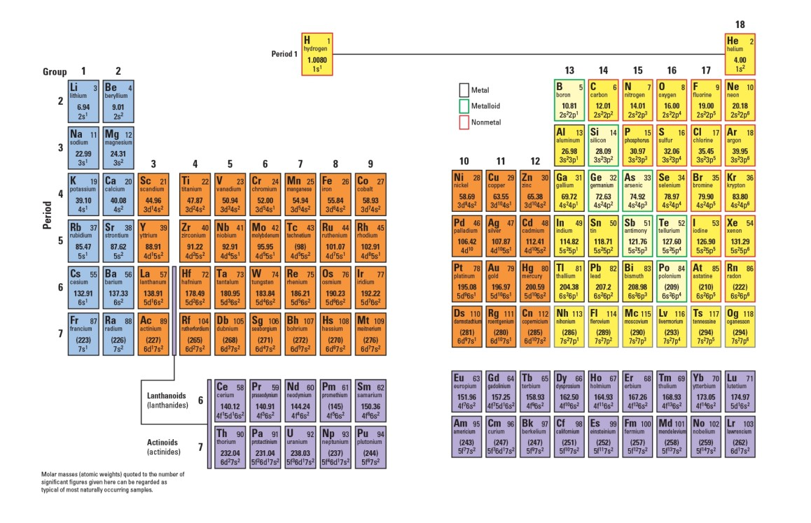{#fig-periodic-table fig-alt="Periodic table showing the chemical elements organized by increasing atomic number, with elements arranged into periods and groups" width="100%"}

## 4.1 Atoms First

Let's review two fundamental concepts from our previous chemistry lectures:

- An **atom** is the smallest unit of an element that retains the chemical properties of that element.
- An **element** is a substance that cannot be broken down into two or more simpler substances by chemical means.

**Examples of elements:**

- **Potassium (K):** Metal
- **Oxygen (O):** Nonmetal
- **Silicon (Si):** Metalloid

### Understanding Atoms: An Analogy

A useful analogy can help us visualize why an atom represents the smallest unit of an element that retains its chemical identity.

Imagine you have a collection of CDs. You can separate the collection into smaller and smaller groups until you are left with a single CD.

You could break that CD into smaller pieces, but would those pieces still be a CD?

**No.** You would have pieces of a CD that no longer function as an individual CD.

Similarly, a collection of atoms can be separated into smaller groups until only one atom remains. Although an atom contains smaller particles, separating those particles would mean it no longer retains the identity of the original element.

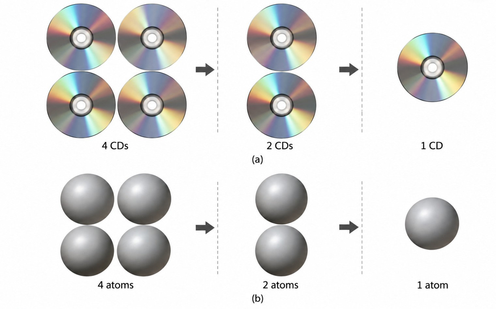{#fig-cd-atom-analogy fig-alt="Two parallel sequences showing four CDs reduced to two CDs and then one CD, and four atoms reduced to two atoms and then one atom" width="100%"}

Remember, John Dalton? Dalton said "that atoms, of which all matter consists, are tiny, indivisible particles." However, we know that atoms are divisible and made up of smaller subatomic particles.

## 4.2 Subatomic Particles and Atomic Structure

### Discovery of the Electron

In Lecture 02, we discussed how John Dalton proposed that atoms were tiny, indivisible particles. However, scientific discoveries in the late nineteenth century began to challenge this model.

In 1897, the British physicist **J. J. Thomson** investigated the behavior of cathode rays produced when a high voltage was applied between two electrodes inside a vacuum tube.

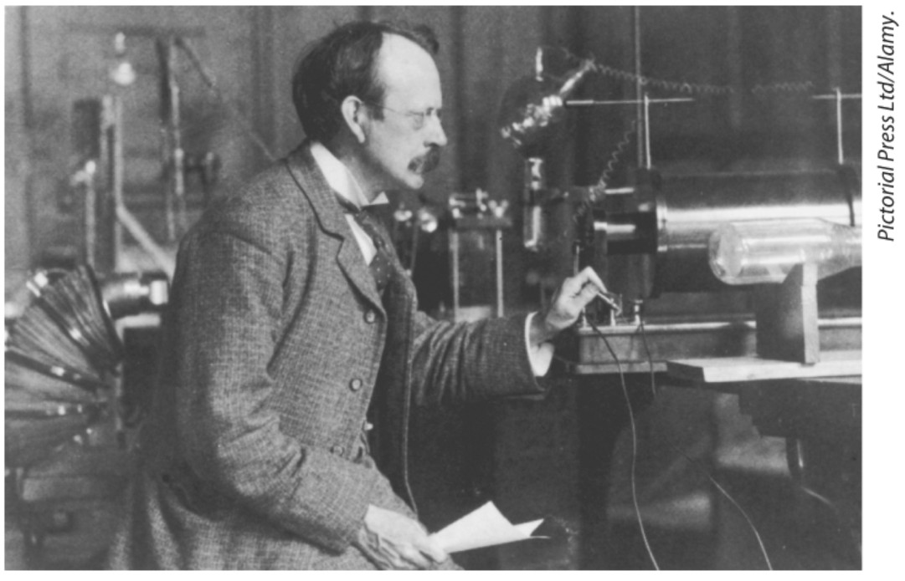{#fig-jj-thomson fig-alt="J. J. Thomson and his experimental apparatus used to investigate cathode rays" width="85%"}

The rays traveled from the negatively charged electrode, known as the **cathode**, toward the opposite end of the tube, where they could produce a visible glow on a fluorescent screen.

Thomson observed that the rays could be deflected by an electric field. From these observations, he concluded that cathode rays consisted of streams of negatively charged particles, which we now call **electrons**.

Importantly, Thomson found that these particles behaved the same way regardless of the metal used to produce them. This observation led him to conclude that electrons are part of the makeup of all atoms.

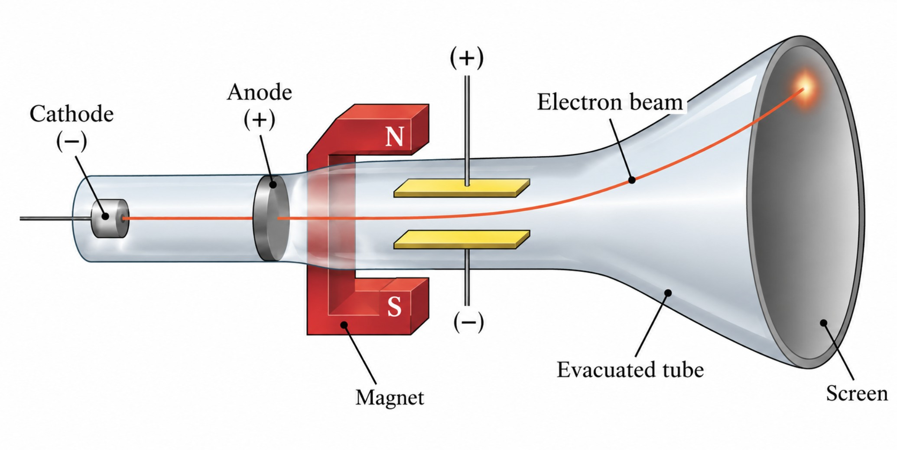{#fig-cathode-ray-tube fig-alt="Side-view schematic of an evacuated cathode-ray tube showing the cathode, anode, magnet, positively and negatively charged deflection plates, and electron beam bending toward the positive plate" width="100%"}

#### Determining the Electron's Charge and Mass

Thomson's discovery of the electron was not the result of a single observation. Instead, he conducted a series of experiments to investigate the physical properties of cathode rays.

By applying electric and magnetic fields, Thomson observed that cathode rays could be deflected from their original paths.

When an electric field was applied, the rays were attracted toward the positively charged plate and repelled by the negatively charged plate.

This provided experimental evidence that cathode rays consisted of negatively charged particles.

Thomson's experiments also demonstrated that these particles were much smaller than atoms, providing further evidence that atoms were not indivisible.

**Scientific significance:** Thomson's discovery challenged Dalton's original atomic model and established that atoms contain smaller, negatively charged particles called electrons.

### Millikan's Oil-Drop Experiment

Following Thomson's discovery of the electron, scientists understood that atoms contained negatively charged particles. However, they still did not know the magnitude of the electric charge carried by an individual electron.

In the early twentieth century, the American physicist **Robert Millikan**, working with his graduate student **Harvey Fletcher**, developed an ingenious experiment to investigate this question.

Their approach was to study the behavior of extremely small, electrically charged droplets of oil.

#### How the Experiment Worked

Millikan and Fletcher introduced tiny oil droplets into a chamber containing two electrically charged metal plates.

The droplets were affected by two opposing forces:

1.  **Gravity:** Pulled the oil droplets downward.
2.  **Electric force:** Could push the charged droplets upward or downward, depending on their electric charge and the direction of the electric field.

By adjusting the voltage between the plates, the researchers could change the electric force acting on a droplet.

For some droplets, they could adjust the electric field until the upward electric force balanced the downward pull of gravity.

When these forces were balanced, the droplet remained suspended rather than rising or falling.

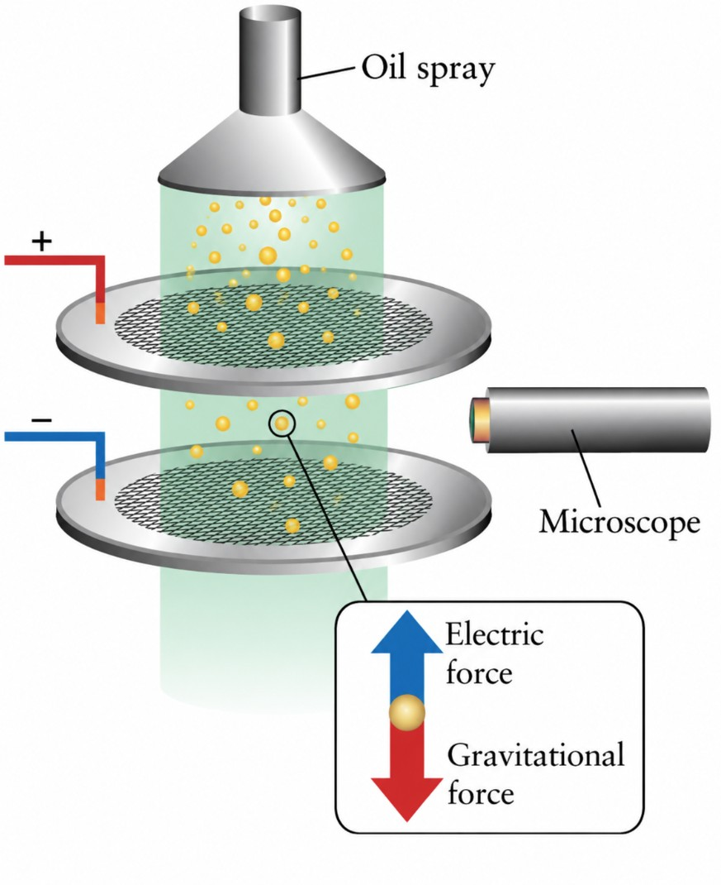{#fig-millikan-oil-drop fig-alt="Millikan oil-drop apparatus showing oil droplets released from a sprayer between two electrically charged plates, a microscope used to observe the droplets, and opposing upward electric and downward gravitational forces acting on a selected droplet" width="85%"}

#### What Did the Researchers Discover?

Millikan and Fletcher found that the charge on any particular drop was always a multiple of $-1.6022 \times 10^{-19}\ \mathrm{C}$, which they deduced was the charge on a single electron.

#### Why Was This Discovery Important?

Millikan and Fletcher's experiments combined with Thomson's allowed scientists to calculate the mass of an electron:

$$
m_e = \frac{\text{Charge}}{\text{Charge/Mass}} = \frac{-1.6022 \times 10^{-19}\ \cancel{\mathrm{C}}}{-1.76 \times 10^{8}\ \cancel{\mathrm{C}}/\mathrm{g}} = 9.10 \times 10^{-28}\ \mathrm{g}
$$

### Radioactivity

While scientists were investigating the electron, other experiments revealed that certain materials could spontaneously emit radiation.

In 1896, French physicist **Henri Becquerel** observed that uranium oxide left in a drawer with photographic plates darkened areas of the plates. From his observations he realized that uranium must give off some kind of "radiation." Also, this observation gave evidence that radiation could originate from within matter itself.

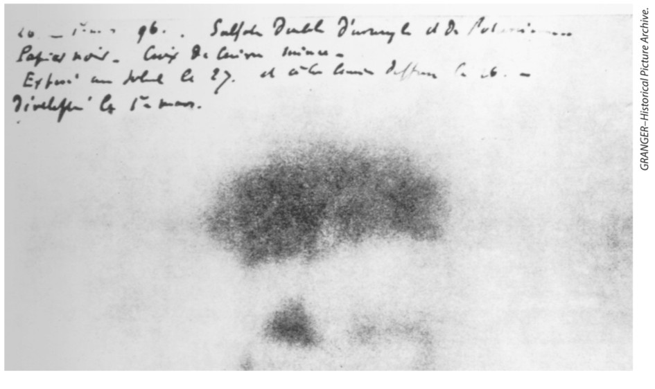{#fig-becquerel-photographic-plates fig-alt="Photographic plates showing darkened regions caused by radiation from uranium compounds during Becquerel's experiments" width="85%"}

**Marie Curie** demonstrated that the radiation emitted by uranium, which she called **radioactivity**, was independent of the chemical compound in which the uranium was found. She concluded that the source of this radiation must be the uranium atoms themselves.

{#fig-marie-curie fig-alt="Historical photograph of physicist and chemist Marie Curie" width="65%"}

Together with her husband, **Pierre Curie**, she received the Nobel Prize in Physics for their research on radiation phenomena. Their investigations also contributed to the discovery of the radioactive elements **polonium** and **radium**, while thorium was also identified as radioactive.

Marie Curie later received a second Nobel Prize, this time in Chemistry, for her discovery of radium and polonium and her research on radium.

**Key definitions:**

- **Radioactivity:** The spontaneous emission of radiation by atomic nuclei.
- **Radioactive:** Having the ability to emit ionizing radiation spontaneously.

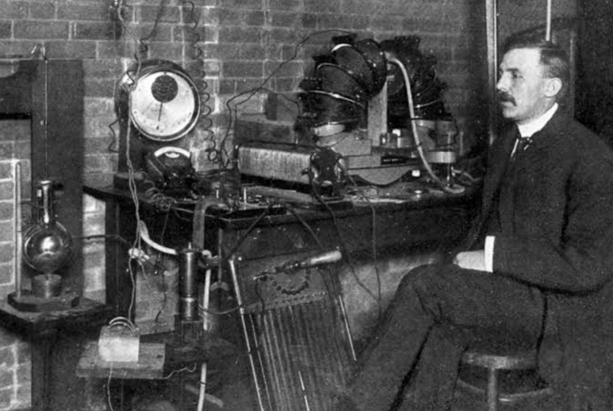{#fig-ernest-rutherford fig-alt="Historical photograph of physicist Ernest Rutherford" width="45%"}

*Photograph source: [Rincón Educativo](https://rinconeducativo.org/en/anniversaries/august-30-1871-birth-ernest-rutherford-nobel-prize-considered-one-of-the-fathers-atomic-physics/).*

Radioactivity was a mystery because the structure of the atomic nucleus was still unknown. **Ernest Rutherford** took the first steps in discovering its origin when he identified three different types of electric fields on radioactive emissions:

These emissions include:

- **Alpha particles (**$\alpha$): Positively charged particles.
- **Beta particles (**$\beta$): Charged particles, including electrons emitted from the nucleus during radioactive decay.
- **Gamma rays (**$\gamma$): High-energy electromagnetic radiation that carries no electric charge, emitted by the nuclei.

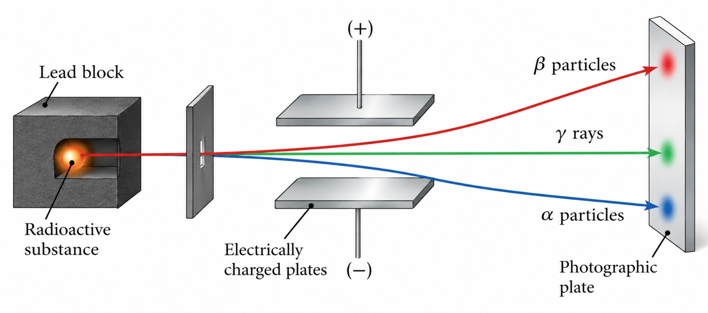{#fig-radiation-emission-types fig-alt="Beta particles (red) deflect toward the positive plate, alpha particles (blue) deflect toward the negative plate, and gamma rays (green) continue straight without deflection." width="100%"}

Because alpha and beta particles carry electric charge, their paths can be deflected by electric or magnetic fields. Gamma rays do not undergo this type of deflection because they have no electric charge.

**What can we learn about an unknown form of radiation by observing how it responds to an electric field?**

These discoveries provided additional evidence that atoms were more complex than Dalton's original model suggested.

### The Proton and the Nuclear Model of the Atom

Although Thomson demonstrated that atoms contain negatively charged electrons, another question remained:

**If atoms contain negatively charged electrons, why are atoms electrically neutral?**

Scientists reasoned that atoms must also contain positive charge to balance the negative charge of their electrons.

Thomson proposed a plum-pudding model in which negatively charged electrons were embedded within a region of distributed positive charge.

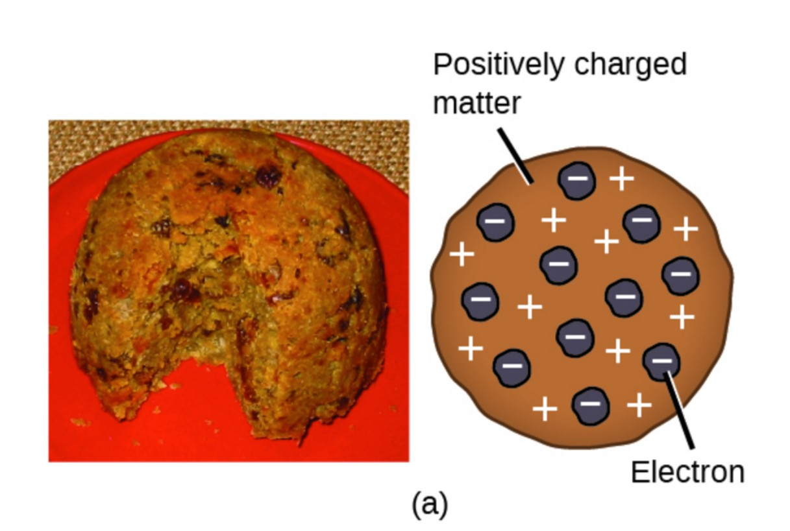{#fig-thomson-plum-pudding fig-alt="Schematic illustration of Thomson's plum-pudding atomic model, showing negatively charged electrons embedded in a uniformly distributed positive charge" width="75%"}

*Image source: [Khan Academy, Discovery of the Electron and Nucleus](https://www.khanacademy.org/science/cambridge-o-level-physics-cie/x0e04e0cb682fb793:nuclear-physics/x0e04e0cb682fb793:the-atom/a/discovery-of-the-electron-and-nucleus).*

However, subsequent experiments challenged this explanation.

#### Rutherford's Gold Foil Experiment

**Ernest Rutherford**, working with **Hans Geiger and Ernest Marsden**, investigated how positively charged alpha particles interacted with thin metal foil.

The researchers directed alpha particles toward the foil and observed their scattering using a fluorescent screen.

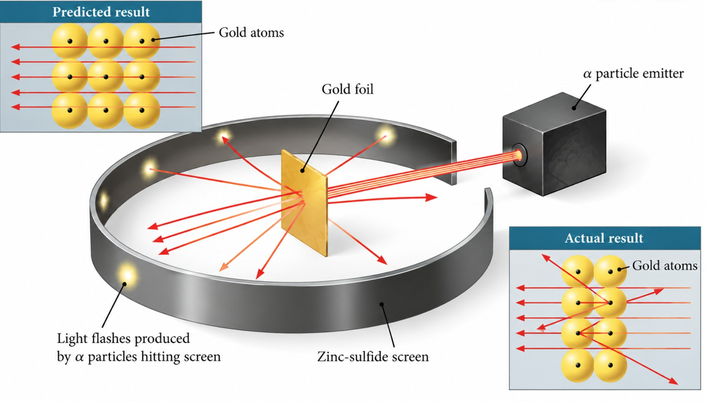{#fig-gold-foil-experiment fig-alt="Diagram of Rutherford's gold foil experiment showing an alpha particle emitter, thin gold foil, zinc-sulfide detection screen, and alpha-particle trajectories. Most particles pass through with little or no deflection, some scatter at an angle, and a small number reverse direction toward the source." width="100%"}

They made three important observations:

1.  **Most alpha particles passed through the foil** with little or no change in direction.
2.  **Some alpha particles were deflected** from their original paths.
3.  **A very small number of alpha particles experienced a large repulsive force and therefore a large deflection**, making the alpha particle traveling directly toward the nucleus completely repelled and reverse in direction.

From these observations, Rutherford concluded that most of an atom consists of relatively empty space, while its positive charge and most of its mass are concentrated in a small, dense region called the **atomic nucleus**.

This became known as the **nuclear model of the atom**.

#### From the Nucleus to the Proton

The positive charge of the nucleus is associated with particles called **protons**.

A proton carries a positive electric charge equal in magnitude to the negative charge of an electron.

In an electrically neutral atom, the number of protons equals the number of electrons.

For example, an aluminum atom has an atomic number of 13. This means its nucleus contains 13 protons. A neutral aluminum atom also contains 13 electrons.

**Scientific significance:** Rutherford's scattering experiment demonstrated that an atom's positive charge is concentrated in a small nucleus rather than distributed uniformly throughout the atom.

### The Neutron

Although Rutherford's nuclear model explained the concentration of positive charge within the nucleus, protons and electrons alone could not account for the mass of many atoms.

- It was known that hydrogen, the simplest atom, contained only one proton.
- It was also known that the helium atom contained two protons.
- Therefore, the ratio of the mass of a helium atom to that of a hydrogen atom should be 2:1 (because electrons are much lighter than protons).
- In reality, the mass ratio was approximately 4:1.

This led Rutherford and others to think that there must be another type of subatomic particle in the atomic nucleus.

In 1932, British physicist **James Chadwick** bombarded a thin sheet of beryllium with alpha particles. A very high-energy radiation was emitted by the metal that was not deflected by either electric or magnetic fields, similar to gamma rays. Later experiments showed that the radiation consisted of a third type of subatomic particle, which Chadwick named **neutrons**.

{#fig-james-chadwick fig-alt="Historical portrait of British physicist James Chadwick, who discovered the neutron in 1932" width="55%"}

*Photograph source: [Wikipedia, James Chadwick](https://en.wikipedia.org/wiki/James_Chadwick).*

The discovery of the neutron helped explain the mass of atomic nuclei.

We now understand that atoms contain three fundamental subatomic particles:

- **Protons:** Positively charged particles that determine the identity of an element.
- **Neutrons:** Electrically neutral particles that contribute to nuclear mass and influence nuclear stability.
- **Electrons:** Negatively charged particles that occupy the region surrounding the nucleus.

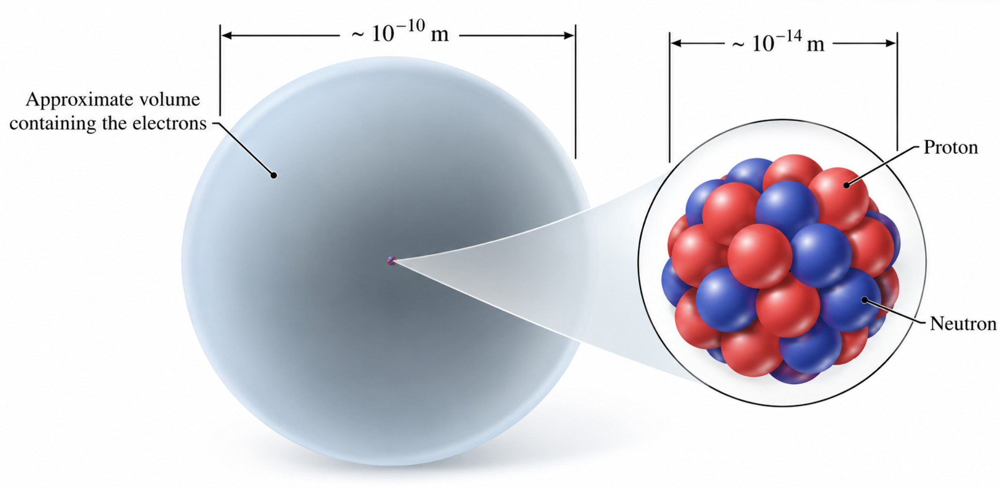{#fig-atom-nucleus-model fig-alt="Diagram comparing the approximate size of an atom, 10^-10 meters, with its nucleus, 10^-14 meters. The atom is represented by a large electron-containing region, while the enlarged nucleus shows positively charged protons and electrically neutral neutrons." width="100%"}

{#fig-dodger-stadium fig-alt="Photograph of Dodger Stadium illustrating the relative scale of an atomic nucleus and the much larger region occupied by electrons, using a fly at the center of the baseball field as an analogy." width="100%"}

*Photograph source: [Wikipedia, Dodger Stadium](https://en.wikipedia.org/wiki/Dodger_Stadium).*

**Table reference:** Chemistry: Atoms First, Table 2.1 (masses and electric charges of electrons, protons, and neutrons).

**Scientific significance:** Chadwick's discovery helped establish our modern understanding of the nucleus as a structure containing both protons and neutrons.

### Historical Development of Atomic Structure and Radioactivity

Our understanding of atomic structure developed through a series of scientific discoveries. Each discovery provided new experimental evidence that challenged earlier explanations of matter and helped scientists develop a more complete understanding of the atom.

1.  **John Dalton (Early 1800s): Atomic Theory**

    Dalton proposed that matter consists of tiny, indivisible particles called atoms. His atomic theory provided a foundation for explaining the composition and behavior of matter.

2.  **Henri Becquerel (1896): Discovery of Radioactivity**

    Becquerel observed that uranium-containing materials could darken photographic plates without exposure to light. His observations provided evidence that radiation could originate from within matter itself.

3.  **J. J. Thomson (1897): Discovery of the Electron**

    Thomson investigated cathode rays and demonstrated that they consisted of negatively charged particles called electrons. His experiments provided evidence that atoms contain smaller subatomic particles and are not indivisible.

4.  **Marie and Pierre Curie (1898 onward): Investigations of Radioactivity**

    Marie Curie demonstrated that radioactivity was associated with atoms rather than their chemical compounds. Together, Marie and Pierre Curie investigated radioactive materials and contributed to the discovery of polonium and radium.

5.  **Robert Millikan and Harvey Fletcher (Early 1900s): Measurement of the Electron's Charge**

    Through their oil-drop experiments, Millikan and Fletcher determined the magnitude of the elementary electric charge. Combined with Thomson's measurements, their findings allowed scientists to calculate the mass of an electron.

6.  **Ernest Rutherford (1911): Discovery of the Atomic Nucleus**

    Rutherford, working with Hans Geiger and Ernest Marsden, investigated the scattering of alpha particles through thin metal foil. Their observations provided evidence that most of an atom consists of relatively empty space, with its positive charge and most of its mass concentrated in a small, dense nucleus.

7.  **James Chadwick (1932): Discovery of the Neutron**

    Chadwick investigated radiation produced when beryllium was bombarded with alpha particles. His experiments provided evidence for the existence of electrically neutral particles called neutrons, helping explain the mass and composition of atomic nuclei.

**Scientific significance:** These discoveries demonstrate how scientific understanding develops through observations, experimentation, and the evaluation of evidence. Scientists were able to investigate the structure of atoms and identify subatomic particles even though they could not directly observe individual atoms.

Together, these discoveries established the foundation for our modern understanding of atomic structure, radioactivity, and nuclear chemistry.

## 4.3 Atomic Number, Mass Number, and Isotopes

All elements on the periodic table can be identified by the following:

- The **atomic number (**$Z$): the number of protons in the nucleus of each atom of an element.
- The **mass number (**$A$): the total number of neutrons *AND* protons. Often referred to *jointly* as **nucleons**.

Therefore:

$$
\text{Mass number } (A) = \text{Number of protons } (Z) + \text{Number of neutrons}
$$

or

$$
\text{Number of neutrons} = \text{Mass number } (A) - \text{Number of protons } (Z)
$$

or

$$
\text{Number of protons (Z)} = \text{Mass number } (A) - \text{Number of neutrons}
$$

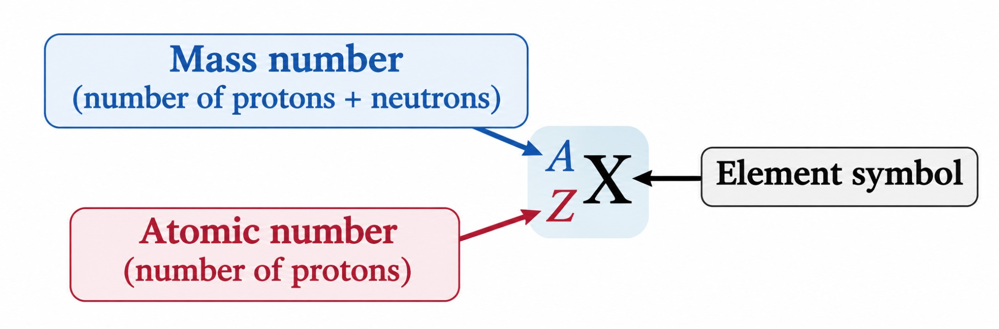{#fig-atomic-number-mass-number fig-alt="Diagram showing the element symbol X with mass number A in the upper left and atomic number Z in the lower left. The mass number represents the total number of protons and neutrons, while the atomic number represents the number of protons." width="100%"}

What do we call an atom that has the same atomic number (Z) but different mass numbers (A)?

### Isotopes

Most elements have two or more isotopes, atoms that have the same atomic number (same number of protons *and* electrons) but different number of neutrons.

How do we identify an isotope from an element?

- We write the mass number after the name of the element. Take Uranium of example:

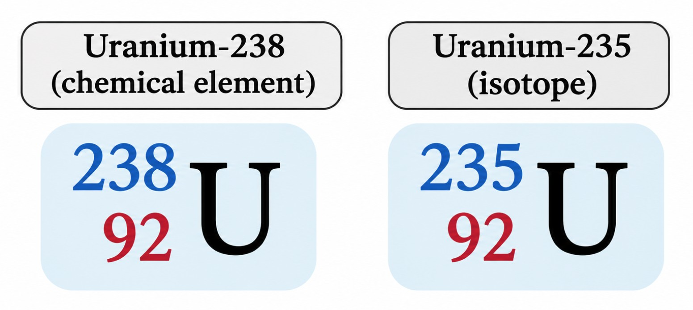{#fig-uranium-isotopes fig-alt="Side-by-side comparison of uranium-238 and uranium-235 showing the same atomic number of 92 and different mass numbers of 238 and 235." width="100%"}

The isotope Uranium-235 (U-235) has 143 neutrons in its nucleus (235-92 = 143) and is used in nuclear reactors and atomic bombs, whereas U-238 does not behave the same way in these applications.

NOTE: the chemical properties of an element are determined primarily by the number of protons and electrons in its atoms; not by the number of neutrons. Therefore, isotopes of the same element usually, not always, exhibit very similar chemical properties.

## 4.4 Introduction to Nuclear Stability

{fig-alt="Periodic table showing the chemical elements organized by increasing atomic number, with elements arranged into periods and groups" width="100%"}

The nuclei of some elements are stable, but others decay seconds after they are formed. Therefore, patterns of stability and instability of nuclei are useful to make predictions regarding nuclear decay.

The principal factor that determines whether a nucleus is stable is the *neutron-to-proton ratio (n/p)*. For atoms of elements having low atomic numbers (less than or equal to 20; calcium), the *n/p* value is close to 1. The increase in the ratio of neutrons-to-protons with increasing atomic number can be explained by considering the role of the neutrons in helping to overcome the electrical repulsion between protons. The strong force holds that protons and neutrons together in a nucleus is powerful enough to overcome the electrostatic repulsion between the protons, but it can act over only a very short distance, about the diameter of a nucleus.

Given that neutrons are uncharged, they can contribute to the strong force without adding to the electrostatic repulsion. Therefore, a lot of neutrons are needed to overcome the mutal repulsion of the protons in a nucleus of high atomic number, which explains why the band of stability curves upward.

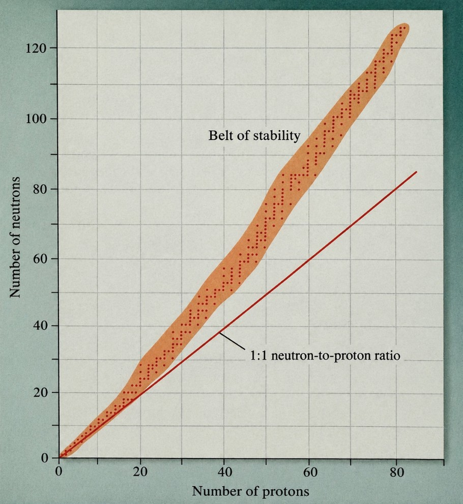{#fig-neutron-proton-stability fig-alt="Graph showing the number of protons on the horizontal axis and the number of neutrons on the vertical axis. A straight red diagonal line represents a 1:1 neutron-to-proton ratio. An orange belt of stability curves upward above the red line as atomic number increases, indicating that heavier stable nuclei require more neutrons than protons." width="100%"}

*Figure adapted from Figure 2.9, "Plot of Neutrons Versus Protons," Chapter 2: Atoms and the Periodic Table, in Chemistry: Atoms First by Julia Burdge and Jason Overby.*

General patterns:

- **magic numbers** there are more stable nuclei containing *2, 8, 20, 50, 82, and 126* protons or neutrons than there are containing other numbers of protons or neutrons.

  - Example: tin (Sn) vs. antimony (Sb):

  | Element       | atomic number | stable isotopes |
  |:--------------|--------------:|----------------:|
  | Tin (Sn)      |            50 |              10 |
  | Antimony (Sb) |            51 |               2 |

- There are more stable nuclei with even numbers of both protons and neutrons than with odd numbers of these particles.

- All isotopes of the elements with atomic numbers higher than 82 are radioactive.

  - NOTE: Bismuth Z = 83 was long thought to have a stable isotope but it was found to decay very slowly.

- All isotopes of technetium (Tc, Z = 43) and promethium (Pm, Z = 61) are radioactive.

# Part II. Nuclear Chemistry

*Primary source: Chemistry: Atoms First, 2nd ed., Chemical Principles Focus 9: Nuclear Chemistry.*

## 4.5 Nuclei and Nuclear Reactions

### Nuclei

Rutherford showed that each type of radiation is produced by **nuclear decay.** A change in the composition of a nucleus is called a **nuclear reaction.** Understand, that a specific atom with a given atomic number (Z) and mass number (A) is called a **nuclide.** For example, ${}^{1}_{1}\mathrm{H}$, ${}^{2}_{1}\mathrm{H}$, ${}^{16}_{8}\mathrm{O}$ are three different nucldies, the first two being isotopes of the same element. Nuclei that change their *structure spontaneously* and *emit radiation* are described as **radioactive.** Often the results is a nucleus of a different element.

### Understanding the Nuclear Notation

Nuclear notation identifies an element and its atomic number and mass number.

$$
{}^{A}_{Z}\mathrm{X}
$$

- **A (upper left):** Mass number, the total number of protons and neutrons.
- **Z (lower left):** Atomic number, the number of protons.
- **X (right):** Chemical symbol of the element.

**For hydrogen-1:**

$$
{}^{1}_{1}\mathrm{H}
$$

- Mass number = 1
- Atomic number = 1
- Number of protons = 1
- Number of neutrons = 1 − 1 = 0

### Understanding Nuclear Reactions

Nuclear reactions differ in some important ways from chemical reactions.

1.  Different isotopes of the same element undergo essentially the same chemical reactions but undergo very different nuclear reactions.

2.  Some nuclear reactions, such as those in which $\alpha$ or $\beta$ particles are emitted from the nucleus, leave behind a nucleus with a different number of protons and which is therefore the nucleus of an atom of a different element. The product nucleus is called a **daughter nucleus.**

    For example, when atmospheric ${}^{14}_{7}\mathrm{N}$, is convereted to ${}^{14}_{6}\mathrm{C}$ and ${}^{1}_{1}\mathrm{H}$, which results when the nitrogen isotpoe is bombarded by neutrons (from the sun), **nuclear transmuation** has taken place. This type of transmuation occurs naturally in outer space, but it can also be achieved artificially.

3.  Another important difference between nuclear and chemical reactions is that energy changes are very much greater for nuclear reactions than for chemical reactions.

    For example, the combustion of $1.0\ \mathrm{g}$ of methane produces about $52\ \mathrm{kJ}$ of energy as heat. In contrast, a nuclear reaction of $1.0\ \mathrm{g}$ of uranium-235 produces about $8.2 \times 10^{7}\ \mathrm{kJ}$ of energy, more than a million times as much.

    To put that energy into perspective:

    - A moving baseball: A 250-gram baseball thrown or hit at roughly 20 meters per second (45 mph) carries about 50 joules of kinetic energy.
    - Walking/Climbing: Walking up a flight of stairs (roughly 10 to 12 steps) uses around 2 to 4 kilojoules depending on your body weight.

| Chemical Reactions | Nuclear Reactions |
|:-----------------------------------|:----------------------------------|
| 1\. Atoms are rearranged by the breaking and forming of chemical bonds. | 1\. Elements are converted to other elements (or isotopes). |
| 2\. Only electrons in atomic or molecular orbitals are involved in the reaction. | 2\. Protons, neutrons, electrons, and other subatomic particles such as $\alpha$ particles may be involved. |
| 3\. Reactions are accompanied by the absorption or release of relatively small amounts of energy. | 3\. Reactions are accompanied by the absorption or release of tremendous amounts of energy. |
| 4\. Rates of reaction are influenced by temperature, pressure, concentration, and catalysts. | 4\. Rates of reaction normally are not affected by temperature, pressure, or catalysts. |

: Comparison of Chemical Reactions and Nuclear Reactions

*Source: Burdge, J., & Overby, J. (2018). Chemistry: Atoms First (2nd ed.), Chapter 20, Table 20.1, "Comparison of Chemical Reactions and Nuclear Reactions."*

### Key Definitions

- **nuclear decay:** the partial breakup of a nucleus
- **nuclear reaction:** a change that a nucleus undergoes
- **nuclide:** An atom of specified atomic number and mass number. *Examples* ${}^{1}_{1}\mathrm{H}$, ${}^{16}_{8}\mathrm{O}$
- **radioactive:** A nucleus is radioactive if it can change its structure spontaneously and emit radiation.
- **daughter nucleus:** a nucleus that is the produce of a nuclear decay.
- **nuclear transmutation:** The conversion of one element into another.

------------------------------------------------------------------------

### Types of Nuclear Radiation

Rutherford identified three common types of nuclear radiation: alpha ($\alpha$) particles, beta ($\beta$) particles, and gamma ($\gamma$) rays. Each differs in its physical characteristics, electric charge, and degree of penetration.

#### Alpha Particles ($\alpha$)

**Alpha-particle radiation:** ${}^{4}_{2}\alpha$ is positively charged and can be thought of as a tightly bound cluster of two protons and two neutrons. An alpha particle is also often referred to as a helium nucleus: ${}^{4}_{2}\mathrm{He}$.

When a nucleus emits an alpha particle, its **atomic number decreases by two** and its **mass number decreases by four.**

When a nucleus emits an alpha particle, its **atomic number decreases by two** and its **mass number decreases by four**.

We can represent this transformation using a **nuclear equation**, which shows how an unstable nucleus changes into a different nucleus while emitting radiation.

For example, when polonium-212 undergoes alpha decay:

$$
{}^{212}_{84}\mathrm{Po}
\;\longrightarrow\;
{}^{4}_{2}\alpha
\;+\;
{}^{208}_{82}\mathrm{Pb}
$$

In this nuclear equation:

- **Parent nucleus:** Polonium-212 (${}^{212}_{84}\mathrm{Po}$)
- **Emitted particle:** Alpha particle (${}^{4}_{2}\alpha$)
- **Daughter nucleus:** Lead-208 (${}^{208}_{82}\mathrm{Pb}$)

The atomic number decreases from 84 to 82, while the mass number decreases from 212 to 208.

**Degree of penetration:** Alpha particles have very limited penetration. They can travel only a short distance through air (*\~4 inches from their source*) and can be stopped by a sheet of paper or the outer layer of skin.

Although alpha particles generally present a limited external radiation hazard, radioactive material that emits alpha particles can be particularly damaging if it enters the body through inhalation, ingestion, or wounds.

*Source: Bevelacqua, A. S., & Norman, L. A. Hazardous Materials Chemistry (3rd ed.). Jones & Bartlett Learning, Chapter 3, "Alpha Particles."*

#### Beta Particles ($\beta$)

**Beta-particle radiation:** ${}^{0}_{-1}\beta$ is negatively charged, and by measuring the charge and mass of these particles, Rutherford showed that they are electrons. Given that a beta particle has no protons or neutrons, its mass number is 0 and can be written as ${}^{0}_{-1}\mathrm{e}$.

Beta particles are high-speed electrons emitted during nuclear transformations.

During negative beta decay ($\beta^{-}$), **a neutron** in the nucleus is **converted into a proton**, and an **electron is emitted**. **The atomic number increases by one**, while **the mass number remains unchanged**.

We can represent this transformation using the following nuclear equation:

$$
{}^{1}_{0}\mathrm{n}
\;\longrightarrow\;
{}^{1}_{1}\mathrm{p}
\;+\;
{}^{0}_{-1}\mathrm{e}
$$

When a nucleus emits a beta particle ($\beta^{-}$), its **atomic number increases by one** while its **mass number remains unchanged**.

We can represent this transformation using a **nuclear equation**, which shows how an unstable nucleus changes into a different nucleus while emitting radiation.

For example, when strontium-90 undergoes beta-minus decay:

$$
{}^{90}_{38}\mathrm{Sr}
\;\longrightarrow\;
{}^{0}_{-1}\beta
\;+\;
{}^{90}_{39}\mathrm{Y}
$$

In this nuclear equation:

- **Parent nucleus:** Strontium-90 (${}^{90}_{38}\mathrm{Sr}$)
- **Emitted particle:** Beta particle (${}^{0}_{-1}\beta$)
- **Daughter nucleus:** Yttrium-90 (${}^{90}_{39}\mathrm{Y}$)

The atomic number increases from 38 to 39, while the mass number remains 90.

**Degree of penetration:** Beta particles are moderately penetrating. They generally travel farther through air than alpha particles (*\~1 to 20 feet from their source*) and can penetrate the outer layers of skin.

Beta radiation can be shielded using suitable materials, including plastic or thin sheets of metal. The choice of shielding material depends on the energy of the beta particles.

*Source: Bevelacqua, A. S., & Norman, L. A. Hazardous Materials Chemistry (3rd ed.). Jones & Bartlett Learning, Chapter 3, "Beta Particles."*

#### Gamma Radiation ($\gamma$)

**Gamma radiation:** Gamma rays ($\gamma$) are high-energy photons of electromagnetic radiation emitted when an excited atomic nucleus moves to a lower-energy state.

Unlike alpha and beta-minus decay, **gamma emission does not change the atomic number or mass number**. The nucleus loses energy, but its number of protons and neutrons remains unchanged.

We can represent this transformation using a **nuclear equation**, which shows how an excited nucleus releases excess energy.

For example, when technetium-99m undergoes an isomeric transition:

$$
{}^{99m}_{43}\mathrm{Tc}
\;\longrightarrow\;
{}^{0}_{0}\gamma
\;+\;
{}^{99}_{43}\mathrm{Tc}
$$

In this nuclear equation:

- **Parent nucleus:** Technetium-99m (${}^{99m}_{43}\mathrm{Tc}$)
- **Emitted radiation:** Gamma-ray photon (${}^{0}_{0}\gamma$)
- **Daughter nucleus:** Technetium-99 (${}^{99}_{43}\mathrm{Tc}$)

The superscript **m** means *metastable*: technetium-99m is in an excited nuclear state. Gamma emission moves the nucleus to a lower-energy state. The atomic number remains **43**, and the mass number remains **99**. Technetium-99 is itself radioactive, so gamma emission does not necessarily produce a stable nucleus.

**Degree of penetration:** Gamma radiation is highly penetrating compared with alpha and beta particles. Its penetration depends on photon energy and the shielding material. Lead or concrete can reduce gamma radiation intensity, but shielding does not necessarily stop every photon.

Because gamma photons can penetrate tissue, gamma-emitting sources may present an **external radiation exposure hazard**. Technetium-99m is also used in diagnostic nuclear medicine because its emitted photons can be detected by specialized imaging equipment.

*Sources: Bevelacqua, A. S., & Norman, L. A. Hazardous Materials Chemistry (3rd ed.), Chapter 3, "Gamma Radiation"; Burdge, J., & Overby, J. Chemistry: Atoms First (2nd ed.), Chapter 20.*

#### Other Nuclear Particles and Processes

Since Rutherford's work, scientists have identified other types of nuclear radiation. Some consist of rapidly moving particles, such as neutrons or protons. A proton can also be referred to as a hydrogen-1 nucleus, represented by ${}^{1}_{1}\mathrm{H}$ or ${}^{1}_{1}\mathrm{p}$.

Others consist of rapidly moving **antiparticles**, particles with a mass equal to that of one of the subatomic particles but with an opposite charge.

For example, the **positron** has the same mass as an electron but a positive charge. It is denoted by $\beta^{+}$ or ${}^{0}_{+1}\mathrm{e}$.

When an antiparticle encounters its corresponding particle, both particles are annihilated and completely converted into energy.

In **electron capture**, an electron in an atomic orbital is captured by the nucleus, and a proton is converted into a neutron.

#### Comparison of Nuclear Radiation

The following table summarizes the properties of particles commonly found in nuclear radiation.

| Type | Particle | Mass Number | Charge | Degree of Penetration |
|:------------|:------------|:-----------:|:-----------:|:--------------------|
| Alpha ($\alpha$) | Helium-4 nucleus, ${}^{4}_{2}\alpha$ | 4 | +2 | Low; stopped by paper or outer skin |
| Beta ($\beta^{-}$) | Electron, ${}^{0}_{-1}\mathrm{e}$ | 0 | −1 | Moderate; can penetrate skin |
| **Gamma (**$\gamma$) | **Photon,** $\gamma$ | **0** | **0** | **Very penetrating** |
| Positron ($\beta^{+}$) | Antielectron, ${}^{0}_{+1}\mathrm{e}$ | 0 | +1 | Moderately penetrating |
| Proton ($\mathrm{p}$) | Hydrogen-1 nucleus, ${}^{1}_{1}\mathrm{H}$ or ${}^{1}_{1}\mathrm{p}$ | 1 | +1 | Moderate or low penetration |
| **Neutron (**$\mathrm{n}$) | **Neutron,** ${}^{1}_{0}\mathrm{n}$ | **1** | **0** | **Very penetrating** |

: Comparison of Common Types of Nuclear Radiation

*Source: Adapted from Atkins, Jones, Laverman, Patterson, and Young, Chemical Principles (8th ed.), Focus 9: Nuclear Chemistry, Table 9A.1, "Nuclear Radiation."*

{#fig-radiation-penetration fig-alt="Illustration comparing the penetrating ability of different types of nuclear radiation through shielding materials" width="100%"}

##### Why Are Gamma Rays and Neutrons So Penetrating?

Both gamma rays and neutrons carry **no electric charge**. Unlike charged particles, they are not directly attracted or repelled by the electric fields of atoms.

However, gamma rays and neutrons interact with matter in different ways:

- **Gamma rays (**$\gamma$): Gamma rays are high-energy electromagnetic photons that interact with electrons and under certain conditions, atomic nuclei. Their lack of electric charge allows them to travel considerable distances through matter before an interaction occurs.

- **Neutrons (**$\mathrm{n}$): Neutrons are electrically neutral particles that interact primarily with atomic nuclei. Without an electric charge, neutrons are not subject to electrostatic attraction or repulsion and may travel considerable distances through matter before undergoing a nuclear interaction.

These differences are important when selecting materials to shield workers and the public from radiation exposure.

- **Gamma radiation:** Dense materials, such as lead and concrete, are commonly used to reduce exposure to gamma radiation.

- **Neutron radiation:** Hydrogen-rich materials, such as water and polyethylene, are particularly effective at slowing down fast neutrons. Additional shielding materials may be necessary to absorb neutrons and reduce secondary radiation produced during nuclear interactions.

**Important:** No shielding material completely stops all radiation under every condition. The effectiveness of shielding depends on the type and energy of the radiation, as well as the thickness and composition of the shielding material.

#### Ionization and Ionizing Radiation

In our earlier discussion of atomic structure, we established that electrons occupy the region surrounding the atomic nucleus.

When radiation interacts with matter, energy can be transferred to the electrons within an atom. If sufficient energy is transferred, an electron may be removed from the atom entirely.

This process is called **ionization**.

The atom that loses an electron becomes a positively charged **ion**, while the electron that was removed carries a negative charge.

Radiation that has sufficient energy to remove electrons from atoms or molecules is called **ionizing radiation**.

The process of ionization depends on how radiation interacts with matter. Charged particles, such as alpha and beta particles, can produce ionization directly through their interactions with electrons. Gamma rays can produce ionization through interactions that transfer energy to electrons, while neutrons produce ionization indirectly through the charged particles and other radiation generated during nuclear interactions.

##### Connecting Ionization to Our Nuclear Radiation Examples

Earlier in this lecture, we examined several examples of nuclear decay and radiation emission. We can now use those examples to understand how radiation may produce ionization when it encounters matter.

- **Alpha radiation (**$\alpha$): When polonium-212 (${}^{212}_{84}\mathrm{Po}$) undergoes alpha decay, it emits an alpha particle (${}^{4}_{2}\alpha$). Because alpha particles carry a positive charge of +2, they can interact strongly with electrons in surrounding atoms and produce ionization. Although alpha particles have limited penetration, they can cause substantial ionization over a short distance.

- **Beta radiation (**$\beta^{-}$): When strontium-90 (${}^{90}_{38}\mathrm{Sr}$) undergoes beta-minus decay, it emits a high-speed electron (${}^{0}_{-1}\mathrm{e}$). As this electron travels through matter, it can transfer energy to electrons in other atoms, producing ionization.

- **Gamma radiation (**$\gamma$): When technetium-99m (${}^{99m}_{43}\mathrm{Tc}$) transitions to a lower-energy nuclear state, it releases energy in the form of gamma radiation. Gamma rays carry no electric charge, but they can transfer energy to electrons through interactions with matter, producing ionization. Their penetrating ability allows them to affect tissues deeper within the body.

- **Neutron radiation (**$\mathrm{n}$): Neutrons (${}^{1}_{0}\mathrm{n}$) carry no electric charge and therefore do not directly ionize atoms through electrostatic interactions. Instead, neutrons interact primarily with atomic nuclei. These interactions can produce energetic charged particles or secondary radiation that subsequently cause ionization.

##### Ionization and Biological Injury

**Ionization** can initiate chemical changes in living tissue. Radiation may damage a biological molecule **directly** by depositing energy in it, or **indirectly** by ionizing nearby molecules, including water, and producing reactive chemical species that subsequently interact with cellular structures.

**Free radicals** are atoms or molecules with an unpaired electron; some are highly reactive. Radiation-induced chemical reactions may damage proteins, cell membranes, and **DNA**, the molecule that stores genetic information.

Not every ionization event causes lasting injury. Cells have mechanisms that can repair some damage. However, injury may occur when damage is extensive, occurs in a sensitive location, or is not repaired correctly.

**Connecting the chemistry to health:** Nuclear decay produces radiation; radiation transfers energy to matter; ionization can initiate chemical reactions; and some of those reactions can damage cells and tissues.

##### Biological Effects of Radiation

The effects of ionizing radiation depend on **absorbed dose**, **dose rate**, radiation type, the tissues exposed, and whether exposure is external or results from radioactive material entering the body.

Two broad categories help us interpret potential health effects:

- **Tissue reactions (deterministic effects):** These generally occur only after a sufficient dose has been delivered to a tissue. Above that threshold, the severity of injury tends to increase with dose. Examples at sufficiently high doses include skin injury and radiation sickness.
- **Stochastic effects:** These are effects for which the *probability* of occurrence, rather than severity, is modeled as increasing with dose. Radiation-induced cancer is the principal example considered in radiation protection. A particular exposure does **not** mean that cancer will necessarily occur.

**External exposure** occurs when radiation reaches a person from a source outside the body. **Internal contamination** occurs when radioactive material enters the body, for example through inhalation, ingestion, or an open wound. A person can be exposed to radiation without becoming contaminated.

These distinctions explain why **alpha-emitting materials**, despite having low external penetration, may pose a serious hazard when taken into the body, while **penetrating gamma radiation** can pose a significant external exposure hazard.

*Source guidance: Cember, H., & Johnson, T. E. Introduction to Health Physics (4th ed.); Burdge, J., & Overby, J. Chemistry: Atoms First (2nd ed.), Chapter 20, “Biological Effects of Radiation.” Specific dose-response thresholds are intentionally not assigned here.*

## Radioactive Half-Life: How Radiation Hazards Change Over Time

Alpha, beta, and gamma radiation describe **what is emitted** during nuclear transformations. Half-life answers a different question: **how does the amount of radioactive material change over time?**

### What Is Physical Half-Life?

**Physical half-life (**$H$): The time required for half of the radioactive nuclei in a large sample to undergo decay. Each radionuclide has a characteristic half-life. For technetium-99m, the physical half-life is approximately **6 hours**.

{#fig-half-life-tc-99m fig-alt="Technetium-99m decay infographic showing 100 percent initially, 50 percent after six hours, 25 percent after twelve hours, 12.5 percent after eighteen hours, and 6.25 percent after twenty-four hours." width="85%"}

After one half-life, **50%** remains; after two, **25%** remains; after three, **12.5%** remains. The **fraction** decreases by half each interval, not the same absolute quantity.

### Why Does Half-Life Matter for Safety and Health?

Half-life helps us estimate **(1)** how much activity remains, **(2)** how much time has elapsed, **(3)** how long it may take to reach a specified activity level, and **(4)** which precautions and measurements are needed to make informed safety decisions.

**Important distinction:** A sample does **not** become completely stable after a fixed number of half-lives. Some radioactive nuclei remain, and daughter products may also be radioactive. Reaching a calculated activity does not, by itself, establish that handling, entry, or disposal is safe.

### Activity and Its Units

**Activity (**$A$) is the rate of nuclear transformations. Its SI unit is the **becquerel (Bq)**:

$$
1\ \mathrm{Bq}=1\ \text{nuclear transformation per second}
$$

A megabecquerel (MBq) equals one million becquerels. For a single radionuclide, activity decreases in the same proportion as the number of undecayed nuclei.

### Calculating Activity Remaining

Suppose a technetium-99m sample begins with **800 MBq** of activity:

| Time elapsed | Half-lives elapsed | Activity remaining |
|:-------------|-------------------:|-------------------:|
| 0 hours      |                  0 |            800 MBq |
| 6 hours      |                  1 |            400 MBq |
| 12 hours     |                  2 |            200 MBq |
| 18 hours     |                  3 |            100 MBq |
| 24 hours     |                  4 |             50 MBq |

: Technetium-99m Activity Over Four Half-Lives

The same pattern can be calculated using:

$$
\boxed{A=A_0\left(\frac{1}{2}\right)^{t/H}}
$$

Where:

- $A$: Activity remaining, in Bq or MBq.
- $A_0$: Initial activity, in the same units as $A$.
- $t$: Elapsed time, in hours, days, or another time unit.
- $H$: Physical half-life, in the **same time unit** as $t$.
- $t/H$: Number of half-lives elapsed; the time units cancel.

The exponent tells us how many times the activity is halved.

### Worked Example: How Much Remains After 18 Hours?

**Problem:** A sample initially contains 800 MBq of technetium-99m. Its half-life is 6 hours. How much activity remains after 18 hours?

**Step 1. Identify known values:** $A_0=800\ \mathrm{MBq}$, $t=18\ \mathrm{h}$, and $H=6\ \mathrm{h}$.

**Step 2. Calculate the number of half-lives:**

$$
\frac{t}{H}=\frac{18\ \mathrm{h}}{6\ \mathrm{h}}=3
$$

**Step 3. Substitute into the equation:**

$$
A=800\ \mathrm{MBq}\left(\frac12\right)^3
=800\ \mathrm{MBq}\times\frac18
$$

$$
\boxed{A=100\ \mathrm{MBq}}
$$

**Step 4. Check:** $800\rightarrow400\rightarrow200\rightarrow100\ \mathrm{MBq}$. Three half-lives have elapsed, so one-eighth of the initial activity remains.

### Worked Example: How Much Time Must Pass?

**Problem:** How long must the same sample decay to decrease from 800 MBq to **50 MBq**?

Count the halvings: $800\rightarrow400\rightarrow200\rightarrow100\rightarrow50$. This takes **four half-lives**.

$$
t=4\times6\ \mathrm{h}=\boxed{24\ \mathrm{h}}
$$

**Safety interpretation:** We can predict that activity will be approximately 50 MBq after 24 hours, but **50 MBq is not automatically a safe level**. Radiation type and energy, distance, shielding, contamination pathways, dose rate, and applicable requirements all matter. Confirm conditions with appropriate measurements and radiation safety procedures.

*Sources: Burdge, J., & Overby, J. Chemistry: Atoms First (2nd ed.), Chapter 20; Cember, H., & Johnson, T. E. Introduction to Health Physics (4th ed.).*

## 4.6 Radiation Penetration and Shielding

We have already compared the penetrating ability of alpha, beta, gamma, and neutron radiation. **Penetration** describes how readily radiation passes through matter; **shielding** uses appropriately selected material to reduce the amount of radiation reaching a person or area.

| Radiation | Primary shielding consideration | Hazard-management connection |
|:-----------------------|:-----------------------|:-----------------------|
| Alpha ($\alpha$) | Paper, clothing, or the outer layer of intact skin can stop many alpha particles | Prevent inhalation, ingestion, and contamination of wounds |
| Beta ($\beta^{-}$) | Low-atomic-number materials such as plastic are often preferred for energetic beta radiation | Evaluate skin and eye exposure; high-energy beta shielding can generate bremsstrahlung X-rays |
| Gamma ($\gamma$) | Dense materials such as lead or sufficient thicknesses of concrete | Evaluate penetrating external exposure and the thickness of shielding |
| Neutron ($\mathrm{n}$) | Hydrogen-rich materials such as water or polyethylene can slow fast neutrons; absorbers may be needed | Consider secondary gamma radiation and the energy of the neutrons |

: Practical Radiation Penetration and Shielding Considerations

**Important:** Shielding generally **reduces** radiation intensity; it does not guarantee that every particle or photon is stopped. Shielding effectiveness depends on radiation energy, material composition, thickness, and exposure geometry.

### Principles of Radiation Protection

Three foundational controls for **external radiation exposure** are:

1.  **Time:** Reduce the time spent in an area with an elevated radiation field.
2.  **Distance:** Increase separation from the source when practical.
3.  **Shielding:** Place suitable material between the source and the person.

**Contamination control** is a related but distinct concern. When radioactive material may be dispersed, responders must also consider containment, preventing material from entering the body, appropriate protective equipment, and monitoring for contamination.

For a point-like source under suitable conditions, radiation intensity decreases approximately with the square of distance. Actual incident conditions may differ because sources are not always point-like and shielding or scattering may affect measurements.

**HazMat application:** Before choosing a control, determine what type of radiation or radioactive material is present, how exposure could occur, and whether the principal concern is external irradiation, contamination, or both. Incident-specific monitoring and qualified radiation safety guidance remain essential.

*Source guidance: Bevelacqua, A. S., & Norman, L. A. Hazardous Materials Chemistry (3rd ed.), radiation chapter; Cember, H., & Johnson, T. E. Introduction to Health Physics (4th ed.).*

## 4.7 Understanding Radioactivity and Radiation Absorbed Dose

The terms **radioactivity**, **activity**, **exposure**, and **dose** are related, but they do not mean the same thing.

### Activity: How Often Nuclei Decay

**Activity** describes the number of nuclear transformations occurring in a radioactive source per unit time.

- **Becquerel (Bq):** One nuclear decay per second ($1\ \mathrm{Bq}=1\ \mathrm{s}^{-1}$).
- **Curie (Ci):** A historical unit of activity; $1\ \mathrm{Ci}=3.7\times10^{10}\ \mathrm{Bq}$.

A source with greater activity undergoes more nuclear transformations per second, but **activity alone does not tell us the dose received by a person**.

### Absorbed Dose: Energy Deposited in Matter

**Absorbed dose** is the energy deposited by ionizing radiation per unit mass of material.

$$
D=\frac{E_{\mathrm{absorbed}}}{m}
$$

Where:

- $D$ is the **absorbed dose**.
- $E_{\mathrm{absorbed}}$ is the energy deposited in the material.
- $m$ is the mass of the material receiving that energy.

The SI unit of absorbed dose is the **gray (Gy)**:

$$
1\ \mathrm{Gy}=1\ \mathrm{J/kg}
$$

The **rad** is an older unit: $1\ \mathrm{Gy}=100\ \mathrm{rad}$.

### Biological Weighting: Equivalent and Effective Dose

Absorbed dose alone does not fully describe the potential biological impact of radiation. Different radiation types can produce different biological effects for the same absorbed dose.

- **Equivalent dose** accounts for radiation type through a radiation weighting factor.
- **Effective dose** additionally accounts for the differing sensitivities of organs and tissues; it is used in radiation protection to compare and manage overall risk, not to predict an individual person's outcome.

Both quantities are expressed in **sieverts (Sv)** in the SI system. The **rem** is an older unit: $1\ \mathrm{Sv}=100\ \mathrm{rem}$.

| Quantity | What it describes | SI unit |
|:-----------------------|:-----------------------|:-----------------------|
| Activity | Nuclear transformations per second | Becquerel (Bq) |
| Absorbed dose | Energy deposited per unit mass | Gray (Gy) |
| Equivalent dose | Absorbed dose weighted for radiation type | Sievert (Sv) |
| Effective dose | Weighted estimate accounting for radiation type and tissue sensitivity | Sievert (Sv) |

: Distinguishing Radioactivity and Radiation Dose

**Example:** Two radioactive sources may have the same activity but produce different doses to a worker because they emit different radiation, are at different distances, or are separated from the worker by different shielding materials.

### Dose Rate and Stay Time

**Dose rate** describes how quickly dose accumulates, commonly expressed in units such as $\mathrm{mSv/h}$ or $\mathrm{mGy/h}$. For an approximately constant dose rate, a simple planning relationship is:

$$
\text{Time}=\frac{\text{Allowable dose}}{\text{Dose rate}}
$$

This relationship requires consistent units and assumes the dose rate remains constant. It is **not** an authorization to enter or remain in a hazardous area; response limits and decisions must follow applicable procedures and qualified direction.

*Source guidance: Burdge, J., & Overby, J. Chemistry: Atoms First (2nd ed.), Chapter 20; Cember, H., & Johnson, T. E. Introduction to Health Physics (4th ed.); Bevelacqua, A. S., & Norman, L. A. Hazardous Materials Chemistry (3rd ed.).*

## 4.8 Returning to Nuclear Stability

Earlier, we introduced the **neutron-to-proton ratio** and the **belt of nuclear stability**. We can now return to that model with a practical question: **Why do different unstable nuclei emit different types of radiation?**

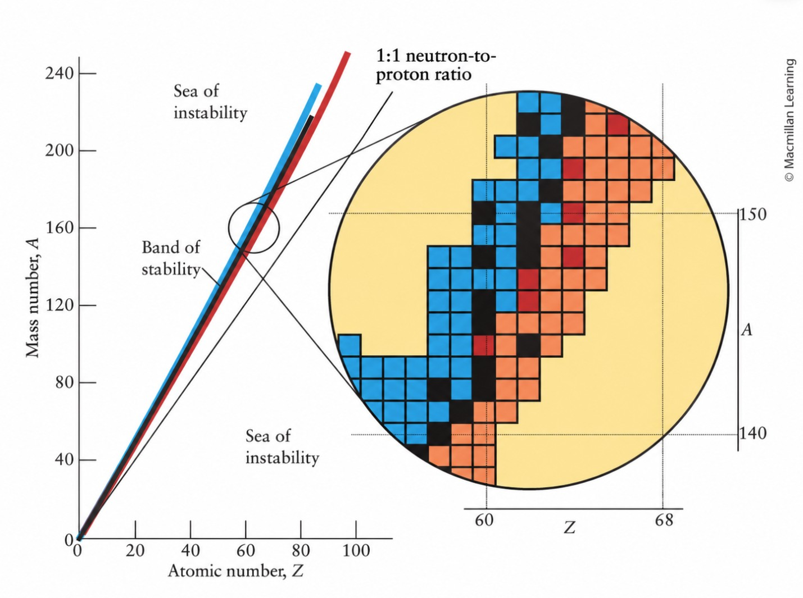{#fig-nuclear-stability fig-alt="Graph illustrating the band of nuclear stability and regions of nuclear instability" width="100%"}

### Predicting Common Nuclear Transformations

- **Neutron-rich nuclei** may undergo **beta-minus decay**, converting a neutron to a proton. We saw this with strontium-90 (${}^{90}_{38}\mathrm{Sr}$).
- **Proton-rich nuclei** may undergo **positron emission** or **electron capture**, converting a proton to a neutron. We saw electron capture in the iodine-125 (${}^{125}_{53}\mathrm{I}$) example.
- **Very heavy nuclei** may undergo **alpha decay**, reducing both their proton number and mass number. We saw this with polonium-212 (${}^{212}_{84}\mathrm{Po}$).
- An **excited nucleus** may release energy by **gamma emission** without changing its proton or neutron count. We saw this with technetium-99m (${}^{99m}_{43}\mathrm{Tc}$).

These are **general patterns**, not a rule that uniquely predicts the decay of every isotope. Nuclear energy levels and other factors determine which transformations are possible.

### Nuclear Binding Energy

The **strong nuclear interaction** helps hold protons and neutrons together in the nucleus despite the electrical repulsion between positively charged protons.

**Nuclear binding energy** is the energy required to separate a nucleus into its individual protons and neutrons. A related concept, **mass defect**, is the difference between the mass of a bound nucleus and the combined masses of its separated nucleons. Mass and energy are related through Einstein's equation:

$$
E=mc^2
$$

Where $E$ is energy, $m$ is mass, and $c$ is the speed of light in a vacuum. We introduce this relationship conceptually here; detailed binding-energy calculations are beyond the scope of this lecture.

*Source: Burdge, J., & Overby, J. Chemistry: Atoms First (2nd ed.), Chapter 20, “Nuclear Stability” and “Nuclear Binding Energy.”*

## Radiation Detection Instruments: Ionization Chambers and Survey Probes

Knowing the radioactive half-life helps us **predict** how activity changes. Radiation instruments help us **measure** conditions at the scene. Instrument selection depends on radiation type, energy, measurement purpose, and calibration.

### Ionization Chambers

An **ionization chamber** contains a gas and electrodes. Ionizing radiation produces positive ions and electrons in the gas; an applied electric field collects these charges and generates a measurable signal. Ionization chambers are commonly used to measure exposure or dose rate when properly calibrated for the radiation field.

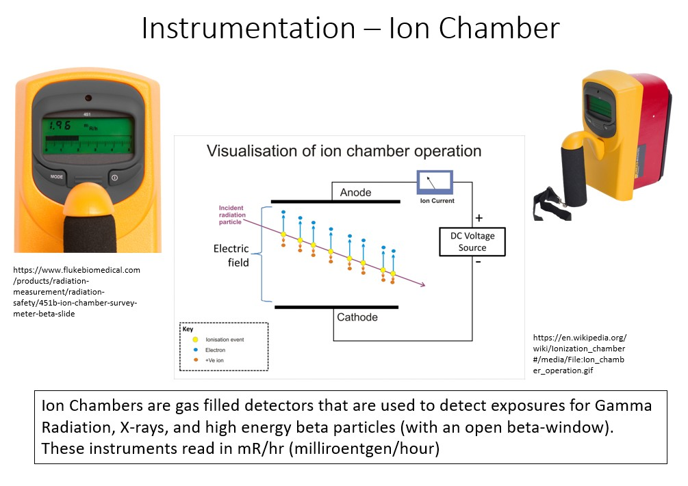{#fig-ion-chamber fig-alt="Training illustration of an ionization chamber radiation measurement instrument." width="85%"}

*Source: NASA Armstrong Flight Research Center, Ionizing Radiation Safety Training.*

### Radiation Survey Probes

A **survey probe** is a detector connected to an instrument that displays the response. Different probes are designed for different radiation types and measurement tasks. A probe appropriate for beta contamination may not be appropriate for measuring a gamma dose rate.

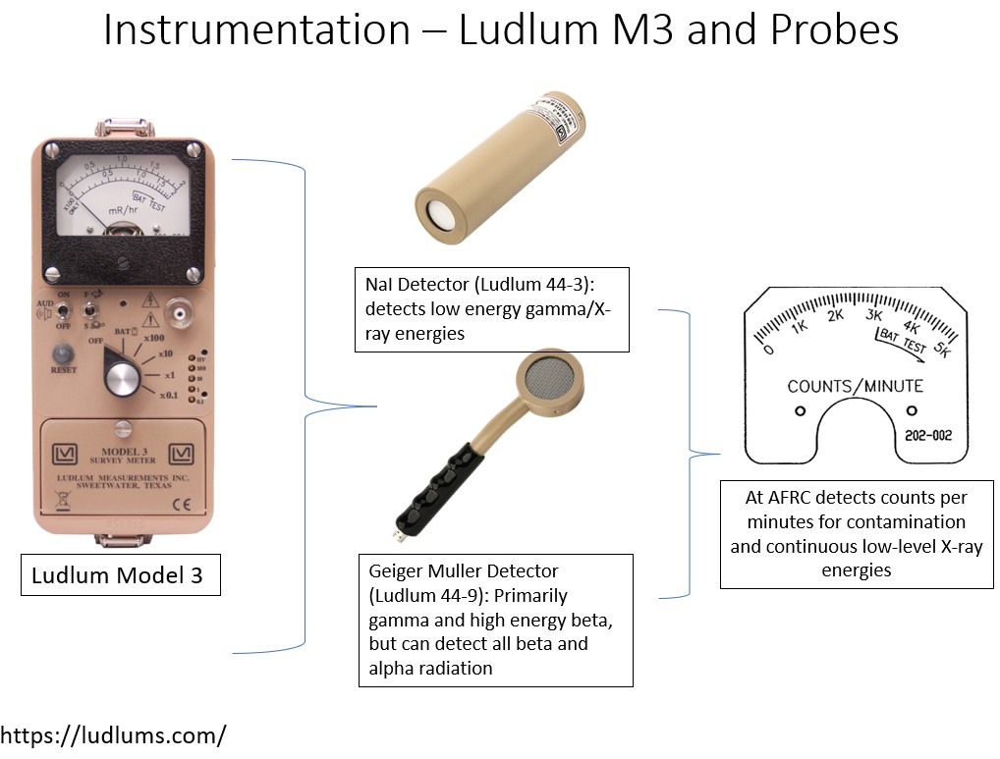{#fig-radiation-survey-probes fig-alt="Training illustration showing examples of radiation survey detector probes." width="85%"}

*Source: NASA Armstrong Flight Research Center, Ionizing Radiation Safety Training.*

### How Does a Geiger-Müller Counter Work?

A **Geiger-Müller (GM) detector** is a gas-filled tube with an applied voltage. Radiation that enters the sensitive volume creates ion pairs. Electrons accelerate toward the central wire, triggering a gas avalanche and an electrical pulse that the instrument counts.

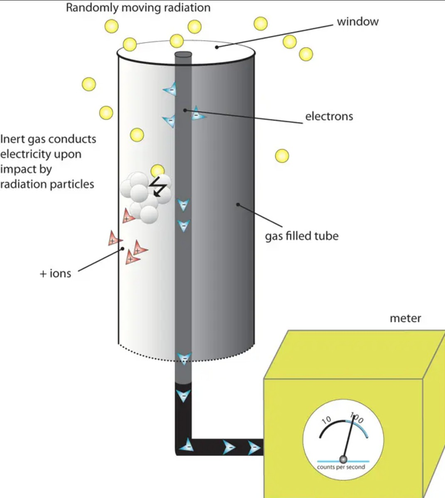{#fig-gas-filled-detector fig-alt="Educational illustration of a gas-filled Geiger-Müller radiation detector." width="85%"}

*Source: Linda Hall Library, [The Atomic Age: What Is a Geiger Counter and What Makes It Tick?](https://www.lindahall.org/experience/digital-exhibitions/the-atomic-age/02-it-s-a-question-of-physics/e-what-is-a-geiger-counter-and-what-makes-it-tick/).*

A GM instrument may report **counts per minute (CPM)** or **counts per second (CPS)**. **Counts are not automatically equivalent to absorbed dose or dose rate**. Detector efficiency, geometry, energy response, and calibration must be considered. Some GM detectors are useful for beta and gamma surveys; detecting alpha particles requires a suitable thin-window detector and appropriate conditions.

**HazMat application:** Identify the measurement objective before selecting an instrument. Contamination surveys, source location, and external dose-rate measurements may require different detectors and procedures.

# Part III. The Electromagnetic Spectrum and Non-Ionizing Radiation

We have examined gamma rays as high-energy **electromagnetic radiation**. However, electromagnetic radiation also includes many familiar forms of energy, such as visible light, infrared radiation, microwaves, and radio waves.

## 4.9 Understanding the Electromagnetic Spectrum

**Non-ionizing radiation** is radiation that does not have sufficient energy per photon to directly ionize atoms or molecules through ordinary single-photon interactions. It includes radiofrequency waves, microwaves, infrared radiation, visible light, and much of the ultraviolet spectrum. **Non-ionizing does not mean harmless:** intense exposures can cause heating, eye injury, or photochemical damage, depending on wavelength and conditions.

We will use the electromagnetic spectrum to compare frequency, wavelength, photon energy, and occupational exposure scenarios before discussing common sources and protective controls.

**Electromagnetic radiation** consists of oscillating electric and magnetic fields that transport energy through space. Its energy can also be described in terms of **photons**.

Three related properties help describe electromagnetic radiation:

- **Wavelength (**$\lambda$): The distance between repeating points of a wave, such as two adjacent peaks.
- **Frequency (**$f$): The number of wave cycles passing a point each second, measured in hertz ($\mathrm{Hz}$).
- **Photon energy (**$E$): The energy carried by one photon.

For electromagnetic waves traveling in a vacuum:

$$
c=\lambda f
$$

Where $c$ is the speed of light in a vacuum. A **shorter wavelength** corresponds to a **higher frequency**. Photon energy increases with frequency:

$$
E=hf
$$

Where $h$ is Planck's constant.

**Key relationship:** As wavelength decreases, frequency and photon energy increase.

### From Radio Waves to Gamma Rays

In order of **increasing frequency and photon energy**, the major regions of the electromagnetic spectrum are:

**Radio waves → Microwaves → Infrared → Visible light → Ultraviolet → X-rays → Gamma rays**

These regions form a **continuous spectrum**. Their boundaries are conventional, and X-rays and gamma rays can overlap in energy; they are commonly distinguished by their origin.

### Ionizing Versus Non-Ionizing Electromagnetic Radiation

- **Non-ionizing radiation** generally does not have enough energy *per photon* to remove a tightly bound electron from an atom or molecule. Examples include radio waves, microwaves, infrared, and visible light.
- **Ionizing electromagnetic radiation** includes X-rays and gamma rays, which can transfer enough energy to ionize matter.
- **Ultraviolet (UV) radiation** requires special care in this classification. Much of the UV encountered in sunlight is classified as non-ionizing, yet UV can still cause chemical changes and biological injury, including sunburn, eye damage, and increased skin-cancer risk. The highest-energy, shortest-wavelength UV approaches or crosses ionization thresholds depending on the material.

**Important:** *Non-ionizing* does **not** mean *incapable of causing harm*. Different parts of the spectrum interact with tissue through different mechanisms.

## 4.10 Familiar Sources of Non-Ionizing Radiation

### Infrared Radiation

**Infrared (IR)** lies beyond the red end of visible light, at longer wavelengths. Warm objects emit infrared radiation. At sufficiently high intensities, IR can contribute to **heating** and thermal injury, particularly to the skin and eyes.

**Occupational examples:** Furnaces, molten materials, heat lamps, and high-temperature industrial processes.

### Visible Light

**Visible light** is the portion of the electromagnetic spectrum detected by the human eye. Very intense light, including some laser beams and welding arcs, can damage the eyes.

**Occupational examples:** High-intensity lamps, lasers, and welding operations.

### Ultraviolet Radiation

**Ultraviolet (UV)** has shorter wavelengths and higher photon energies than visible light. UV exposure can cause **sunburn**, **photokeratitis** (painful inflammation of the cornea), and longer-term damage to the skin and eyes.

**Occupational examples:** Outdoor work in sunlight, welding arcs, and certain UV disinfection equipment.

### Microwaves and Radio Waves

**Radiofrequency (RF) radiation** includes radio waves and the microwave region. These waves are used to transmit information wirelessly. At sufficiently high exposure levels, RF energy can produce **heating** in biological tissue.

**Everyday and occupational examples:** Broadcast antennas, radar, telecommunications equipment, wireless networking, and certain industrial heating equipment.

### Where Do Mobile Phones, Wi-Fi, Bluetooth, and AirDrop Fit?

| Technology | What it uses | Region of the spectrum |
|:-----------------------|:-----------------------|:-----------------------|
| Cellular phone signals | Radiofrequency signals in licensed cellular bands | Radio waves / microwave-frequency RF |
| Wi-Fi | Commonly 2.4, 5, and 6 GHz frequency bands, depending on equipment and region | Microwave-frequency RF |
| Bluetooth | 2.4 GHz industrial, scientific, and medical (ISM) band | Microwave-frequency RF |
| Apple AirDrop | Bluetooth for discovery and Wi-Fi-based wireless communication for transfer (implementation varies) | Microwave-frequency RF |

: Common Wireless Technologies and Electromagnetic Radiation

**GHz** means **gigahertz**, or one billion cycles per second ($10^9\ \mathrm{Hz}$). These frequencies are **non-ionizing**; their photons do not have enough energy to ionize atoms by the same mechanism as X-rays or gamma rays.

**Important distinction:** A wireless signal carrying data is not the same as radioactive decay. A phone or router transmitting RF signals is not thereby a radioactive source.

## 4.11 Radiation Safety, Standards, and Regulation

Different kinds of radiation fall under different regulatory and professional frameworks. No single agency regulates every radiation source or every possible exposure.

### Ionizing Radiation

In the United States, relevant organizations may include:

- **Nuclear Regulatory Commission (NRC):** Regulates certain uses of radioactive materials and nuclear facilities, alongside authorized state programs.
- **Occupational Safety and Health Administration (OSHA):** Enforces applicable workplace safety and health requirements, including ionizing-radiation provisions in covered workplaces.
- **Environmental Protection Agency (EPA):** Establishes certain environmental radiation standards and provides radiological emergency guidance.
- **Food and Drug Administration (FDA):** Regulates medical radiation-emitting electronic products and radiopharmaceuticals within its statutory responsibilities.

### Non-Ionizing Radiation and Wireless Technologies

- **Federal Communications Commission (FCC):** Regulates radio transmitters and applies RF exposure requirements to covered communications devices and facilities, including mobile phones and wireless infrastructure.
- **OSHA:** Addresses workplace hazards where applicable, including relevant non-ionizing radiation and laser safety provisions.
- **FDA:** Has responsibilities involving radiation-emitting electronic products, including certain medical and laser devices.
- **International Commission on Non-Ionizing Radiation Protection (ICNIRP):** An independent scientific organization that publishes exposure guidelines; **it is not a U.S. regulatory agency**.
- **Institute of Electrical and Electronics Engineers (IEEE):** Develops technical standards, including standards related to RF exposure; **it is not a government regulator**.

**Regulatory distinction:** A scientific exposure guideline, an industry standard, and an enforceable regulation are not necessarily the same thing. Applicable requirements depend on the radiation source, workplace, device, and jurisdiction.

### Closing Perspective: Thinking Like a Chemist and a HazMat Responder

We began by examining how scientists used experimental evidence to identify electrons, protons, neutrons, and the atomic nucleus. We then used that model to explain **nuclear stability**, **radioactive decay**, **ionization**, and **biological effects**.

We also learned that electromagnetic radiation includes both ionizing and non-ionizing forms, and that familiar technologies such as mobile phones, Wi-Fi, Bluetooth, and wireless data transfer operate in the **radiofrequency** region of the spectrum.

For occupational and environmental health professionals, the central questions are:

**What is the source? What type of radiation does it emit? How does that radiation interact with matter and biological tissue? What exposure pathways are possible? And which protective measures and regulatory requirements apply?**

Our goal is to use scientific evidence to evaluate those questions and make defensible decisions that protect workers, the public, and the environment.

# Source-Page Appendix

## Referenced Textbooks and Educational Sources

1.  Burdge, Julia, and Jason Overby. *Chemistry: Atoms First*, 2nd edition. Chapter 2, **Atoms and the Periodic Table**, and Chapter 20, **Nuclear Chemistry**. Used for atomic structure, nuclear stability, radioactive decay, technetium-99m, and biological effects of radiation.
2.  Atkins, Peter, Loretta Jones, Leroy Laverman, James Patterson, and Michael Young. *Chemical Principles*, 8th edition. **Focus 9: Nuclear Chemistry**. Used for nuclear radiation classifications and comparative properties.
3.  Bevelacqua, Armando S., and Laurie A. Norman. *Hazardous Materials Chemistry*, 3rd edition. Jones & Bartlett Learning, radiation chapter. Used for alpha, beta, gamma, penetration, shielding, and hazardous materials response context.
4.  Cember, Herman, and Thomas E. Johnson. *Introduction to Health Physics*, 4th edition. Used as a conceptual reference for ionization, biological effects, radiation dosimetry, and protection. Confirm chapter/page details against the instructor's edition before final publication.
5.  **Study.com educational materials.** Previously consulted during lecture development; exact lesson titles, authors, and URLs remain to be documented if retained as cited sources.

## Regulatory and Standards References for Final Verification

The lecture identifies the **NRC, OSHA, EPA, FDA, FCC, ICNIRP, and IEEE** by their general responsibilities. Before publishing the regulatory section, add links to the specific official regulations, guidance, and standards selected for the course. **No numerical exposure limits are asserted here**, because limits and their applicability depend on the source, frequency, exposure conditions, and jurisdiction.

## Figures and Third-Party Materials

Textbook figures, the periodic table, historical photographs, and the radiation penetration illustration remain credited at their respective locations in the lecture. Verify original image attribution, reuse permissions, and any source-page references before distributing a public version.

# Copyright & Use

**SHM 377: Hazardous Materials Management**\
© 2026 Yoni Rodriguez

Except where otherwise noted, original course materials are licensed under the Creative Commons Attribution-NonCommercial 4.0 International License (CC BY-NC 4.0).

Third-party textbook excerpts, figures, photographs, and other referenced materials are **not** covered by this license and remain subject to their respective copyright and licensing terms.
